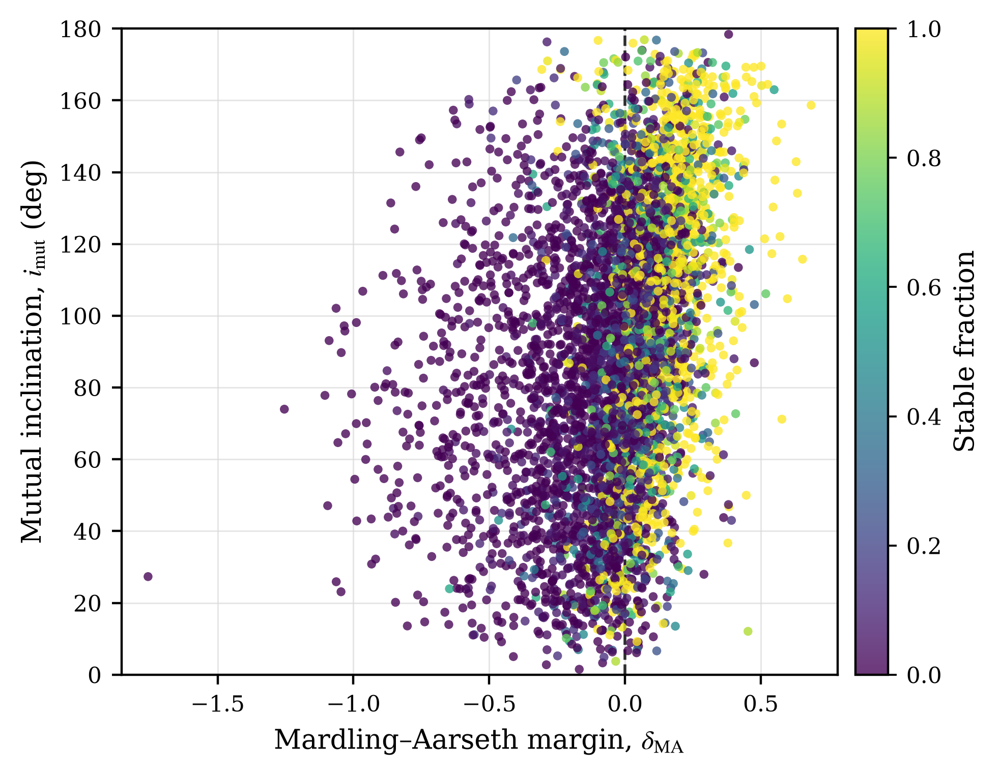
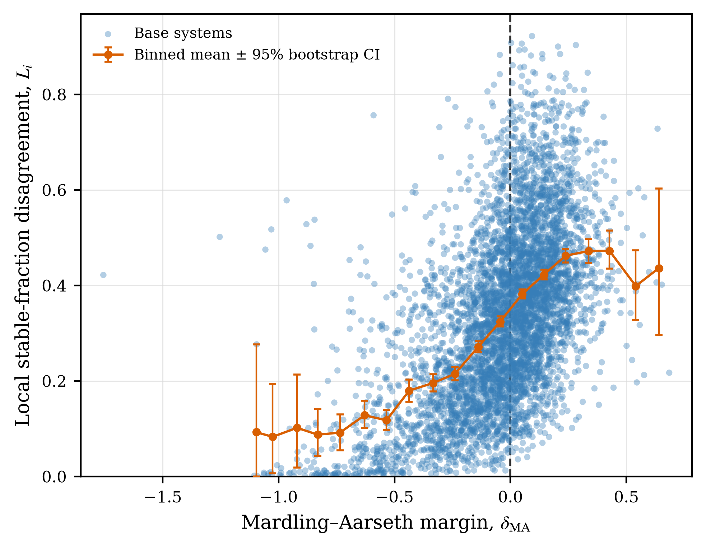
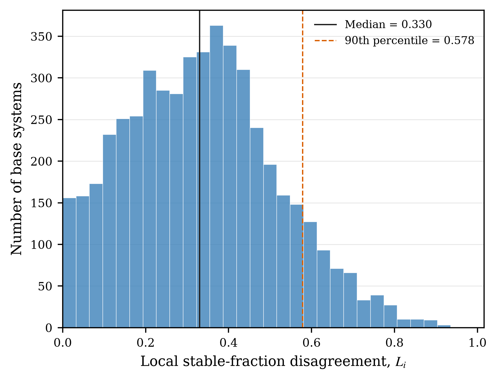
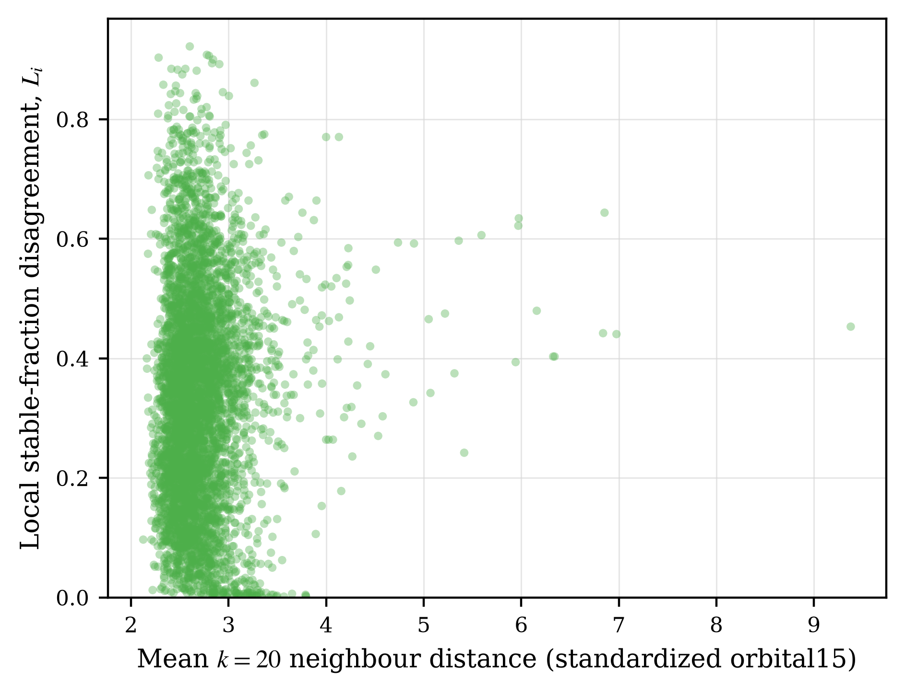

# Stellar Dynamics Research Repo

This repository uses a hierarchical three-body stability dataset for six tasks:

- `Task A`: Predict system-level stability from initial conditions alone
- `Task B`: Use an early orbital prefix to predict whether a trajectory is stable at the horizon, then aggregate predictions to evaluate the system stable fraction
- `Task C`: Predict survival at multiple horizons for complete 32-variation systems
- `Task D`: Predict the system-level median decorrelation time of paired orbits from initial conditions
- `Task E`: Forecast orbital/state sequences directly, including Transformer and foundation-model baselines
- `Task F`: Predict stability from randomly masked high-resolution orbital prefixes

Each task section collects its definition, experimental results, and reproduction entry points; historical notebooks and incomplete runs are listed separately after the task sections.
The authoritative results are the corresponding `metrics.json`, `summary.csv`, `test_metrics.json`, and summary Markdown files;
experiments with different labels, splits, horizons, or input budgets are not ranked together.

The current mainline code is in [scripts](scripts) and [tasks](tasks). See [tasks/README.md](tasks/README.md) for the code map and entry points for all six tasks. The pretrained Panda paper weights are loaded through an external submodule; the main project maintains only the three-body data adaptation, adapter, and evaluation entry points. See [experiments/foundation_models/README.md](experiments/foundation_models/README.md).

## Repository Layout

- [dataset_v3](dataset_v3): Existing data entry point for `dataset_v3_low_resolution` (sampling 2), used by the saved Task A results
- [dataset_sampling_3_prefix1024](dataset_sampling_3_prefix1024): Existing data entry point for `dataset_v3_high_resolution` (sampling 3), used by the current main Task B–F experiments
- [scripts](scripts): Task-level entry scripts
- [tasks](tasks): Task entry points, data processing, models, and training utilities
- [results](results) / [Panda outputs](experiments/foundation_models/outputs): Task artifacts; the old `runs/` directory has been merged into `results/`
- [experiments/foundation_models](experiments/foundation_models): Panda submodule and isolated historical experiments; use the main project scripts for new Task E Panda comparisons

## `dataset_v3_low_resolution` (sampling 2; code path `dataset_v3/`)

Dataset names map to code paths as follows: sampling 2 = `dataset_v3_low_resolution` → `dataset_v3/`; sampling 3 = `dataset_v3_high_resolution` → `dataset_sampling_3_prefix1024/`. The following tables describe the sampling 2 files.

### Core Files

| File | Role |
| --- | --- |
| `dataset_v3/ICs_sampling_2.hdf5` | Static initial conditions for 160,000 trajectories |
| `dataset_v3/completed_systems_sampling_2.txt` | Completion status, `time_unbound`, and diagnostic flags for each trajectory |
| `dataset_v3/results_batch_00_sampling_2.hdf5` ... `results_batch_19_sampling_2.hdf5` | 20 time-series result shards |

### Scale

- `160000` trajectories
- `5000` base systems
- Each system has `32` perturbed variations
- Each trajectory has `2001` time steps
- Each result shard has `8000` trajectories
- The completion table has `159953` valid trajectories
- `4998` systems retain all `32` valid variations

### Unstable Variation Distribution

A variation is unstable when `time_unbound < 10000`; only valid records with
`time_unbound >= 0` and `diagnosis == 0` are counted. Of the original 5000 systems,
4998 have all 32 valid variations; systems `182` and `365` are excluded because of invalid
diagnostic records.

Among these 4998 valid systems, `109536 / 159936 = 68.49%` of variations are
unstable. The distribution of the number of unstable variations per system is:

| Unstable count | Systems | Share | Unstable count | Systems | Share |
| ---: | ---: | ---: | ---: | ---: | ---: |
| 0 | 790 | 15.81% | 17 | 33 | 0.66% |
| 1 | 101 | 2.02% | 18 | 48 | 0.96% |
| 2 | 64 | 1.28% | 19 | 34 | 0.68% |
| 3 | 48 | 0.96% | 20 | 36 | 0.72% |
| 4 | 34 | 0.68% | 21 | 51 | 1.02% |
| 5 | 38 | 0.76% | 22 | 45 | 0.90% |
| 6 | 38 | 0.76% | 23 | 58 | 1.16% |
| 7 | 40 | 0.80% | 24 | 66 | 1.32% |
| 8 | 40 | 0.80% | 25 | 86 | 1.72% |
| 9 | 33 | 0.66% | 26 | 86 | 1.72% |
| 10 | 32 | 0.64% | 27 | 103 | 2.06% |
| 11 | 36 | 0.72% | 28 | 138 | 2.76% |
| 12 | 36 | 0.72% | 29 | 178 | 3.56% |
| 13 | 40 | 0.80% | 30 | 294 | 5.88% |
| 14 | 37 | 0.74% | 31 | 557 | 11.14% |
| 15 | 44 | 0.88% | 32 | 1,692 | 33.85% |
| 16 | 42 | 0.84% |  |  |  |

### Empirical Stability Boundary in Initial-Condition Space

[](figures/ma_margin_vs_mutual_inclination.pdf)

Each point represents a complete 32-variation base system. The horizontal axis is the natural-log
Mardling–Aarseth margin δ_MA; the vertical axis is mutual inclination. Color shows the
`stable_fraction` of the 32 variations at `time_horizon=10000`. The vertical dashed line marks
the conventional MA theoretical boundary at δ_MA = 0.

The figure was generated by [`analysis/plot_ma_boundary.py`](analysis/plot_ma_boundary.py). The available
`sampling_3` data do not store base initial conditions separately, so coordinates use the
`t=0` initial conditions of variation 0 in each system; angular variables are not averaged. The full output is
[`ma_margin_vs_mutual_inclination.pdf`](figures/ma_margin_vs_mutual_inclination.pdf).

### Local Stable-Fraction Disagreement in Orbital15 Space

[](figures/local_disagreement_vs_ma_margin.pdf)

[](figures/local_disagreement_histogram.pdf)

[](figures/local_disagreement_vs_neighbor_distance.pdf)

In the original standardized `orbital15` feature space, this analysis computes
local stable-fraction disagreement \(L_i\) using the 20 nearest neighbors of each base system. The orange curve and error bars show, respectively, the
mean and bootstrap 95% interval in `delta_MA` bins; each point is still an actual base system.
The full analysis also generated a [stable-fraction disagreement histogram](figures/local_disagreement_histogram.png)
and a [neighbor-distance diagnostic](figures/local_disagreement_vs_neighbor_distance.png).
The analysis script is [`analysis/analyze_local_stable_fraction_disagreement.py`](analysis/analyze_local_stable_fraction_disagreement.py),
and per-system results are saved in [`results/shared_analysis/dataset_unknown/analysis/local_stable_fraction_disagreement.csv`](results/shared_analysis/dataset_unknown/analysis/local_stable_fraction_disagreement.csv).

The full `sampling_3` results contain 4,998 base systems. For \(k=20\), the mean
\(L_i=0.3540\) near the boundary (\(|\delta_{\rm MA}|<0.1\)) versus
\(L_i=0.3207\) farther away; `Spearman(L_i, |delta_MA|) = -0.180`. The correlation of local disagreement with mean neighbor distance is only
`0.058`, suggesting that sparse regions are not the main cause. In addition, `26.45%` of systems differ from their
nearest neighbor in stable fraction by more than `0.5`. These results moderately support the hypothesis that the fuzzy stability boundary is not solely an artifact of a two-dimensional projection,
but do not by themselves establish a fractal boundary or deterministic chaos.

The density-effect diagnostic gives `Spearman(L_i, mean_neighbor_distance_k20) = 0.0583`.
The nearest-neighbor stable-fraction difference exceeds `0.25` for `1,931/4,998 = 38.64%` of systems and `0.5` for
`1,322/4,998 = 26.45%`. The median nearest-neighbor distance is `2.0386` (standardized orbital15
Euclidean distance), so sparse regions alone do not explain the local outcome disagreement.

### Indexing Convention

- `case_id = run_id // 32`
- `variation_id = run_id % 32`
- `batch_id = run_id // 8000`
- `row_in_batch = run_id % 8000`

The `32` variations can be viewed as two groups of `16`. By default, `Task D` pairs `(i, i+16)` to compare responses to different inner-orbit semimajor-axis perturbations on the same phase grid.

### Static Initial Conditions

Common fields in `ICs_sampling_2.hdf5`:

| Key | Shape | Meaning |
| --- | --- | --- |
| `aratios` | `(160000, 1)` | Semimajor-axis ratio |
| `mratios` | `(160000, 2)` | Mass ratios |
| `eccs` | `(160000, 2)` | Eccentricities |
| `incs` | `(160000, 2)` | Inclinations |
| `APs` | `(160000, 2)` | Arguments of periapsis |
| `LANs` | `(160000, 2)` | Longitudes of ascending node |
| `positions` | `(160000, 3, 3)` | Initial positions of the three bodies |
| `velocities` | `(160000, 3, 3)` | Initial velocities of the three bodies |

Other fields include `masses`, `smaxes`, `periods`, `tAnos`, `rel_positions`, and `rel_velocities`, but the orbital/state features above are used most often by the main tasks.

### Time-Series Result Shards

Common fields in each `results_batch_XX_sampling_2.hdf5`:

| Key | Shape per shard | Meaning |
| --- | --- | --- |
| `times_complete` | `(8000, 2001)` | Time grid |
| `aratios_complete` | `(8000, 2001, 1)` | Semimajor-axis ratio over time |
| `mratios_complete` | `(8000, 2001, 2)` | Mass ratios over time |
| `eccs_complete` | `(8000, 2001, 2)` | Eccentricity sequence |
| `incs_complete` | `(8000, 2001, 2)` | Inclination sequence |
| `APs_complete` | `(8000, 2001, 2)` | Angular-variable sequence |
| `LANs_complete` | `(8000, 2001, 2)` | Angular-variable sequence |
| `smaxes_complete` | `(8000, 2001, 2)` | Semimajor-axis sequence |
| `positions_complete` | `(8000, 2001, 3, 3)` | Position sequence |
| `velocities_complete` | `(8000, 2001, 3, 3)` | Velocity sequence |
| `energy_complete` | `(8000, 2001, 1)` | Energy |
| `angMomentum_complete` | `(8000, 2001, 3)` | Angular momentum |

### Data Quality Notes

- Usually filter samples with `time_unbound < 0` or `diagnosis != 0` using `completed_systems_sampling_2.txt` first.
- Some `*_complete` channels contain NaN/inf even in otherwise valid samples.
- Mainline scripts therefore screen for finite values or fall back to a more robust subset of features.

### Data Diagnostics and Traditional Baselines

The main dataset has 160,000 trajectories and 5,000 base systems; after filtering, it has 159,953 valid
trajectories and 4,998 complete 32-variation systems.

| Experiment | Key settings | Results |
| --- | --- | --- |
| Divergence statistics | censor=10000; earliest divergence per pair | raw rows/groups = 160000/5000; invalid rows = 47; 2 incomplete/invalid groups excluded; divergent trajectories 109553/159953 = **0.6849**; divergent systems 4208/4998 = **0.8419**; trajectory divergence-time P50/P90/P99 = 255/4050/9062.4; system P50/P90/P99 = 70/2048/8255.45 |
| Traditional stability criterion | Paper Eq. (2); group prediction uses the minimum pair margin | individual accuracy 0.6806, balanced accuracy 0.7099, sensitivity 0.7891, specificity 0.6307; group accuracy 0.6232, balanced accuracy 0.7336, sensitivity 0.8949, specificity 0.5722 |
| Orbital-parameter examples | 6 representative systems, rows 0/800/1600/2400/3200/4000 | Generated 6 orbital-parameter diagnostic plots; most channels have finite fraction 1, while `periods_complete` is missing for some representative samples |

Source files: [divergence_summary.json](results/task_d/sampling_2/divergence_statistics/divergence_summary.json),
[traditional_stability_summary.json](results/shared_analysis/sampling_2/traditional_stability/traditional_stability_summary.json),
[orbital examples summary](results/shared_analysis/sampling_2/dataset_v3_orbital_examples/summary.json).

## Common Input Representations

Although the tasks have different targets, their inputs mostly use the following four representations.

### 1. IC token representation

Used by `Task A`.

- Raw fields: `aratios`, `mratios`, `eccs`, `incs`, `APs`, `LANs`
- `Task A` currently takes only the first initial condition from each group of `32` variations by default
- `Task A` applies `sin/cos` to `APs` / `LANs` and keeps the original `incs` by default
- Thus the default `Task A` input matches the static initial-condition version of `orbital15`, with `15` dimensions

### 2. Prefix orbital15 representation

The current main Task B/C/E experiments use `orbital15` orbital sequences. Task B/C extract the first `prefix_len` time steps from result shards; each time step has `15` channels from these fields:

- `aratios_complete`: 1 channel
- `mratios_complete`: 2 channels
- `eccs_complete`: 2 channels
- `incs_complete`: 2 channels, retaining the original values
- `APs_complete`: `sin/cos` for each of 2 angles, giving 4 channels
- `LANs_complete`: `sin/cos` for each of 2 angles, giving 4 channels

Only `APs_complete` and `LANs_complete` are expanded into `sin/cos`; `incs_complete` is not, so the representation has 15 rather than 17 dimensions. Task A uses the same fields at the static initial time, while Task F adds an observation-mask channel to the `orbital15` prefix.

`orbital15` excludes `masses_complete`, `smaxes_complete`, `energy_complete`, and `angMomentum_complete`, and does not append pairwise geometry or a normalized time channel. The older wider feature set can be selected with Task B's `--representation full` or Task C's `--prefix-representation full`; the geometry/time switches affect only `full`.

Task C's Panda/Chronos-2 branches generate frozen embeddings from `orbital15` prefixes and train a survival head on those embeddings, so the head input is not 15-dimensional.

### 3. `raw_state18` representation

This is an optional representation for direct state forecasting in Task E; current main results use `orbital15` by default.

- `positions_complete`: `3 bodies x 3 coords = 9`
- `velocities_complete`: `3 bodies x 3 coords = 9`
- `18` channels in total

## Tasks

### Shared system-level split for Tasks A/B/C (maintained separately by dataset)

Task A/B/C experiments on the same dataset should reuse one system-level split, rather than
calling separate random splitting functions. Saved Task A results currently use sampling 2, whereas
the current main Task B/C experiments use sampling 3. The two datasets each have their own manifest,
which must not be used interchangeably. The counts and command below refer to the sampling 2 data for Task A:

- The split unit is `raw_case_id`: one base system and all its `32` variations. Task B's
  trajectory-level samples must inherit their system's split; variations from one system must not
  be placed in different sets.
- The candidate population consists of `4998` systems whose completion-table entries satisfy `time_unbound >= 0` and `diagnosis == 0`
  and have all `variation_id=0..31` present.
- Systems are coarsely stratified by stable fraction at the fixed `time_horizon=10000`, with bins
  `0`, `(0,0.25]`, `(0.25,0.5]`, `(0.5,1)`, and `1`. Stratification only keeps the stability
  distributions similar across sets; it does not change any task label.
- With `seed=42` and a `70/15/15` ratio, integer system counts yield
  `3498 / 750 / 750` (`69.988% / 15.006% / 15.006%`). Task B's
  `trajectory_binary` split has `111936 / 24000 / 24000` trajectories.
- The default sampling 2 manifest is `dataset_v3/common_case_split_sampling_2_g32_h10000_r70-15-15_seed42.csv`, with same-named `.json` metadata alongside it. Entry points for the same dataset validate and reuse it; `--split-manifest` can also be provided explicitly. The current main sampling 3 experiments use the corresponding manifest in [configs/splits](configs/splits).

It is recommended to generate the manifest explicitly first:

```bash
python -m tasks.common.create_case_split \
  --dataset-dir dataset_v3 --sampling-id 2 --group-size 32 \
  --time-horizon 10000 --train-ratio 0.70 --val-ratio 0.15 \
  --test-ratio 0.15 --seed 42
```


### Task A: Group Stability from Initial Conditions

Entry script: [scripts/task_a.py](scripts/task_a.py); implementation: [tasks/task_a/main.py](tasks/task_a/main.py)

**Task definition**

- Input: representative initial conditions for each system; the system's `32` variations are used to construct the label
- Default target: `stable_fraction`
  - The proportion of the `32` variations that remain stable through `time_horizon`
- Optional target: `binary_any`
  - The label is `1` only when all `32` variations remain stable through `time_horizon`
  - The label is `0` if any variation becomes unbound

**Input format**

- Data sources: `dataset_v3/ICs_sampling_2.hdf5` + `dataset_v3/completed_systems_sampling_2.txt`; these raw files must be provided separately because the `dataset_v3` link target is unavailable in the current checkout
- First rearrange the initial conditions into groups with `group_size=32`
- By default, modeling uses only the first initial condition among the `32` variations in each group
- The feature definition matches `orbital15`:
  - `aratios`: `1`
  - `mratios`: `2`
  - `eccs`: `2`
  - `incs`: `2`
  - `sin/cos(APs)`: `4`
  - `sin/cos(LANs)`: `4`
  - `15` dimensions in total
- This is the current MLP/XGBoost input convention. The physical criteria and official pretrained MLP instead process all `32` variations individually and aggregate to a system prediction.

**Model families**

- `binary_any`: `equation2`, `equation4`, `pretrained_mlp`, `pretrained_ghost_mlp`, `mlp`, `xgboost`
- `stable_fraction`: `equation2`, `equation4`, `pretrained_mlp`, `pretrained_ghost_mlp`, `mlp`, `xgboost`

`equation2` (the MA criterion) directly uses the semimajor-axis ratio, outer-orbit eccentricity, masses, and orbital
angular-momentum directions from the raw initial conditions to compute the stability of each variation. A system is predicted stable only if all 32
variations have positive MA-criterion margins. It has no trainable parameters, but metrics are still reported separately for train/val/test systems in the
shared manifest, so its test results can be compared directly with MLP and
XGBoost. In `stable_fraction` mode, the MA criterion predicts the proportion of the 32 variations
classified as stable by the physical criterion.

`equation4` implements the Vynatheya et al. criterion (Equations (3)–(4) of the 2022 paper). Relative to the MA criterion,
it adds inner-orbit eccentricity and a nonlinear mutual-inclination correction, and uses
`log(Y_tilde / Y_tilde_crit)` as the margin. Outside the classical LK window, negative values under the square root in the formula for maximum LK eccentricity
are clipped to `0`, meaning no LK eccentricity correction is applied. `binary_any` still requires all
variation margins to be positive; `stable_fraction` uses the fraction of the 32 variations classified as stable
by the physical criterion. Both physical criteria read raw `aratios`, `eccs`, `masses`, and `h_uvecs`
directly and do not tune parameters on training labels.

`pretrained_mlp` uses `mlp_model_trip_v1.2.2.pkl` from the official Vynatheya et al.
`triple-stability` repository, corresponding to the semimajor-axis-change labels in the 2022 paper. The model has 6 hidden layers of 50
logistic units each. The official input order is
`[q_in, q_out, a_in/a_out, e_in, e_out, i_mut/pi]`, and class `1` means unstable.
Task A's `binary_any` score is the minimum stable probability among the 32 variations. It retains
the official fixed threshold of `0.5` and also reports an operating point whose threshold is chosen only from validation F1,
as with the local models. `stable_fraction` uses the mean of the 32 stable probabilities. Because the weights are
a pickle file, the code verifies the official SHA-256 before deserialization. These external weights are not committed to Git;
download them before use:

```bash
mkdir -p external_checkpoints/triple_stability
curl -L \
  https://raw.githubusercontent.com/pavanvyn/triple-stability/main/mlp_model_trip_v1.2.2.pkl \
  -o external_checkpoints/triple_stability/mlp_model_trip_v1.2.2.pkl
sha256sum external_checkpoints/triple_stability/mlp_model_trip_v1.2.2.pkl
```

Expected SHA-256:
`f8bc2f192813145f42683669adaef6448a287523875895343453055b3acf1436`.
The model was saved with scikit-learn `1.2.2`; inference works in the current `1.8.0` environment, and the version difference is recorded in
`pretrained_mlp_metadata.json`.

`pretrained_ghost_mlp` uses `mlp_model_trip_ghost_v1.2.2.pkl` from the same official repository.
Its inputs and Task A aggregation are unchanged, but its training labels also treat bound systems that diverge substantially from a perturbed ghost orbit
as unstable. Download command and checksum:

```bash
curl -L \
  https://raw.githubusercontent.com/pavanvyn/triple-stability/main/mlp_model_trip_ghost_v1.2.2.pkl \
  -o external_checkpoints/triple_stability/mlp_model_trip_ghost_v1.2.2.pkl
sha256sum external_checkpoints/triple_stability/mlp_model_trip_ghost_v1.2.2.pkl
```

Expected SHA-256:
`a260845fc9c5b80ede3ab0028ac582bffa8450dad0c23f3ce78d73987932b866`.

`stable_fraction` is continuous regression; `binary_any` is system-level 0/1 classification.
In `binary_any` mode, MLP uses `BCEWithLogitsLoss` by default, while XGBoost uses
`binary:logistic`; both report accuracy, precision, recall, F1, AUROC, and AUPRC.
By default, binary thresholds for MLP and XGBoost maximize F1 on the validation set only and are then fixed for the
test set. The MA and Vynatheya et al. criteria retain their physical `margin > 0` rules. The official
pretrained MLP reports both the upstream `0.5` threshold and a validation-F1 threshold; only the latter operating
point uses local validation labels, and model weights remain frozen throughout.
`metrics.json` also saves balanced accuracy, specificity, FPR/FNR, MCC,
the confusion matrix (TN/FP/FN/TP), Brier score, log loss, and 10-bin ECE/MCE,
allowing checks of class imbalance, threshold behavior, and probability calibration. `stable_fraction` regression additionally reports
median absolute error, explained variance, Pearson/Spearman correlation, mean bias, error tolerance rates,
errors binned by target stable fraction, and the MSE ratio relative to binomial sampling noise from 32 perturbations.

The task asks how much system-level stability information can be predicted from initial conditions alone, without observing time evolution.

**Current rerun results on the shared split**

To run the binary version, which labels a system unstable if even one variation becomes unbound:

```bash
conda run -n stellar python -m tasks.task_a \
  --dataset-dir dataset_v3 \
  --sampling-id 2 \
  --group-size 32 \
  --time-horizon 10000 \
  --target-mode binary_any \
  --models equation2,mlp,xgboost \
  --mlp-size base \
  --xgb-size base \
  --train-ratio 0.70 \
  --val-ratio 0.15 \
  --test-ratio 0.15 \
  --split-manifest dataset_v3/common_case_split_sampling_2_g32_h10000_r70-15-15_seed42.csv \
  --seed 42 \
  --epochs 50 \
  --device cuda \
  --output-dir results/task_a/sampling_2/task_a_common/binary
```

`--time-horizon` can be changed to another decision time, such as `5000`. The maximum `time_unbound` in the current
`completed_systems_sampling_2.txt` is `10000`, so do not set a horizon beyond
`10000`.
The binary command above saves `metrics.json`, system predictions from the MA criterion, MLP/XGBoost
model files, test predictions, and MLP ROC/PR curves. Results for the Vynatheya et al. criterion come from the separate run below.

Test results on this shared split are shown below. The original models are saved in
`results/task_a/sampling_2/task_a_common/binary/metrics.json`; the Vynatheya et al. criterion is saved in the separate directory below:

| Method | Accuracy | F1 | AUROC | AUPRC |
| --- | ---: | ---: | ---: | ---: |
| MA criterion | 0.6187 | 0.4414 | 0.7529 | 0.2810 |
| Vynatheya et al. criterion | 0.6600 | 0.4540 | 0.7536 | 0.2887 |
| Official pretrained MLP (fixed 0.5) | 0.6453 | 0.4701 | **0.9124** | 0.6934 |
| Official pretrained MLP (validation threshold 0.8232) | 0.7933 | 0.5658 | **0.9124** | 0.6934 |
| Official Ghost MLP (fixed 0.5) | 0.7267 | 0.5060 | 0.9086 | **0.7184** |
| Official Ghost MLP (validation threshold 0.6872) | **0.8120** | **0.5841** | 0.9086 | **0.7184** |
| MLP-base | 0.7507 | 0.4905 | 0.8416 | 0.5139 |
| XGBoost-base | **0.8053** | 0.5350 | 0.8525 | 0.5089 |

Full separate artifacts for the Vynatheya et al. criterion and pretrained MLP are in
`results/task_a/sampling_2/task_a_common/equation4_binary/` and
`results/task_a/sampling_2/task_a_common/pretrained_mlp_binary/`, respectively. Ghost results are in
`results/task_a/sampling_2/task_a_common/pretrained_ghost_mlp_binary/`. At the fixed official threshold, the pretrained MLP
favors stable predictions and has modest accuracy, but its AUROC/AUPRC are much higher. This indicates strong cross-dataset ranking performance with
mismatched threshold calibration. Adjusting only the validation operating point raises test F1 to 0.5658,
above the local MLP/XGBoost. The paper's original labels require survival for 100 outer-orbit periods with
no more than 10% semimajor-axis change, while this repository labels solely by `time_unbound >= time_horizon`. This is therefore
a transfer evaluation of the same physical criterion on Task A labels, not a reproduction of the paper's 93% accuracy.

To run stable-fraction regression:

```bash
conda run -n stellar python -m tasks.task_a \
  --dataset-dir dataset_v3 \
  --sampling-id 2 \
  --group-size 32 \
  --time-horizon 10000 \
  --target-mode stable_fraction \
  --models mlp,xgboost \
  --mlp-size base \
  --xgb-size base \
  --train-ratio 0.70 \
  --val-ratio 0.15 \
  --test-ratio 0.15 \
  --split-manifest dataset_v3/common_case_split_sampling_2_g32_h10000_r70-15-15_seed42.csv \
  --seed 42 \
  --epochs 50 \
  --device cuda \
  --output-dir results/task_a/sampling_2/task_a_common/stable_fraction
```

Test results for stable fraction on the shared split are shown below. The original models are saved in
`results/task_a/sampling_2/task_a_common/stable_fraction/metrics.json`; the Vynatheya et al. criterion is saved in the separate directory below:

| Method | MSE | RMSE | MAE | R² |
| --- | ---: | ---: | ---: | ---: |
| MA criterion | 0.2488 | 0.4988 | 0.3073 | -0.5653 |
| Vynatheya et al. criterion | 0.2268 | 0.4763 | 0.2853 | -0.4269 |
| Official pretrained MLP | 0.1294 | 0.3597 | 0.2397 | 0.1859 |
| Official Ghost MLP | 0.1056 | 0.3249 | **0.2176** | 0.3359 |
| MLP-base | 0.0901 | 0.3001 | 0.2247 | 0.4335 |
| XGBoost-base | **0.0884** | **0.2972** | 0.2330 | **0.4442** |

Separate stable-fraction artifacts for the MA and Vynatheya et al. criteria are in
`results/task_a/sampling_2/task_a_common/equation2_stable_fraction/` and
`results/task_a/sampling_2/task_a_common/equation4_stable_fraction/`; pretrained MLP results are in
`results/task_a/sampling_2/task_a_common/pretrained_mlp_stable_fraction/`.
Ghost results are in `results/task_a/sampling_2/task_a_common/pretrained_ghost_mlp_stable_fraction/`.

### Task B: Prefix-Based Stability Prediction

Task B uses [scripts/task_b.py](scripts/task_b.py) as its unified entry point: `--resolution high` selects the main sampling 3 (`dataset_v3_high_resolution`) experiment, while `--resolution low` selects the historical sampling 2 (`dataset_v3_low_resolution`) `trajectory_binary` / `group_fraction` implementation.

**Task definition**

Current main sampling 3 Task B results use `trajectory_binary`; the older entry point also offers `group_fraction`:

- `trajectory_binary`
  - Input: an early prefix of one trajectory
  - Target: whether it remains stable through the horizon
- `group_fraction`
  - Input: the `32` trajectory prefixes of one system
  - Target: the stable fraction of the whole system

**Input format**

- Current main results: sampling 3 `orbital15` prefixes ([channel definition above](#2-prefix-orbital15-representation)) of lengths `64/128/256/512`, with a label horizon of `10000`.
- The historical sampling 2 entry point defaults to `prefix_len=100`; see the [Task B code guide](tasks/README.md#task-b) for `group_fraction` and other input formats.
- Each dataset is split by complete `raw_case_id` systems, so the `32` variations of one system cannot cross train/val/test; tasks on the same dataset reuse its manifest.

**Model families**

The main sampling 3 results compare MLP, CNN, TCN, Panda-72M + linear, Chronos-2 + linear, and Summary (Stats) + XGBoost. The older sampling 2 entry point also supports:

- `svm`: A linear baseline on the flattened prefix
- `cnn`: 1D temporal CNN
- `tcn`: dilated temporal convolution
- `gru`: A two-layer unidirectional GRU temporal encoder
- `attention`: Transformer encoder over time
- `group_attention`: Attention over variations followed by attention over time

#### Historical two-level trajectory/system evaluation on the shared sampling 2 split

All models use the same `111936/24000/24000` trajectory split, `time_horizon=10000`,
and 750 test systems. The first half of the table reports stable-positive trajectory binary metrics. In the second half,
`prob_stable` is averaged over the 32 trajectories of each system and compared with the true stable fraction,
so MAE, MSE, and R² are evaluated per system. Dynamical summaries extract
`initial/final/mean/std/slope/min/max/delta` from each of the 15 `orbital15` channels to give 120-dimensional
prefix features for XGBoost.

| Prefix | Representation | Model | Trajectory Accuracy | Trajectory F1 | Trajectory AUROC | Trajectory AUPRC | System MAE ↓ | System MSE ↓ | System R² ↑ |
| ---: | --- | --- | ---: | ---: | ---: | ---: | ---: | ---: | ---: |
| 96 | Panda encoder | Linear | 0.8640 | 0.8070 | 0.9467 | 0.8911 | 0.1031 | 0.0256 | 0.8390 |
| 96 | Chronos-2 encoder | Linear | 0.8623 | 0.8067 | 0.9531 | 0.9083 | 0.1112 | 0.0281 | 0.8230 |
| 96 | Dynamical summaries | XGBoost | **0.9000** | **0.8404** | **0.9649** | **0.9319** | **0.0703** | **0.0153** | **0.9040** |
| 96 | Raw sequence | SVM | 0.7493 | 0.5800 | 0.8135 | 0.6166 | 0.2373 | 0.0927 | 0.4165 |
| 96 | Raw sequence | CNN | 0.7937 | 0.6092 | 0.8888 | 0.7526 | 0.1759 | 0.0786 | 0.5056 |
| 96 | Raw sequence | TCN | 0.8167 | 0.7402 | 0.8971 | 0.7523 | 0.1570 | 0.0581 | 0.6347 |
| 512 | Panda encoder | Linear | 0.9217 | 0.8845 | 0.9786 | 0.9550 | 0.0534 | 0.0071 | 0.9554 |
| 512 | Chronos-2 encoder | Linear | 0.9209 | 0.8848 | 0.9791 | 0.9552 | 0.0614 | 0.0087 | 0.9452 |
| 512 | Dynamical summaries | XGBoost | **0.9329** | **0.8960** | **0.9851** | **0.9673** | **0.0398** | **0.0051** | **0.9676** |
| 512 | Raw sequence | SVM | 0.7590 | 0.5918 | 0.8282 | 0.6232 | 0.2184 | 0.0818 | 0.4855 |
| 512 | Raw sequence | CNN | 0.8839 | 0.8205 | 0.9470 | 0.8543 | 0.0985 | 0.0278 | 0.8249 |
| 512 | Raw sequence | TCN | 0.8973 | 0.8411 | 0.9593 | 0.8900 | 0.0765 | 0.0177 | 0.8886 |

In these historical sampling 2 results, Dynamical summaries + XGBoost is best at both prefix lengths and evaluation levels. Results are in
`results/task_b/sampling_2/task_b_common/two_level_evaluation/`; raw predictions are in
`experiments/foundation_models/outputs/panda_unbound_dataset/task_b_common/`. These results use
Task B's early-detection definition and do not exclude samples that have already become unbound within the prefix. Thus the
trajectory binary columns should not be interpreted as strictly future-only predictions.

##### Ablation excluding systems that became unbound within the prefix

To exclude easy samples, apply a system-level filter: remove the whole system if any of its 32 variations became unbound before the
prefix cutoff. The time-step interval is 5, so prefixes 96 and
512 correspond to `t=480` and `t=2560`. The target remains the system stable fraction at
`H=10000`. Models are the Task A initial-condition XGBoost and Task B dynamical-summary
XGBoost; they are reevaluated without retraining.

| At-risk cohort | Available information | Systems | MAE ↓ | MSE ↓ | R² ↑ |
| --- | --- | ---: | ---: | ---: | ---: |
| All 32 survive to `t=480` | Initial conditions | 257 | 0.3432 | 0.1551 | -0.8771 |
| All 32 survive to `t=480` | Prefix 96 | 257 | **0.1103** | **0.0269** | **0.6746** |
| All 32 survive to `t=2560` | Initial conditions | 174 | 0.3985 | 0.1940 | -35.8425 |
| All 32 survive to `t=2560` | Prefix 96 | 174 | 0.0897 | 0.0187 | -2.5556 |
| All 32 survive to `t=2560` | Prefix 512 | 174 | **0.0520** | **0.0079** | **-0.4984** |

In the `t=480` at-risk cohort, prefix 96 reduces MAE/MSE by
67.8%/82.7% relative to initial conditions. In the `t=2560` cohort, prefix 512 reduces MAE/MSE by
42.0%/57.9% relative to prefix 96. Neither paired system-bootstrap 95% CI crosses zero. The second cohort has a mean true fraction of
0.9668 and very low variance, so MAE/MSE and paired differences matter more than
its negative R². Full results are in `results/comparisons/dataset_unknown/task_ab_future_only_ablation/`.

**Default model sizes in the sampling 2 entry point (`orbital15` representation)**

- `SVM`
  - Parameter count is automatically determined by `T * C`; currently `C = 15`
- `T = 100`
  - `cnn`: ~`92K`
  - `tcn`: ~`355K`
  - `gru`: ~`155K`
  - `attention`: ~`399K`
- `T = 200`
  - `cnn`: ~`141K`
  - `tcn`: ~`454K`
  - `gru`: ~`155K`
  - `attention`: ~`597K`
- `T = 500`
  - `cnn`: ~`200K`
  - `tcn`: ~`706K`
  - `gru`: ~`240K`
  - `attention`: ~`931K`
- The script automatically chooses these sizes based on the actual number of input time steps. Setting `--hidden-dim` explicitly gives `cnn/tcn/gru/attention` the same hidden width; `--tcn-levels`, `--gru-layers`, `--attention-layers`, and `--attention-heads` can also be overridden separately.
- The default maximum is `50` training epochs, with early stopping (`patience = 8`).

These are early-warning classification results from the older sampling 2 implementation; current main sampling 3 results appear below.

**Historical sampling 2 experimental results**

In the following `trajectory_binary` test set, the stable positive class is about `31.6%` (unstable is about `68.4%`):

| Prefix | Model | Accuracy | Precision | Recall | F1 | AUROC | AUPRC |
| ---: | --- | ---: | ---: | ---: | ---: | ---: | ---: |
| 100 | SVM | 0.7687 | 0.6659 | 0.5385 | 0.5955 | 0.8361 | 0.6387 |
| 100 | CNN | **0.8135** | 0.6912 | **0.7414** | **0.7154** | 0.8891 | 0.7509 |
| 100 | TCN | 0.8042 | 0.7267 | 0.6101 | 0.6633 | 0.8922 | **0.7642** |
| 100 | Attention | 0.8053 | **0.7270** | 0.6150 | 0.6663 | **0.8930** | 0.7467 |
| 200 | SVM | 0.7723 | 0.6611 | 0.5743 | 0.6147 | 0.8418 | 0.6476 |
| 200 | CNN | 0.8391 | 0.7275 | 0.7851 | 0.7552 | 0.9132 | 0.7943 |
| 200 | TCN | **0.8622** | **0.7575** | **0.8297** | **0.7920** | **0.9321** | **0.8293** |
| 200 | Attention | 0.8456 | 0.7277 | 0.8179 | 0.7701 | 0.9167 | 0.7709 |

With a `100`-step prefix, all temporal neural networks outperform the flattened SVM. CNN has the highest F1,
while TCN/Attention have stronger ranking metrics. At a `200`-step prefix, TCN reaches
F1 `0.7920`, AUROC `0.9321`, and AUPRC `0.8293`;
recall also rises from `0.6101` to `0.8297`. SVM improves less, suggesting that longer observations
need a suitable temporal inductive bias to become useful early-warning signals.

#### Current main experiment: high-resolution `sampling_3`, `prefix=64/128/256/512`

The `trajectory_binary` Task B experiment was rerun on the new high-resolution dataset with `orbital15` input and a label
horizon of `10000`, comparing the first `64`, `128`, `256`, and `512` time steps. After filtering invalid labels and non-finite prefixes,
there are `159936` trajectories (`4998` complete systems), split into
`111936/24000/24000` trajectories (`3498/750/750` systems) for train/val/test. All four prefixes reuse the
exact same label order and complete `raw_case_id` system split to prevent leakage across a system's 32 perturbations.
The following results treat stable as positive, use a `0.5` threshold, and have a `30.92%` positive test share. Current classification labels check only stability at `H=10000` and do not exclude trajectories already unbound by the end of the prefix; this is early-observation classification, not strictly future-only risk prediction.

MLP, CNN, and TCN use seed `42`, up to `50` epochs, early-stopping patience `8`,
batch size `2048`, and CUDA AMP. Panda-72M and Chronos-2 both use frozen foundation encoders,
respectively taking per-channel Panda patch-mean embeddings and Chronos-2 REG embeddings (each
`15 x 768 = 11520` dimensions) to train a linear probe. Probes train for `20` epochs, selecting checkpoints by validation AUROC.
Stats XGBoost extracts eight statistics from each `orbital15` channel:
`initial/final/mean/std/slope/min/max/delta`, for `120` dimensions in total.

Both Panda and Chronos-2 use patch size/stride `16`. Thus prefixes `64` and `128` make exactly
`4` and `8` context patches per variable, with no padding or truncation. Panda averages encoder outputs across the patch
dimension to retain a `15 x 768` representation; Chronos-2 retains a REG token for each variable and concatenates them into the same
`15 x 768` shape. Both normalize sequence scale inside the encoder, and both foundation encoders stay frozen.

**Prefix 64**

| Model | Accuracy | Balanced Accuracy | Precision | Recall | F1 | AUROC | AUPRC |
| --- | ---: | ---: | ---: | ---: | ---: | ---: | ---: |
| MLP | 0.7468 | 0.6545 | 0.6406 | 0.4126 | 0.5019 | 0.7961 | 0.6152 |
| CNN | 0.7614 | 0.7140 | 0.6199 | 0.5899 | 0.6046 | 0.8149 | 0.6631 |
| TCN | 0.7585 | 0.7040 | 0.6211 | 0.5611 | 0.5896 | 0.8092 | 0.6600 |
| Panda-72M + linear | 0.8177 | 0.7973 | 0.6906 | 0.7438 | 0.7162 | 0.8906 | 0.7554 |
| Chronos-2 + linear | 0.8225 | 0.8195 | 0.6779 | **0.8115** | 0.7387 | 0.9061 | 0.8034 |
| Stats XGBoost | **0.8657** | **0.8322** | **0.8063** | 0.7444 | **0.7741** | **0.9349** | **0.8663** |

**Prefix 128**

| Model | Accuracy | Balanced Accuracy | Precision | Recall | F1 | AUROC | AUPRC |
| --- | ---: | ---: | ---: | ---: | ---: | ---: | ---: |
| MLP | 0.7470 | 0.6451 | 0.6582 | 0.3781 | 0.4803 | 0.8025 | 0.6265 |
| CNN | 0.7747 | 0.7120 | 0.6647 | 0.5476 | 0.6005 | 0.8317 | 0.6745 |
| TCN | 0.7628 | 0.7350 | 0.6068 | 0.6619 | 0.6332 | 0.8375 | 0.6848 |
| Panda-72M + linear | 0.8322 | 0.8338 | 0.6877 | 0.8379 | 0.7554 | 0.9157 | 0.8207 |
| Chronos-2 + linear | 0.8450 | **0.8511** | 0.7019 | **0.8670** | 0.7758 | 0.9320 | 0.8601 |
| Stats XGBoost | **0.8724** | 0.8428 | **0.8114** | 0.7651 | **0.7876** | **0.9437** | **0.8875** |

**Prefix 256**

| Model | Accuracy | Balanced Accuracy | Precision | Recall | F1 | AUROC | AUPRC |
| --- | ---: | ---: | ---: | ---: | ---: | ---: | ---: |
| MLP | 0.7618 | 0.6615 | 0.7025 | 0.3985 | 0.5085 | 0.8238 | 0.6520 |
| CNN | 0.7908 | 0.7364 | 0.6871 | 0.5937 | 0.6370 | 0.8547 | 0.7034 |
| TCN | 0.7803 | 0.7459 | 0.6415 | 0.6560 | 0.6486 | 0.8562 | 0.7008 |
| Panda-72M + linear | 0.8633 | 0.8619 | 0.7408 | 0.8582 | 0.7952 | 0.9392 | 0.8686 |
| Chronos-2 + linear | 0.8584 | **0.8676** | 0.7184 | **0.8917** | 0.7957 | 0.9458 | 0.8908 |
| Stats XGBoost | **0.8891** | 0.8603 | **0.8454** | 0.7848 | **0.8140** | **0.9550** | **0.9023** |

**Prefix 512**

| Model | Accuracy | Balanced Accuracy | Precision | Recall | F1 | AUROC | AUPRC |
| --- | ---: | ---: | ---: | ---: | ---: | ---: | ---: |
| MLP | 0.7676 | 0.6845 | 0.6814 | 0.4668 | 0.5540 | 0.8507 | 0.6701 |
| CNN | 0.8040 | 0.7408 | 0.7335 | 0.5751 | 0.6447 | 0.8837 | 0.7494 |
| TCN | 0.7771 | 0.7865 | 0.6040 | 0.8109 | 0.6923 | 0.8684 | 0.7124 |
| Panda-72M + linear | 0.8826 | 0.8807 | 0.7741 | 0.8759 | 0.8218 | 0.9563 | 0.9079 |
| Chronos-2 + linear | 0.8695 | 0.8818 | 0.7312 | **0.9140** | 0.8125 | 0.9582 | 0.9164 |
| Stats XGBoost | **0.9036** | **0.8821** | **0.8573** | 0.8258 | **0.8412** | **0.9651** | **0.9205** |

**System-level stable-fraction evaluation**

The definition matches the older Task B two-level evaluation: within each of 750 test systems, average
`prob_stable` for its 32 trajectories to predict stable fraction; the true stable fraction is the mean
of their 32 `target_stable` labels. Thus MAE, MSE, and R² below are evaluated per system,
rather than reapplying classification metrics to trajectory-level 0/1 predictions.

| Prefix | Model | System MAE ↓ | System MSE ↓ | System R² ↑ |
| ---: | --- | ---: | ---: | ---: |
| 64 | MLP | 0.2255 | 0.1064 | 0.3146 |
| 64 | CNN | 0.2301 | 0.0944 | 0.3922 |
| 64 | TCN | 0.2133 | 0.1112 | 0.2841 |
| 64 | Panda-72M + linear | 0.1514 | 0.0543 | 0.6500 |
| 64 | Chronos-2 + linear | 0.1592 | 0.0553 | 0.6441 |
| 64 | Stats XGBoost | **0.1134** | **0.0355** | **0.7712** |
| 128 | MLP | 0.2101 | 0.1085 | 0.3010 |
| 128 | CNN | 0.2222 | 0.0866 | 0.4421 |
| 128 | TCN | 0.2085 | 0.0984 | 0.3665 |
| 128 | Panda-72M + linear | 0.1386 | 0.0459 | 0.7046 |
| 128 | Chronos-2 + linear | 0.1379 | 0.0428 | 0.7245 |
| 128 | Stats XGBoost | **0.1012** | **0.0306** | **0.8030** |
| 256 | MLP | 0.1994 | 0.0984 | 0.3663 |
| 256 | CNN | 0.1889 | 0.0826 | 0.4679 |
| 256 | TCN | 0.1881 | 0.0874 | 0.4372 |
| 256 | Panda-72M + linear | 0.1090 | 0.0295 | 0.8098 |
| 256 | Chronos-2 + linear | 0.1220 | 0.0354 | 0.7719 |
| 256 | Stats XGBoost | **0.0865** | **0.0236** | **0.8479** |
| 512 | MLP | 0.1818 | 0.0844 | 0.4562 |
| 512 | CNN | 0.1693 | 0.0702 | 0.5480 |
| 512 | TCN | 0.1950 | 0.0739 | 0.5240 |
| 512 | Panda-72M + linear | 0.0869 | 0.0197 | 0.8732 |
| 512 | Chronos-2 + linear | 0.1058 | 0.0268 | 0.8273 |
| 512 | Stats XGBoost | **0.0700** | **0.0157** | **0.8989** |

Stats XGBoost is best on all three system-level metrics at all four prefixes. For Stats XGBoost,
increasing the prefix from `64` to `512` lowers system MAE from `0.1134` to `0.0700`, MSE from
`0.0355` to `0.0157`, and raises R² from `0.7712` to `0.8989`. Panda-72M and Chronos-2
also generally improve with prefix length; from-scratch models improve less, and TCN's MAE is nonmonotonic.

Stats XGBoost has the highest Accuracy, Precision, F1, AUROC, and AUPRC at all four prefixes,
making it the strongest overall model. Chronos-2 has the highest stable Recall at all four prefixes and
the highest Balanced Accuracy at `prefix=128/256`. Panda and Chronos-2 already clearly outperform
from-scratch MLP/CNN/TCN on short prefixes, showing the utility of frozen foundation encoder representations for early orbital discrimination.
Increasing the prefix from `64` to `128` improves F1 for Panda, Chronos-2, and Stats XGBoost by
`0.0392`, `0.0371`, and `0.0135`, respectively; TCN gains `0.0436`, while MLP/CNN fluctuate slightly.


Full metrics, models, per-sample predictions, and configurations are located below. The `prefix=512` `config.json` now lists all MLP/CNN/TCN models needed for reproduction, while `model_selection_provenance` records that the last original invocation listed only `mlp`. The separate CNN/TCN invocation arguments were not saved; their checkpoints, training logs, predictions, and metrics are all in that directory:

- `prefix=64`: [MLP/CNN/TCN](results/task_b/sampling_3/task_b_sampling3_prefix64/),
  [Panda-72M](results/task_b/sampling_3/task_b_sampling3_prefix64_panda_linear/),
  [Chronos-2](results/task_b/sampling_3/task_b_sampling3_prefix64_chronos2/),
  [Stats XGBoost](results/task_b/sampling_3/task_b_sampling3_prefix64_stats_xgboost/)
- `prefix=128`: [MLP/CNN/TCN](results/task_b/sampling_3/task_b_sampling3_prefix128/),
  [Panda-72M](results/task_b/sampling_3/task_b_sampling3_prefix128_panda_linear/),
  [Chronos-2](results/task_b/sampling_3/task_b_sampling3_prefix128_chronos2/),
  [Stats XGBoost](results/task_b/sampling_3/task_b_sampling3_prefix128_stats_xgboost/)
- `prefix=256`: [MLP/CNN/TCN](results/task_b/sampling_3/task_b_sampling3_prefix256/),
  [Panda-72M](results/task_b/sampling_3/task_b_sampling3_prefix256_panda_linear/),
  [Chronos-2](results/task_b/sampling_3/task_b_sampling3_prefix256_chronos2/),
  [Stats XGBoost](results/task_b/sampling_3/task_b_sampling3_prefix256_stats_xgboost/)
- `prefix=512`: [MLP/CNN/TCN](results/task_b/sampling_3/task_b_sampling3_prefix512/),
  [Panda-72M](results/task_b/sampling_3/task_b_sampling3_prefix512_panda_linear/),
  [Chronos-2](results/task_b/sampling_3/task_b_sampling3_prefix512_chronos2/),
  [Stats XGBoost](results/task_b/sampling_3/task_b_sampling3_prefix512_stats_xgboost/)

To save disk space, temporary Panda/Chronos embedding `.npy` and baseline-input caches for `prefix=64/128`
were removed after probe training and artifact verification. Embedding metadata, best checkpoints, complete metrics, and per-sample predictions remain;
the respective runners can regenerate the feature caches.

The MLP/CNN/TCN run script is [`scripts/task_b.py`](scripts/task_b.py);
the foundation embedding and Stats XGBoost runners are in
[`experiments/foundation_models/scripts/`](experiments/foundation_models/scripts/).
System-level metrics are generated by
[`tasks/task_b/evaluate_highres_two_level.py`](tasks/task_b/evaluate_highres_two_level.py)
from the per-trajectory predictions above. Summary metrics, per-system predictions, and a separate Markdown table are in
[`results/task_b/sampling_3/task_b_sampling3_two_level_evaluation/`](results/task_b/sampling_3/task_b_sampling3_two_level_evaluation/).

#### Historical non-shared splits

Artifacts from these experiments on non-shared splits have been deleted as requested. See the main Task A and Task B sections above for current results and reproduction commands; do not combine historical metrics with shared-split metrics.


The following results come from the historical independent pipeline in `experiments/foundation_models` and should be compared separately from the current main Task B experiment.

#### Separate Panda experiment: unbound classifier

| Run | Test n | Positive rate | Acc | Precision | Recall | F1 | AUROC |
| --- | ---: | ---: | ---: | ---: | ---: | ---: | ---: |
| legacy orbital15 dataset | 8000 | 0.642625 | 0.884375 | 0.968861 | 0.847306 | 0.904016 | 0.950854 |
| Panda orbital15 dataset | 8000 | 0.642625 | **0.939250** | 0.966153 | **0.938339** | **0.952043** | **0.978368** |
| Panda patch-mean keep-channels | 32032 | 0.684253 | 0.922203 | **0.969908** | 0.914682 | 0.941486 | 0.977106 |

The corresponding Task-B split test metrics (the file saves both unbound-positive and complementary
stable-positive metrics) follow. The head is specified by each directory's <code>run_config.json</code>:

| Run / head | Unbound Acc | Unbound Prec | Unbound Recall | Unbound F1 | AUROC | Unbound AP | Stable F1 | Stable AP |
| --- | ---: | ---: | ---: | ---: | ---: | ---: | ---: | ---: |
| prefix96 / linear | 0.508281 | 0.684763 | 0.520562 | 0.591478 | 0.500254 | 0.684630 | 0.382532 | 0.316294 |
| prefix96 aligned / linear | 0.867150 | 0.941606 | 0.858993 | 0.898404 | 0.945449 | 0.974732 | 0.808123 | 0.883745 |
| prefix512 / main | 0.928897 | 0.962739 | 0.932094 | **0.947169** | 0.978716 | 0.990267 | 0.891303 | 0.954518 |
| prefix512 attention / attention | 0.921541 | **0.978409** | 0.905239 | 0.940403 | 0.979344 | 0.990641 | 0.885212 | 0.956522 |
| prefix512 DeepSets / deepsets | 0.923793 | 0.974077 | **0.912849** | 0.942470 | **0.979450** | **0.990742** | 0.887160 | 0.956113 |

### Task C: System Survival Curves

Current paper results run through [scripts/task_c.py](scripts/task_c.py), implemented in [tasks/task_c/survival.py](tasks/task_c/survival.py). It uses the `32` `orbital15` prefixes and `time_unbound` values in each complete system to construct 20-bin event-time and censoring labels, predicts a survival curve per variation, and aggregates them into a system stable-fraction curve. The Panda and Chronos-2 branches first generate frozen embeddings, then train survival heads on the same target. Evaluation uses 20-bin MAE, final-bin MAE, discrete IBS, and curves from the same model at seven specified time points.

#### Main experiment: `dataset_v3_high_resolution` (sampling 3), `prefix=128`

This is the current main Task C setup. Inputs are the first `128` sampled steps of `orbital15` from the high-resolution
`dataset_sampling_3_prefix1024` dataset
(`time_stride=1`), with event-time labels from `time_unbound`:
`1` through `10000` are raw `time_unbound` time coordinates, distinct from the prefix step count; `10000` is the right-censoring limit. The data contain
`159,952` valid trajectories; Task C selects `159,936` belonging to complete systems,
corresponding to `4,998` complete 32-variation systems. Of the selected trajectories, `49,770`
are censored at `10000` (about `31.11%`). For events exactly on an interior bin boundary, the hazard and empirical-survival labels have a [potential inconsistency requiring review](docs/scientific_issues.md#task-c-events-exactly-on-an-interior-hazard-bin-boundary); existing metrics have not been recomputed.

All models use the same complete-system split (`3498/750/750`, seed `42`),
the same `20` log-spaced hazard bins (`1 → 10000`), future horizons
`500,800,1500,2500,4000,6500,10000`, `variation_target=full32`,
batch size `64`, and at most `20` epochs. Foundation models freeze their backbones before training
a survival hazard head. Panda-72M uses `15×768` patch-mean channel embeddings;
Chronos-2 uses the corresponding `[REG]` tokens (also `15×768`). The embedding cache's
label fingerprint is
`c6bb88cbcc643a8d8eb30b95fe36916e28807ed99d8e18f745979e297ad0398e`.

| Model | Input/pooling | 20-bin MAE | Final-bin MAE | IBS |
| --- | --- | ---: | ---: | ---: |
| Mean baseline | train mean curve | 0.2805 | 0.3483 | 0.1166 |
| Stats | Eight `orbital15` statistics | 0.0858 | 0.1892 | 0.0726 |
| CNN | raw orbital15 | 0.0976 | 0.2020 | 0.0790 |
| TCN | raw orbital15 | 0.0861 | 0.2034 | 0.0728 |
| GRU | raw orbital15 | **0.0816** | 0.1959 | **0.0710** |
| Attention | raw orbital15 | 0.1242 | 0.2417 | 0.0953 |
| Panda-72M | direct (`15×768`) | 0.0570 | 0.1194 | 0.0555 |
| Panda-72M | mean+std (`1536`) | 0.0675 | 0.1428 | 0.0605 |
| Panda-72M | channel attention | 0.0622 | 0.1279 | 0.0592 |
| Chronos-2 | direct (`15×768`) | **0.0494** | **0.1125** | **0.0517** |
| Chronos-2 | mean+std (`1536`) | 0.0585 | 0.1272 | 0.0544 |
| Chronos-2 | channel attention | 0.0525 | 0.1184 | 0.0523 |

Among raw-trajectory models, GRU has the best overall MAE/IBS; Stats and TCN are close, indicating that trend statistics from high-resolution orbits already contain considerable useful information.
Frozen foundation representations are substantially stronger,
with Chronos-2 direct best on all three table metrics and Panda-72M direct next.
The pooling order is the same for both foundation models: direct outperforms attention,
which outperforms mean+std. Errors are generally larger at later times, so long-term survival
curves remain the main challenge.

Results and reproduction files:

- Raw models: [metrics.json](results/task_c/sampling_3/task_c_sampling3_prefix128_raw/metrics.json),
  [config.json](results/task_c/sampling_3/task_c_sampling3_prefix128_raw/config.json),
  [survival curve](results/task_c/sampling_3/task_c_sampling3_prefix128_raw/figure_1_20bin_survival_curve.png)
- Panda-72M: [metrics.json](results/task_c/sampling_3/task_c_sampling3_prefix128_panda/metrics.json),
  [config.json](results/task_c/sampling_3/task_c_sampling3_prefix128_panda/config.json),
  [embedding metadata](results/task_c/sampling_3/task_c_sampling3_prefix128_panda/panda_features.float16.json)
- Chronos-2: [metrics.json](results/task_c/sampling_3/task_c_sampling3_prefix128_chronos2/metrics.json),
  [config.json](results/task_c/sampling_3/task_c_sampling3_prefix128_chronos2/config.json),
  [embedding metadata](results/task_c/sampling_3/task_c_sampling3_prefix128_chronos2/chronos2_reg_features.float16.json)
- Raw input cache: [metadata.json](results/task_c/sampling_3/task_c_sampling3_prefix128_cache/metadata.json)
- Shared system split: [CSV manifest](results/task_b/sampling_3/task_b_sampling3_prefix128/common_case_split_sampling_3_g32_h10000_r70-15-15_seed42.csv)

### Task D: Median Orbital-Decorrelation Time

Current entry point: [scripts/task_d.py](scripts/task_d.py); implementation: [tasks/task_d/main.py](tasks/task_d/main.py) and [tasks/task_d/quantile.py](tasks/task_d/quantile.py). The input is the static `orbital15` initial condition of only the first nominal variation in each system. The target is one system-level orbital decorrelation time, not P25/P50/P75.

For the 16 `(r, r+16)` pairs, define `Q_r(t)=a_in(t)/a_out(t)` and `G_r(t)=|Q_r(t)-Q_{r+16}(t)|/|Q_r(0)-Q_{r+16}(0)|`. By default, find the first crossing of `G_r=e^5`, interpolate log-growth between adjacent samples, and divide each pair's crossing time by the initial outer-orbit period of its nominal member. If at least 8 pairs have valid crossings, the label is the median of their times, and the model is trained in log-time. **Do not divide crossing times by 5.** This is a finite-time decorrelation proxy based on the semimajor-axis ratio, not the maximum Lyapunov time defined by variational equations.

Current sampling 3 results use 4,996 eligible systems, split by system into train/val/test `3497/750/749` (seed `42`). They compare the training-set constant median, XGBoost, and MLP and report log-time MAE/RMSE, Spearman correlation, factor-2 accuracy, and paired-bootstrap 95% CIs. Saved test metrics follow:

| Model | MAE(log time) ↓ | RMSE(log time) ↓ | Spearman ↑ | Factor-2 accuracy ↑ |
| --- | ---: | ---: | ---: | ---: |
| Constant median | 1.2725 | 1.4690 | — | 0.2537 |
| XGBoost | 0.7870 | 0.9849 | 0.7342 | 0.5207 |
| MLP | **0.6519** | **0.8236** | **0.8348** | **0.6275** |

Full configuration, predictions, split, and metrics are in the [current Task D results](results/task_d/sampling_3/task_d_median_decorrelation/metrics.json); see [Reproducible Commands](#reproducible-commands) below. Historical quantile and sampling 2 records were moved to the [archive](archive/task_d_historical_results.md).

### Task E: Forecasting Baselines

Related entry points:

- [tasks/task_e/main.py](tasks/task_e/main.py)
The unified entry point `tasks/task_e/main.py` is recommended. It makes train/val/test group splits by 32-variation base system,
uses a completion-aware train-window scaler, and consistently outputs overall, horizon-wise, and channel-wise metrics in transformed/z
scale. Supported models include
`ridge`, `tcn`, `patchtst`, `transformer`, a simplified
`itransformer`, `timesfm`, `chronos`, `chronos2`, `panda_zero_shot`,
`tirex2`, and `toto2`.

See [`docs/reproduction.md`](docs/reproduction.md) for the current main protocol:
E1 is one-shot `512 -> 128`; E2 reuses the same model for four recursive rolling blocks, with a maximum
forecast horizon of `512`. The E.0/E.1 figures below are older `200 -> 50` preliminary results
retained only as historical records.

#### E.current Main E1/E2 protocol results (2026-08-23)

The following table includes only runs that produced complete validation, test, and E2 metric files. All five models use
`orbital15`, 15 channels, and the same `512 -> 128` E1 / four-block recursive E2 protocol. Four
foundation models use native zero-shot multivariate forecasting; iTransformer is fully supervised.
Results are aggregated by `system -> trajectory -> forecasting_window`;
E2 overall metrics use system-balanced aggregation.

The sampling protocol is consistent: `39,518` validation windows, `38,245` E1 test windows,
and `17,485` E2 rolling windows. These are not all candidate windows; candidate windows
are used only to build a reproducible window index.

**E1 one-shot test (512 -> 128)**

| Model | Checkpoint | MSE-z | MAE-z | RMSE-z | Pearson | sMAPE transformed | Unit-circle error |
| --- | --- | ---: | ---: | ---: | ---: | ---: | ---: |
| [Chronos-2](results/task_e/sampling_2/task_e_chronos2_orbital15_ctx512_pred128/summary.md) | `amazon/chronos-2` | 0.2331056 | **0.2282289** | 0.4828101 | 0.8580278 | **33.3610%** | **0.2264770** |
| [Panda zero-shot](results/task_e/sampling_2/task_e_panda_zero_shot_orbital15_ctx512_pred128/summary.md) | `GilpinLab/panda-72M` | 0.2217443 | 0.2370772 | 0.4708973 | 0.8624963 | 36.1440% | 0.2861868 |
| [iTransformer](results/task_e/sampling_2/task_e_itransformer_orbital15_ctx512_pred128/summary.md) | `iTransformer (30 epochs)` | **0.2123486** | 0.2429306 | **0.4608130** | **0.8672591** | 38.2350% | 0.3151870 |
| [TiRex-2](results/task_e/sampling_2/task_e_tirex2_orbital15_ctx512_pred128/summary.md) | `NX-AI/TiRex-2` | 0.2421608 | 0.2407973 | 0.4920984 | 0.8508211 | 34.5179% | 0.2277438 |
| [Toto-2.0](results/task_e/sampling_2/task_e_toto2_orbital15_ctx512_pred128/summary.md) | `Datadog/Toto-2.0-22m` | 0.2262473 | 0.2303106 | 0.4756546 | 0.8601255 | 33.6224% | 0.2310443 |

**E2 recursive rolling (maximum horizon 512)**

| Model | MSE-z | MAE-z | RMSE-z | Block MAE (1 -> 4) | Error amplification |
| --- | ---: | ---: | ---: | ---: | ---: |
| Chronos-2 | 0.4433864 | **0.2917852** | 0.6658727 | **0.2201 -> 0.3397** | 1.5436 |
| Panda zero-shot | 0.3058527 | 0.2993932 | 0.5530395 | 0.2267 -> 0.3416 | 1.5065 |
| iTransformer | **0.3054687** | 0.3045539 | **0.5526922** | 0.2380 -> 0.3515 | **1.4772** |
| TiRex-2 | 0.3300729 | 0.3052347 | 0.5745198 | 0.2352 -> 0.3507 | 1.4909 |
| Toto-2.0 | 0.3152865 | 0.2981152 | 0.5615038 | 0.2234 -> 0.3483 | 1.5592 |

For E1, iTransformer has the best MSE-z / RMSE-z / Pearson; Chronos-2 has the lowest MAE-z, sMAPE, and
unit-circle error. For E2, iTransformer has the best MSE-z, RMSE-z, and error amplification ratio,
while Chronos-2 has the lowest MAE-z and absolute MAE in all four rollout blocks. These are numeric comparisons under the same evaluation
protocol, not statistical-significance tests.

Existing Ridge, TCN, PatchTST, and Transformer figures belong to the historical
`E.0/E.1` preliminary benchmark (`context=200 -> pred=50`) below and are not mixed with this table.
`results/task_e/dataset_unknown/task_e_e1e2_tcn_orbital15_ctx512_pred128` currently has only a console log and no final metrics
eligible for the main-protocol leaderboard.

Corresponding complete files:

- [Chronos-2 summary](results/task_e/sampling_2/task_e_chronos2_orbital15_ctx512_pred128/summary.md)
- [Panda zero-shot summary](results/task_e/sampling_2/task_e_panda_zero_shot_orbital15_ctx512_pred128/summary.md)
- [iTransformer summary](results/task_e/sampling_2/task_e_itransformer_orbital15_ctx512_pred128/summary.md)
- [TiRex-2 summary](results/task_e/sampling_2/task_e_tirex2_orbital15_ctx512_pred128/summary.md)
- [Toto-2.0 summary](results/task_e/sampling_2/task_e_toto2_orbital15_ctx512_pred128/summary.md)

#### E.current.0 New high-resolution `sampling_3`: fixed first 512 steps (2026-09-20)

These results use high-resolution `sampling_3` data with a corrected time axis and the same prepared cache. Each
trajectory contributes only one fixed `start=0` window: the first `512` steps of the full trajectory predict the next
`128` steps. These are not sliding-window averages. All models share the same system-level split, train-only
scaler, and completion filter: train/validation/test have `62,375/12,713/13,674`
windows from `3,037/650/652` systems. E2 recursively predicts four `128`-step blocks with the same model,
to a final horizon of `512`; `12,535` rolling windows remain after filtering.

MSE/MAE/RMSE in the table are test system-balanced z-space metrics. E1 Pearson and
sMAPE are computed on the test set; E2 amplification is `block_4_MAE / block_1_MAE`.
This table should not be directly pooled with the older `E.current` table above, which used a different data version and window sample count.

**E1 one-shot test (512 -> 128)**

| Model | Training | MSE-z | MAE-z | RMSE-z | Pearson | sMAPE transformed | Unit-circle error |
| --- | --- | ---: | ---: | ---: | ---: | ---: | ---: |
| [Toto-2](results/task_e/sampling_3/task_e_sampling3_first512_toto2/summary.json) | zero-shot | **0.217659** | 0.222297 | **0.466539** | **0.873670** | 30.1662% | 0.182041 |
| [Chronos-2](results/task_e/sampling_3/task_e_sampling3_first512_chronos2/summary.json) | zero-shot | 0.226219 | **0.221723** | **0.475625** | **0.870241** | **29.6257%** | 0.171653 |
| [TiRex-2](results/task_e/sampling_3/task_e_sampling3_first512_tirex2/summary.json) | zero-shot | 0.237418 | 0.232584 | 0.487255 | 0.863216 | 31.0279% | 0.173224 |
| [Panda-72M](results/task_e/sampling_3/task_e_sampling3_first512_panda/summary.json) | zero-shot | 0.231738 | 0.239895 | 0.481392 | 0.863981 | 33.5534% | 0.244699 |
| [iTransformer](results/task_e/sampling_3/task_e_sampling3_first512_itransformer_ep25/summary.json) | supervised, 25 epochs | 0.226875 | 0.260282 | 0.476313 | 0.867887 | 37.7547% | 0.288506 |
| [TCN](results/task_e/sampling_3/task_e_sampling3_first512_tcn_ep25_continued/summary.json) | supervised, 25 epochs | 0.347537 | 0.382849 | 0.589523 | 0.787813 | 57.9286% | 0.547491 |
| [Linear extrapolation](results/task_e/sampling_3/task_e_sampling3_first512_linear/summary.json) | no training | 1.466162 | 0.573974 | 1.210852 | 0.584784 | 53.7090% | 0.000000 |

**E2 recursive rolling (maximum horizon 512)**

| Model | MSE-z | MAE-z | RMSE-z | Block MAE (1 -> 4) | Error amplification |
| --- | ---: | ---: | ---: | ---: | ---: |
| [Toto-2](results/task_e/sampling_3/task_e_sampling3_first512_toto2/e2_metrics.json) | 0.366338 | **0.325192** | 0.605259 | 0.216279 -> 0.399839 | 1.848718 |
| [iTransformer](results/task_e/sampling_3/task_e_sampling3_first512_itransformer_ep25/e2_metrics.json) | **0.362589** | 0.346581 | **0.602153** | 0.255137 -> 0.409072 | **1.603344** |
| [Panda-72M](results/task_e/sampling_3/task_e_sampling3_first512_panda/e2_metrics.json) | 0.371580 | 0.341082 | 0.609574 | 0.231064 -> 0.403988 | 1.748379 |
| [TiRex-2](results/task_e/sampling_3/task_e_sampling3_first512_tirex2/e2_metrics.json) | 0.396369 | 0.336787 | 0.629578 | 0.227547 -> 0.407478 | 1.790741 |
| [Chronos-2](results/task_e/sampling_3/task_e_sampling3_first512_chronos2/e2_metrics.json) | 0.384154 | 0.326271 | 0.619802 | 0.214891 -> 0.400641 | 1.864397 |
| [TCN](results/task_e/sampling_3/task_e_sampling3_first512_tcn_ep25_continued/e2_metrics.json) | 0.444356 | 0.474394 | 0.666600 | 0.383775 -> 0.554580 | **1.445064** |
| [Linear extrapolation](results/task_e/sampling_3/task_e_sampling3_first512_linear/e2_metrics.json) | 11.933765 | 1.210531 | 3.454528 | 0.579115 -> 1.817169 | 3.137837 |

On E1, Toto-2 has the best system-balanced MSE, RMSE, and Pearson; Chronos-2 has the lowest MAE and sMAPE, with TiRex-2 close on unit-circle error. Linear's near-zero unit-circle error comes from explicit sin/cos projection and should not be treated as a direct model advantage. On E2, iTransformer has the best overall MSE/RMSE and error amplification ratio, while Toto-2 has the lowest overall MAE; the advantages of foundation models differ between one-shot and long recursive forecasts. All supervised models are evaluated from their best validation
checkpoint at epoch 25; foundation models train no parameters and perform zero-shot inference only.

#### E.current.masked Task E1: Task F-style partial-observation extension (2026-09-20)

This experiment transfers Task F's time masks to E1's high-resolution `sampling_3` protocol. Every window still has
`context=512 -> pred=128`, with only `start=0` for each trajectory. The scaler is fitted on complete training
windows before contexts are masked in z-space. All 15 physical channels at hidden timestamps are set to zero,
and a 16th `observed_flag` channel is appended (1=observed, 0=hidden); the future 128-step target always retains
15 unmasked physical channels. Thus supervised models learn `[B,512,16] -> [B,128,15]`.
Validation and test sets use fixed per-sample random masks with nonoverlapping seeds. In mixed training, each
epoch dynamically samples clean/single-block/multi-block/random masks; the clean-only control always uses
complete contexts. This extension covers E1 only; masked contexts are not recursively propagated into E2.

**Main 50% random-mask stress test (test system-balanced)**

| Model | Training / input | MSE-z | MAE-z | RMSE-z | Pearson | sMAPE transformed | Unit-circle error |
| --- | --- | ---: | ---: | ---: | ---: | ---: | ---: |
| [iTransformer](results/task_f/sampling_3/masked_forecasting/task_e_sampling3_first512_itransformer_masked_mixed_r50/summary.json) | mixed, 16 -> 15 | **0.321402** | **0.396725** | **0.566923** | **0.831395** | **54.9716%** | **0.546901** |
| [TCN](results/task_f/sampling_3/masked_forecasting/task_e_sampling3_first512_tcn_masked_mixed_r50/summary.json) | mixed, 16 -> 15 | 0.404719 | 0.448462 | 0.636175 | 0.757000 | 66.7148% | 0.646846 |
| [Panda-72M](results/task_f/sampling_3/masked_forecasting/task_e_sampling3_first512_panda_masked_r50/summary.json) | zero-shot, 16-channel input | 0.464034 | 0.566025 | 0.681200 | 0.838396 | 73.1123% | 0.826506 |
| [TiRex-2](results/task_f/sampling_3/masked_forecasting/task_e_sampling3_first512_tirex2_masked_r50/summary.json) | zero-shot, 16-channel input | 0.490926 | 0.587055 | 0.700661 | 0.832026 | 77.7291% | 0.843680 |
| [Chronos-2](results/task_f/sampling_3/masked_forecasting/task_e_sampling3_first512_chronos2_masked_r50/summary.json) | zero-shot, 16-channel input | 0.554911 | 0.621384 | 0.744923 | 0.807168 | 82.6103% | 0.869868 |
| [Toto-2.0](results/task_f/sampling_3/masked_forecasting/task_e_sampling3_first512_toto2_masked_r50/summary.json) | zero-shot, 16-channel input | 0.586839 | 0.630204 | 0.766054 | 0.764037 | 88.5850% | 0.861010 |
| [iTransformer](results/task_f/sampling_3/masked_forecasting/task_e_sampling3_first512_itransformer_masked_clean_r50/summary.json) | clean-only, 16 -> 15 | 0.470040 | 0.555433 | 0.685595 | 0.799928 | 71.0869% | 0.764429 |
| [TCN](results/task_f/sampling_3/masked_forecasting/task_e_sampling3_first512_tcn_masked_clean_r50/summary.json) | clean-only, 16 -> 15 | 0.683660 | 0.658510 | 0.826837 | 0.588171 | 87.9430% | 0.786339 |

**Foundation fixed-mask sensitivity (test MSE-z)**

| Model | 25% hidden | 50% hidden | 75% hidden |
| --- | ---: | ---: | ---: |
| [Panda-72M](results/task_f/sampling_3/masked_forecasting/task_e_sampling3_first512_panda_masked_r25/summary.json) | 0.312909 | **0.464034** | **0.726548** |
| [Chronos-2](results/task_f/sampling_3/masked_forecasting/task_e_sampling3_first512_chronos2_masked_r25/summary.json) | **0.234933** | 0.554911 | 1.058969 |
| [Toto-2.0](results/task_f/sampling_3/masked_forecasting/task_e_sampling3_first512_toto2_masked_r25/summary.json) | 0.239602 | 0.586839 | 1.066093 |
| [TiRex-2](results/task_f/sampling_3/masked_forecasting/task_e_sampling3_first512_tirex2_masked_r25/summary.json) | 0.236252 | 0.490926 | 1.055153 |

**Fixed-mask sensitivity of supervised mixed checkpoints (test MSE-z; no retraining)**

| Model | 25% hidden | 50% hidden | 75% hidden |
| --- | ---: | ---: | ---: |
| [iTransformer](results/task_f/sampling_3/masked_forecasting/task_e_sampling3_first512_itransformer_masked_mixed_eval_r25/summary.json) | **0.264421** | **0.321402** | 0.620715 |
| [TCN](results/task_f/sampling_3/masked_forecasting/task_e_sampling3_first512_tcn_masked_mixed_eval_r25/summary.json) | 0.372196 | 0.404719 | **0.530433** |

Both rows load the original `best_model.pt` trained with a 50% mixed mask and change only the fixed random-mask ratio on validation/test contexts to 25% or 75%. They therefore show missing-rate sensitivity of the same mask-aware checkpoint, not models retrained for each ratio.

**Supervised mixed-checkpoint full metrics (test system-balanced)**

| Model | Context mask | MSE-z | MAE-z | RMSE-z | Pearson | sMAPE transformed | Unit-circle error |
| --- | ---: | ---: | ---: | ---: | ---: | ---: | ---: |
| [iTransformer](results/task_f/sampling_3/masked_forecasting/task_e_sampling3_first512_itransformer_masked_mixed_eval_r25/summary.json) | 25% | 0.264421 | 0.319646 | 0.514219 | 0.846761 | 45.9250% | 0.385172 |
| [iTransformer](results/task_f/sampling_3/masked_forecasting/task_e_sampling3_first512_itransformer_masked_mixed_r50/summary.json) | 50% | 0.321402 | 0.396725 | 0.566923 | 0.831395 | 54.9716% | 0.546901 |
| [iTransformer](results/task_f/sampling_3/masked_forecasting/task_e_sampling3_first512_itransformer_masked_mixed_eval_r75/summary.json) | 75% | 0.620715 | 0.655630 | 0.787855 | 0.775324 | 86.4697% | 0.868959 |
| [TCN](results/task_f/sampling_3/masked_forecasting/task_e_sampling3_first512_tcn_masked_mixed_eval_r25/summary.json) | 25% | 0.372196 | 0.412514 | 0.610079 | 0.773248 | 62.0649% | 0.589304 |
| [TCN](results/task_f/sampling_3/masked_forecasting/task_e_sampling3_first512_tcn_masked_mixed_r50/summary.json) | 50% | 0.404719 | 0.448462 | 0.636175 | 0.757000 | 66.7148% | 0.646846 |
| [TCN](results/task_f/sampling_3/masked_forecasting/task_e_sampling3_first512_tcn_masked_mixed_eval_r75/summary.json) | 75% | 0.530433 | 0.561069 | 0.728309 | 0.695288 | 80.0520% | 0.783927 |

These sensitivity results show that all four foundation models remain usable at 25% missingness, with Chronos-2, TiRex-2, and Toto-2 close to complete-context MSE-z;
errors rise markedly after 50%, and most foundation models nearly fail at 75%. Among supervised models, mixed training
is substantially more robust than clean-only at 50% missingness, supporting the design choice to expose models to missingness patterns during training.

Implementation and reproduction entry points:

- [masked dataset wrapper](tasks/task_e/masking.py)
- [Task E runner](tasks/task_e/main.py)
- [mask wrapper tests](tests/test_task_e_masking.py)
- Each run directory's `config.json` records `input_features=16`, `output_features=15`, mask ratio, seed, and mask geometry; `predictions_sample.npz` also saves `context_mask`.

#### E.current.1 Per-step horizon metrics

The following retains the main metric for every forecast step, rather than recording only one point every `128` steps. E1 is one-shot with
`horizon_step=1..128`; E2 has four recursive rolling blocks with `horizon_step=1..512`. To limit
README width, each E1 cell is ordered `MSE-z / MAE-z / Pearson-z / sMAPE transformed`,
while each E2 cell is ordered `MAE-z system-balanced / MAE-z window-weighted`.
Other E1 per-step fields (RMSE, raw/transformed, KL, Hellinger, etc.) and full unrounded values
are in each model's `horizon_metrics.csv` below. The current E2 per-step files save only the two MAE-z aggregations;
MSE-z/RMSE-z are saved only as overall metrics.

**Per-step result files**

| Model | E1 steps 1–128 | E2 steps 1–512 |
| --- | --- | --- |
| Chronos-2 | [results/task_e/sampling_2/task_e_chronos2_orbital15_ctx512_pred128/horizon_metrics.csv](results/task_e/sampling_2/task_e_chronos2_orbital15_ctx512_pred128/horizon_metrics.csv) | [results/task_e/sampling_2/task_e_chronos2_orbital15_ctx512_pred128/rolling_horizon_metrics.csv](results/task_e/sampling_2/task_e_chronos2_orbital15_ctx512_pred128/rolling_horizon_metrics.csv) |
| Panda zero-shot | [results/task_e/sampling_2/task_e_panda_zero_shot_orbital15_ctx512_pred128/horizon_metrics.csv](results/task_e/sampling_2/task_e_panda_zero_shot_orbital15_ctx512_pred128/horizon_metrics.csv) | [results/task_e/sampling_2/task_e_panda_zero_shot_orbital15_ctx512_pred128/rolling_horizon_metrics.csv](results/task_e/sampling_2/task_e_panda_zero_shot_orbital15_ctx512_pred128/rolling_horizon_metrics.csv) |
| iTransformer | [results/task_e/sampling_2/task_e_itransformer_orbital15_ctx512_pred128/test_metrics.json](results/task_e/sampling_2/task_e_itransformer_orbital15_ctx512_pred128/test_metrics.json) | [results/task_e/sampling_2/task_e_itransformer_orbital15_ctx512_pred128/rolling_metrics.json](results/task_e/sampling_2/task_e_itransformer_orbital15_ctx512_pred128/rolling_metrics.json) |
| TiRex-2 | [results/task_e/sampling_2/task_e_tirex2_orbital15_ctx512_pred128/horizon_metrics.csv](results/task_e/sampling_2/task_e_tirex2_orbital15_ctx512_pred128/horizon_metrics.csv) | [results/task_e/sampling_2/task_e_tirex2_orbital15_ctx512_pred128/rolling_horizon_metrics.csv](results/task_e/sampling_2/task_e_tirex2_orbital15_ctx512_pred128/rolling_horizon_metrics.csv) |
| Toto-2.0 | [results/task_e/sampling_2/task_e_toto2_orbital15_ctx512_pred128/horizon_metrics.csv](results/task_e/sampling_2/task_e_toto2_orbital15_ctx512_pred128/horizon_metrics.csv) | [results/task_e/sampling_2/task_e_toto2_orbital15_ctx512_pred128/rolling_horizon_metrics.csv](results/task_e/sampling_2/task_e_toto2_orbital15_ctx512_pred128/rolling_horizon_metrics.csv) |

<details>
<summary>E1 one-shot: per-step MSE-z / MAE-z / Pearson-z / sMAPE transformed (128 steps)</summary>

| Step | Chronos-2 | Panda zero-shot | TiRex-2 | Toto-2.0 |
| ---: | --- | --- | --- | --- |
| 1 | 0.040934 / 0.071420 / 0.977991 / 13.4232% | 0.036488 / 0.076102 / 0.980616 / 14.5317% | 0.050140 / 0.080957 / 0.972038 / 15.1048% | 0.040475 / 0.067739 / 0.978600 / 12.6723% |
| 2 | 0.052597 / 0.083121 / 0.971461 / 15.0912% | 0.043543 / 0.085175 / 0.976651 / 15.8995% | 0.062886 / 0.096047 / 0.964561 / 17.4617% | 0.051484 / 0.079201 / 0.972387 / 14.3552% |
| 3 | 0.064268 / 0.093856 / 0.966727 / 16.2638% | 0.051827 / 0.094332 / 0.972864 / 17.0644% | 0.076045 / 0.107318 / 0.958463 / 18.7541% | 0.062915 / 0.090014 / 0.967431 / 15.6253% |
| 4 | 0.074412 / 0.103772 / 0.961884 / 17.3872% | 0.059315 / 0.102177 / 0.969537 / 18.0074% | 0.087602 / 0.118245 / 0.953194 / 20.0033% | 0.073212 / 0.100239 / 0.962788 / 16.7803% |
| 5 | 0.084338 / 0.111784 / 0.956989 / 18.4244% | 0.065318 / 0.108677 / 0.966281 / 18.8692% | 0.096388 / 0.125790 / 0.948472 / 21.1386% | 0.082307 / 0.107862 / 0.958188 / 17.8178% |
| 6 | 0.091687 / 0.118500 / 0.952614 / 19.3475% | 0.071625 / 0.115096 / 0.963066 / 19.7666% | 0.103778 / 0.132028 / 0.944058 / 21.9332% | 0.089426 / 0.114386 / 0.953957 / 18.6222% |
| 7 | 0.099560 / 0.125549 / 0.948795 / 20.2454% | 0.078718 / 0.121569 / 0.959724 / 20.6138% | 0.110399 / 0.138060 / 0.940374 / 22.8357% | 0.097674 / 0.121901 / 0.949789 / 19.6199% |
| 8 | 0.106900 / 0.131411 / 0.945899 / 20.9426% | 0.083400 / 0.126800 / 0.957553 / 21.3057% | 0.118195 / 0.144789 / 0.936795 / 23.7057% | 0.104595 / 0.127784 / 0.946729 / 20.3998% |
| 9 | 0.114862 / 0.137752 / 0.942244 / 21.6972% | 0.089032 / 0.131872 / 0.955223 / 21.8261% | 0.126318 / 0.149866 / 0.932843 / 24.1391% | 0.112024 / 0.134057 / 0.943285 / 21.1458% |
| 10 | 0.120099 / 0.142377 / 0.939196 / 22.3236% | 0.092515 / 0.135718 / 0.953187 / 22.3103% | 0.131341 / 0.154371 / 0.929704 / 24.8218% | 0.116601 / 0.138326 / 0.940336 / 21.7325% |
| 11 | 0.126359 / 0.147390 / 0.936636 / 22.9276% | 0.097648 / 0.140175 / 0.950958 / 22.8616% | 0.137098 / 0.159069 / 0.926798 / 25.3861% | 0.122696 / 0.143370 / 0.937437 / 22.3329% |
| 12 | 0.130967 / 0.151700 / 0.933595 / 23.5223% | 0.102551 / 0.144506 / 0.948759 / 23.4217% | 0.141636 / 0.163227 / 0.924136 / 26.0454% | 0.127816 / 0.147888 / 0.934603 / 23.0504% |
| 13 | 0.135184 / 0.155803 / 0.930499 / 24.2374% | 0.107117 / 0.148547 / 0.945981 / 24.0541% | 0.144852 / 0.166301 / 0.921576 / 26.5469% | 0.131557 / 0.151598 / 0.931572 / 23.6601% |
| 14 | 0.139383 / 0.159341 / 0.927894 / 24.7408% | 0.112223 / 0.153076 / 0.943380 / 24.6357% | 0.149326 / 0.169983 / 0.918930 / 27.0070% | 0.135596 / 0.155272 / 0.928929 / 24.1643% |
| 15 | 0.143348 / 0.162695 / 0.925426 / 25.0987% | 0.114991 / 0.156044 / 0.941418 / 25.0269% | 0.152973 / 0.172887 / 0.916544 / 27.2952% | 0.139912 / 0.158946 / 0.926775 / 24.6303% |
| 16 | 0.148076 / 0.166964 / 0.922833 / 25.6243% | 0.118814 / 0.159861 / 0.938997 / 25.6247% | 0.155748 / 0.175892 / 0.914596 / 27.8043% | 0.143151 / 0.162180 / 0.924434 / 25.0996% |
| 17 | 0.157650 / 0.174404 / 0.917268 / 26.7570% | 0.123974 / 0.164265 / 0.936809 / 26.1802% | 0.159799 / 0.179315 / 0.912817 / 28.2519% | 0.146175 / 0.165359 / 0.922796 / 25.6158% |
| 18 | 0.159086 / 0.175669 / 0.916266 / 27.0170% | 0.127891 / 0.167956 / 0.934511 / 26.8274% | 0.163264 / 0.181679 / 0.911237 / 28.4201% | 0.149966 / 0.168042 / 0.921257 / 25.9445% |
| 19 | 0.164220 / 0.179742 / 0.913275 / 27.6077% | 0.133507 / 0.172755 / 0.931039 / 27.5366% | 0.167054 / 0.185407 / 0.908651 / 29.1034% | 0.154321 / 0.171889 / 0.918115 / 26.5631% |
| 20 | 0.166945 / 0.181571 / 0.911416 / 27.8518% | 0.136617 / 0.175588 / 0.928777 / 28.0326% | 0.169604 / 0.187238 / 0.906562 / 29.4221% | 0.157571 / 0.174478 / 0.916265 / 26.9092% |
| 21 | 0.171585 / 0.184801 / 0.909812 / 28.2167% | 0.141089 / 0.179466 / 0.926599 / 28.5955% | 0.173422 / 0.189699 / 0.905169 / 29.6238% | 0.160823 / 0.177462 / 0.914580 / 27.3712% |
| 22 | 0.173782 / 0.186819 / 0.908440 / 28.4352% | 0.144917 / 0.182883 / 0.924542 / 29.0382% | 0.176637 / 0.192273 / 0.903179 / 30.0405% | 0.163669 / 0.179818 / 0.912757 / 27.7331% |
| 23 | 0.177365 / 0.188993 / 0.906449 / 28.7408% | 0.148823 / 0.185918 / 0.922592 / 29.4648% | 0.179369 / 0.194352 / 0.901765 / 30.3695% | 0.166643 / 0.182279 / 0.911413 / 28.0621% |
| 24 | 0.178822 / 0.190280 / 0.905053 / 28.9790% | 0.151914 / 0.188446 / 0.920635 / 29.8265% | 0.180722 / 0.196190 / 0.900344 / 30.6808% | 0.168956 / 0.184504 / 0.909317 / 28.4852% |
| 25 | 0.183355 / 0.193152 / 0.902723 / 29.3492% | 0.155747 / 0.190974 / 0.918717 / 30.0596% | 0.185330 / 0.199054 / 0.897665 / 31.0020% | 0.174219 / 0.187637 / 0.906625 / 28.8023% |
| 26 | 0.184346 / 0.194022 / 0.901892 / 29.4809% | 0.157925 / 0.192591 / 0.917468 / 30.3162% | 0.188272 / 0.200943 / 0.896629 / 31.1302% | 0.174240 / 0.188906 / 0.906419 / 29.1133% |
| 27 | 0.187803 / 0.196704 / 0.900364 / 29.7327% | 0.161635 / 0.195452 / 0.915704 / 30.5780% | 0.190406 / 0.203455 / 0.894913 / 31.5372% | 0.177232 / 0.191325 / 0.904393 / 29.4174% |
| 28 | 0.189162 / 0.197951 / 0.899215 / 29.9827% | 0.165206 / 0.197733 / 0.913817 / 30.8560% | 0.193863 / 0.205718 / 0.893116 / 31.8025% | 0.180132 / 0.193688 / 0.903255 / 29.7643% |
| 29 | 0.193635 / 0.200884 / 0.897372 / 30.3153% | 0.168597 / 0.200348 / 0.912098 / 31.1831% | 0.197560 / 0.208509 / 0.891444 / 32.1769% | 0.184104 / 0.196927 / 0.901546 / 30.1826% |
| 30 | 0.193632 / 0.201849 / 0.896530 / 30.5313% | 0.171601 / 0.202748 / 0.910444 / 31.5745% | 0.197517 / 0.209415 / 0.890821 / 32.4936% | 0.184564 / 0.197959 / 0.900123 / 30.4405% |
| 31 | 0.197619 / 0.204217 / 0.894115 / 30.8013% | 0.176440 / 0.205732 / 0.907957 / 31.8530% | 0.202260 / 0.212309 / 0.888684 / 32.6830% | 0.188282 / 0.200663 / 0.897927 / 30.7330% |
| 32 | 0.198731 / 0.205354 / 0.893255 / 30.9257% | 0.178574 / 0.207579 / 0.906652 / 32.1881% | 0.205255 / 0.214095 / 0.886784 / 32.8367% | 0.190331 / 0.202527 / 0.897008 / 31.0210% |
| 33 | 0.203877 / 0.209154 / 0.890009 / 31.7074% | 0.182808 / 0.210411 / 0.904616 / 32.5810% | 0.213466 / 0.221391 / 0.880792 / 34.2892% | 0.200376 / 0.212785 / 0.889653 / 33.1715% |
| 34 | 0.204841 / 0.210365 / 0.889395 / 31.8038% | 0.185756 / 0.212568 / 0.902716 / 32.9067% | 0.213734 / 0.223200 / 0.880359 / 34.7888% | 0.200596 / 0.213936 / 0.889010 / 33.3367% |
| 35 | 0.206069 / 0.211860 / 0.888460 / 32.0820% | 0.189373 / 0.215806 / 0.900488 / 33.3623% | 0.216986 / 0.225207 / 0.878459 / 34.9256% | 0.202297 / 0.215271 / 0.888425 / 33.4837% |
| 36 | 0.207538 / 0.212718 / 0.887595 / 32.1872% | 0.192055 / 0.217846 / 0.898987 / 33.6926% | 0.216695 / 0.225853 / 0.877967 / 35.2279% | 0.202741 / 0.215790 / 0.887621 / 33.6383% |
| 37 | 0.210177 / 0.214392 / 0.886073 / 32.3806% | 0.194612 / 0.219707 / 0.897381 / 33.9962% | 0.220113 / 0.227928 / 0.876051 / 35.5669% | 0.204185 / 0.216807 / 0.886559 / 33.8223% |
| 38 | 0.211623 / 0.215430 / 0.885561 / 32.5070% | 0.197882 / 0.222048 / 0.895703 / 34.2919% | 0.222139 / 0.229402 / 0.874887 / 35.7145% | 0.206542 / 0.217745 / 0.885367 / 33.8044% |
| 39 | 0.213709 / 0.216732 / 0.884519 / 32.6533% | 0.200449 / 0.224161 / 0.894041 / 34.5910% | 0.224133 / 0.230717 / 0.872980 / 35.9361% | 0.208032 / 0.219302 / 0.884556 / 34.0928% |
| 40 | 0.215248 / 0.217954 / 0.883497 / 32.8534% | 0.202582 / 0.225683 / 0.892936 / 34.8292% | 0.225746 / 0.231949 / 0.872074 / 36.1679% | 0.209872 / 0.220430 / 0.883348 / 34.2784% |
| 41 | 0.216533 / 0.219307 / 0.882828 / 33.1453% | 0.204971 / 0.226976 / 0.891619 / 34.9747% | 0.227704 / 0.232850 / 0.870888 / 36.1525% | 0.210945 / 0.221565 / 0.882369 / 34.4955% |
| 42 | 0.218032 / 0.219894 / 0.881620 / 33.2407% | 0.206826 / 0.228014 / 0.890308 / 35.1017% | 0.228314 / 0.233280 / 0.870245 / 36.3170% | 0.212879 / 0.222187 / 0.881234 / 34.6104% |
| 43 | 0.220904 / 0.221666 / 0.880216 / 33.4176% | 0.209278 / 0.229697 / 0.889370 / 35.2625% | 0.232065 / 0.235334 / 0.868755 / 36.4795% | 0.215633 / 0.223852 / 0.880197 / 34.7263% |
| 44 | 0.222232 / 0.222654 / 0.879598 / 33.5143% | 0.212404 / 0.231397 / 0.888166 / 35.3549% | 0.232972 / 0.236433 / 0.868143 / 36.6456% | 0.216084 / 0.225033 / 0.880294 / 34.8899% |
| 45 | 0.222688 / 0.223295 / 0.878777 / 33.6183% | 0.213137 / 0.232086 / 0.887141 / 35.5712% | 0.233781 / 0.236817 / 0.867515 / 36.6391% | 0.217156 / 0.225484 / 0.879410 / 34.9300% |
| 46 | 0.223829 / 0.224375 / 0.878426 / 33.7698% | 0.214641 / 0.233121 / 0.886256 / 35.7047% | 0.234574 / 0.237696 / 0.867287 / 36.8365% | 0.218168 / 0.226536 / 0.878854 / 35.0736% |
| 47 | 0.226237 / 0.225825 / 0.876586 / 33.9688% | 0.217405 / 0.235130 / 0.884440 / 36.0465% | 0.238224 / 0.238844 / 0.864604 / 36.8212% | 0.220707 / 0.228076 / 0.876556 / 35.3282% |
| 48 | 0.226426 / 0.226493 / 0.876540 / 33.9805% | 0.218381 / 0.235968 / 0.883665 / 36.1341% | 0.238054 / 0.239639 / 0.865271 / 36.8890% | 0.221858 / 0.228872 / 0.876653 / 35.3097% |
| 49 | 0.228389 / 0.228190 / 0.875025 / 34.3838% | 0.220816 / 0.237687 / 0.882141 / 36.4018% | 0.240194 / 0.241024 / 0.864122 / 37.1875% | 0.223270 / 0.230073 / 0.875948 / 35.5774% |
| 50 | 0.230575 / 0.229868 / 0.874618 / 34.5140% | 0.222735 / 0.239590 / 0.880878 / 36.6664% | 0.242114 / 0.242302 / 0.862883 / 37.1177% | 0.225465 / 0.231832 / 0.874790 / 35.6426% |
| 51 | 0.232221 / 0.230634 / 0.873726 / 34.6379% | 0.225862 / 0.241596 / 0.879317 / 36.9346% | 0.243354 / 0.243802 / 0.862566 / 37.4894% | 0.227818 / 0.233264 / 0.874297 / 35.8788% |
| 52 | 0.233896 / 0.231671 / 0.872630 / 34.7275% | 0.228066 / 0.243161 / 0.877766 / 37.1837% | 0.245094 / 0.244849 / 0.862230 / 37.6388% | 0.228983 / 0.233804 / 0.873048 / 35.9654% |
| 53 | 0.233890 / 0.231850 / 0.871842 / 34.8848% | 0.228939 / 0.244160 / 0.876742 / 37.3935% | 0.244856 / 0.244904 / 0.861085 / 37.6447% | 0.229897 / 0.234675 / 0.872092 / 36.1167% |
| 54 | 0.235684 / 0.233191 / 0.872060 / 34.9610% | 0.230943 / 0.245522 / 0.876304 / 37.5400% | 0.245596 / 0.245647 / 0.861262 / 37.7527% | 0.231705 / 0.235612 / 0.872115 / 36.1340% |
| 55 | 0.235738 / 0.233711 / 0.871183 / 35.1117% | 0.232175 / 0.246953 / 0.875137 / 37.7752% | 0.246545 / 0.246457 / 0.860570 / 37.9423% | 0.231687 / 0.236282 / 0.871441 / 36.2861% |
| 56 | 0.236346 / 0.234159 / 0.870146 / 35.1573% | 0.232348 / 0.246926 / 0.874557 / 37.7991% | 0.245863 / 0.247022 / 0.859910 / 38.0507% | 0.231884 / 0.236777 / 0.870582 / 36.3953% |
| 57 | 0.237502 / 0.234706 / 0.869842 / 35.4105% | 0.234205 / 0.247693 / 0.873935 / 37.9536% | 0.247295 / 0.247348 / 0.859220 / 38.1785% | 0.233798 / 0.237737 / 0.869643 / 36.6463% |
| 58 | 0.239068 / 0.235729 / 0.868794 / 35.4400% | 0.235088 / 0.248197 / 0.873569 / 37.8940% | 0.248880 / 0.248115 / 0.858151 / 38.0979% | 0.234350 / 0.238236 / 0.869290 / 36.6636% |
| 59 | 0.241315 / 0.237084 / 0.868082 / 35.5088% | 0.236665 / 0.249383 / 0.872981 / 37.9699% | 0.250811 / 0.250014 / 0.857489 / 38.4190% | 0.236120 / 0.239700 / 0.868466 / 36.7905% |
| 60 | 0.241709 / 0.237493 / 0.867840 / 35.6810% | 0.238130 / 0.250112 / 0.872081 / 38.0398% | 0.251833 / 0.250530 / 0.857051 / 38.5000% | 0.237343 / 0.240750 / 0.867711 / 37.0698% |
| 61 | 0.243734 / 0.239201 / 0.866517 / 35.7789% | 0.240022 / 0.251802 / 0.871338 / 38.1813% | 0.252828 / 0.251476 / 0.856314 / 38.5188% | 0.238688 / 0.242170 / 0.866955 / 37.2272% |
| 62 | 0.244828 / 0.239662 / 0.866109 / 35.9105% | 0.241065 / 0.251986 / 0.870752 / 38.3068% | 0.253114 / 0.252046 / 0.855961 / 38.7559% | 0.241023 / 0.243200 / 0.865761 / 37.3652% |
| 63 | 0.245913 / 0.240351 / 0.865244 / 35.9835% | 0.241754 / 0.252641 / 0.870113 / 38.4273% | 0.255266 / 0.252872 / 0.854892 / 38.7673% | 0.241559 / 0.243879 / 0.865291 / 37.5111% |
| 64 | 0.247353 / 0.241475 / 0.864448 / 36.0606% | 0.243992 / 0.254631 / 0.869200 / 38.6252% | 0.258068 / 0.254706 / 0.853212 / 38.7830% | 0.242393 / 0.245016 / 0.864629 / 37.6721% |
| 65 | 0.247818 / 0.242018 / 0.864261 / 36.2537% | 0.244041 / 0.254816 / 0.868510 / 38.8015% | 0.260256 / 0.256123 / 0.851257 / 39.0977% | 0.244534 / 0.248841 / 0.861866 / 38.7282% |
| 66 | 0.249240 / 0.242651 / 0.863706 / 36.3204% | 0.245361 / 0.255708 / 0.867975 / 38.9243% | 0.259340 / 0.256892 / 0.851678 / 39.6099% | 0.244608 / 0.249077 / 0.861989 / 38.8391% |
| 67 | 0.250370 / 0.243528 / 0.862953 / 36.5106% | 0.246968 / 0.257581 / 0.866772 / 39.1775% | 0.261375 / 0.257897 / 0.850716 / 39.5827% | 0.246180 / 0.249989 / 0.861496 / 38.8665% |
| 68 | 0.252753 / 0.244754 / 0.861597 / 36.5904% | 0.249049 / 0.259025 / 0.865287 / 39.4594% | 0.262851 / 0.259072 / 0.849993 / 39.9143% | 0.248313 / 0.251135 / 0.860247 / 39.1084% |
| 69 | 0.254013 / 0.245875 / 0.860978 / 36.7557% | 0.250063 / 0.260082 / 0.864797 / 39.5675% | 0.263102 / 0.259790 / 0.849578 / 40.0710% | 0.248441 / 0.251438 / 0.859934 / 39.1316% |
| 70 | 0.254741 / 0.246405 / 0.860771 / 36.6820% | 0.252300 / 0.261549 / 0.863769 / 39.7115% | 0.266053 / 0.261223 / 0.848244 / 40.0922% | 0.251454 / 0.252943 / 0.859108 / 39.1070% |
| 71 | 0.253539 / 0.245982 / 0.861080 / 36.8273% | 0.252196 / 0.261758 / 0.863548 / 39.8770% | 0.265419 / 0.261332 / 0.848237 / 40.2449% | 0.250748 / 0.252606 / 0.858913 / 39.1853% |
| 72 | 0.257683 / 0.247812 / 0.859723 / 36.7990% | 0.253544 / 0.262346 / 0.863014 / 39.8159% | 0.268231 / 0.262769 / 0.846982 / 40.3551% | 0.252229 / 0.253559 / 0.858494 / 39.1855% |
| 73 | 0.257613 / 0.248538 / 0.859368 / 37.0605% | 0.254293 / 0.263173 / 0.862594 / 39.8962% | 0.270015 / 0.263128 / 0.845962 / 40.3246% | 0.253181 / 0.254228 / 0.857729 / 39.3476% |
| 74 | 0.258080 / 0.248660 / 0.858917 / 37.1684% | 0.255154 / 0.263304 / 0.862641 / 39.9499% | 0.271044 / 0.263893 / 0.845580 / 40.3956% | 0.254766 / 0.254889 / 0.857219 / 39.4173% |
| 75 | 0.260038 / 0.249537 / 0.858044 / 37.1472% | 0.255553 / 0.263644 / 0.862156 / 39.9146% | 0.271998 / 0.264435 / 0.845169 / 40.4089% | 0.255506 / 0.255505 / 0.856687 / 39.4307% |
| 76 | 0.260619 / 0.250020 / 0.857311 / 37.2961% | 0.257462 / 0.264605 / 0.861194 / 40.0305% | 0.272820 / 0.265162 / 0.844727 / 40.5278% | 0.255346 / 0.255607 / 0.856581 / 39.5363% |
| 77 | 0.261829 / 0.250866 / 0.856736 / 37.3639% | 0.258540 / 0.265288 / 0.860793 / 40.1336% | 0.275188 / 0.266104 / 0.843730 / 40.5992% | 0.256392 / 0.255933 / 0.856353 / 39.4958% |
| 78 | 0.264974 / 0.252556 / 0.856113 / 37.4940% | 0.260181 / 0.266297 / 0.860067 / 40.1837% | 0.276360 / 0.267428 / 0.843393 / 40.7543% | 0.258940 / 0.257452 / 0.855217 / 39.6094% |
| 79 | 0.266028 / 0.253649 / 0.855256 / 37.5920% | 0.261572 / 0.267494 / 0.859555 / 40.2775% | 0.278342 / 0.268029 / 0.842125 / 40.6344% | 0.260413 / 0.258436 / 0.854065 / 39.7738% |
| 80 | 0.265609 / 0.253547 / 0.854821 / 37.6986% | 0.261746 / 0.267673 / 0.858990 / 40.4336% | 0.278605 / 0.268147 / 0.841554 / 40.8685% | 0.261129 / 0.258567 / 0.853582 / 39.9039% |
| 81 | 0.266803 / 0.254334 / 0.854489 / 37.8296% | 0.262751 / 0.268530 / 0.858474 / 40.5445% | 0.278081 / 0.268406 / 0.842264 / 40.9238% | 0.261857 / 0.259560 / 0.853251 / 40.0989% |
| 82 | 0.267612 / 0.254861 / 0.853677 / 37.8689% | 0.263286 / 0.269273 / 0.857834 / 40.7538% | 0.280010 / 0.269069 / 0.840992 / 40.8323% | 0.261495 / 0.259463 / 0.852840 / 39.9729% |
| 83 | 0.269803 / 0.255862 / 0.853213 / 38.0075% | 0.265478 / 0.270449 / 0.856946 / 40.9256% | 0.281217 / 0.270290 / 0.841114 / 41.1564% | 0.263480 / 0.260489 / 0.852826 / 40.1502% |
| 84 | 0.270406 / 0.256245 / 0.853063 / 37.9743% | 0.266563 / 0.271349 / 0.856074 / 41.0374% | 0.280904 / 0.270623 / 0.840982 / 41.3165% | 0.264071 / 0.261175 / 0.852510 / 40.2350% |
| 85 | 0.271641 / 0.257065 / 0.852182 / 38.0617% | 0.267459 / 0.272182 / 0.855382 / 41.1280% | 0.282030 / 0.271199 / 0.840334 / 41.2606% | 0.265757 / 0.262061 / 0.851449 / 40.2502% |
| 86 | 0.272665 / 0.257684 / 0.852048 / 38.2217% | 0.269011 / 0.273234 / 0.855034 / 41.3467% | 0.283906 / 0.272229 / 0.839479 / 41.5116% | 0.267074 / 0.262765 / 0.850947 / 40.4501% |
| 87 | 0.272621 / 0.257662 / 0.851676 / 38.1969% | 0.269302 / 0.273533 / 0.854481 / 41.3593% | 0.283428 / 0.271985 / 0.839341 / 41.4504% | 0.266142 / 0.262346 / 0.850887 / 40.3977% |
| 88 | 0.274682 / 0.258322 / 0.850451 / 38.2217% | 0.271067 / 0.274284 / 0.853642 / 41.4155% | 0.283987 / 0.272576 / 0.839026 / 41.5326% | 0.267424 / 0.262940 / 0.850046 / 40.5076% |
| 89 | 0.273618 / 0.258630 / 0.851183 / 38.3203% | 0.271421 / 0.274812 / 0.853876 / 41.4005% | 0.285260 / 0.273546 / 0.838465 / 41.6023% | 0.268290 / 0.264134 / 0.849898 / 40.4802% |
| 90 | 0.274596 / 0.259120 / 0.850417 / 38.4269% | 0.272182 / 0.274900 / 0.853327 / 41.3760% | 0.286950 / 0.273990 / 0.837884 / 41.6031% | 0.268335 / 0.264313 / 0.849500 / 40.6106% |
| 91 | 0.276211 / 0.260073 / 0.849516 / 38.4394% | 0.272480 / 0.275220 / 0.853291 / 41.3591% | 0.286902 / 0.274642 / 0.837672 / 41.7499% | 0.269231 / 0.265002 / 0.848888 / 40.6935% |
| 92 | 0.276988 / 0.260743 / 0.849283 / 38.6494% | 0.273882 / 0.275922 / 0.852907 / 41.4562% | 0.289095 / 0.275880 / 0.836640 / 41.9190% | 0.269420 / 0.265495 / 0.848622 / 40.9191% |
| 93 | 0.276933 / 0.261037 / 0.848556 / 38.6776% | 0.273652 / 0.276129 / 0.852227 / 41.5158% | 0.287800 / 0.275506 / 0.836116 / 42.0244% | 0.268918 / 0.265730 / 0.848321 / 41.0425% |
| 94 | 0.279369 / 0.262487 / 0.848257 / 38.7224% | 0.275522 / 0.277144 / 0.852059 / 41.5462% | 0.289499 / 0.277002 / 0.835760 / 42.1023% | 0.272328 / 0.267371 / 0.847327 / 40.9862% |
| 95 | 0.279905 / 0.262310 / 0.847491 / 38.7910% | 0.276279 / 0.277728 / 0.851228 / 41.7296% | 0.290416 / 0.276832 / 0.834910 / 42.1703% | 0.271780 / 0.267067 / 0.846836 / 41.1601% |
| 96 | 0.279599 / 0.262660 / 0.847421 / 38.8015% | 0.275865 / 0.277699 / 0.851161 / 41.7138% | 0.291530 / 0.277541 / 0.834498 / 41.9829% | 0.271493 / 0.267797 / 0.846682 / 41.3370% |
| 97 | 0.282730 / 0.264910 / 0.846151 / 39.1740% | 0.277274 / 0.278689 / 0.850901 / 41.9461% | 0.295693 / 0.279792 / 0.832102 / 42.2031% | 0.276507 / 0.272026 / 0.843172 / 42.1089% |
| 98 | 0.284029 / 0.265014 / 0.845576 / 39.1183% | 0.277965 / 0.279326 / 0.849987 / 42.0813% | 0.293701 / 0.279779 / 0.832766 / 42.5683% | 0.276623 / 0.271941 / 0.843244 / 42.1806% |
| 99 | 0.285689 / 0.266321 / 0.845116 / 39.2759% | 0.279965 / 0.281076 / 0.848969 / 42.2960% | 0.296963 / 0.280967 / 0.831665 / 42.5065% | 0.278951 / 0.273134 / 0.842602 / 42.2096% |
| 100 | 0.285304 / 0.266230 / 0.844641 / 39.2389% | 0.279515 / 0.281390 / 0.848805 / 42.3618% | 0.294462 / 0.280244 / 0.832340 / 42.6997% | 0.277822 / 0.272764 / 0.842989 / 42.2335% |
| 101 | 0.285298 / 0.266211 / 0.844575 / 39.2971% | 0.280009 / 0.281676 / 0.848416 / 42.4420% | 0.294140 / 0.280007 / 0.832417 / 42.6902% | 0.277044 / 0.272260 / 0.843028 / 42.2484% |
| 102 | 0.287689 / 0.267483 / 0.843815 / 39.3084% | 0.282608 / 0.283130 / 0.847195 / 42.5418% | 0.296824 / 0.281650 / 0.831220 / 42.8357% | 0.279966 / 0.273711 / 0.841851 / 42.2333% |
| 103 | 0.287135 / 0.267421 / 0.843629 / 39.4840% | 0.282287 / 0.283102 / 0.847247 / 42.6617% | 0.295755 / 0.281290 / 0.831115 / 42.8708% | 0.279749 / 0.273836 / 0.841509 / 42.3342% |
| 104 | 0.288634 / 0.268045 / 0.843009 / 39.3766% | 0.283242 / 0.283924 / 0.846988 / 42.6179% | 0.297211 / 0.282190 / 0.830778 / 42.8953% | 0.279649 / 0.273802 / 0.841833 / 42.1832% |
| 105 | 0.289406 / 0.268688 / 0.843146 / 39.5221% | 0.283446 / 0.283992 / 0.846679 / 42.6338% | 0.299273 / 0.282471 / 0.829640 / 42.7448% | 0.280739 / 0.274333 / 0.841400 / 42.3074% |
| 106 | 0.290538 / 0.269109 / 0.842596 / 39.5467% | 0.283484 / 0.283592 / 0.846763 / 42.5331% | 0.299363 / 0.282870 / 0.829602 / 42.7987% | 0.281974 / 0.274559 / 0.840547 / 42.2583% |
| 107 | 0.291491 / 0.269715 / 0.842088 / 39.5575% | 0.284657 / 0.284222 / 0.846401 / 42.5780% | 0.301392 / 0.283979 / 0.828910 / 42.8841% | 0.282982 / 0.275624 / 0.840535 / 42.3703% |
| 108 | 0.291602 / 0.269924 / 0.841949 / 39.7207% | 0.285671 / 0.284932 / 0.846061 / 42.6280% | 0.302149 / 0.284381 / 0.828723 / 43.0244% | 0.283047 / 0.276005 / 0.840382 / 42.6104% |
| 109 | 0.293228 / 0.270629 / 0.841293 / 39.7950% | 0.286754 / 0.285335 / 0.845489 / 42.7418% | 0.302667 / 0.284612 / 0.828480 / 43.0424% | 0.284055 / 0.276353 / 0.839591 / 42.6220% |
| 110 | 0.293614 / 0.271103 / 0.840744 / 39.8860% | 0.286764 / 0.285664 / 0.845237 / 42.7864% | 0.302131 / 0.284873 / 0.828338 / 43.1330% | 0.283845 / 0.276603 / 0.839525 / 42.6508% |
| 111 | 0.294644 / 0.271212 / 0.840471 / 39.8825% | 0.286734 / 0.285564 / 0.845579 / 42.8193% | 0.304809 / 0.285176 / 0.827098 / 42.9838% | 0.285342 / 0.276839 / 0.839035 / 42.5955% |
| 112 | 0.296959 / 0.272883 / 0.839132 / 40.0098% | 0.288168 / 0.286997 / 0.844559 / 42.9688% | 0.305328 / 0.286169 / 0.826418 / 43.1168% | 0.286004 / 0.277667 / 0.838404 / 42.6891% |
| 113 | 0.298439 / 0.273707 / 0.838098 / 40.3263% | 0.288996 / 0.287500 / 0.843844 / 43.1773% | 0.305153 / 0.286326 / 0.826774 / 43.2451% | 0.286573 / 0.278153 / 0.838174 / 42.9178% |
| 114 | 0.299719 / 0.274262 / 0.837748 / 40.3109% | 0.289568 / 0.288137 / 0.843626 / 43.2790% | 0.307302 / 0.287171 / 0.825633 / 43.1579% | 0.287728 / 0.278652 / 0.837605 / 42.8729% |
| 115 | 0.299854 / 0.274808 / 0.837468 / 40.4211% | 0.290141 / 0.288978 / 0.842980 / 43.4283% | 0.306460 / 0.287846 / 0.825927 / 43.5151% | 0.286993 / 0.279066 / 0.837552 / 43.0729% |
| 116 | 0.301008 / 0.275205 / 0.836959 / 40.3697% | 0.291039 / 0.289875 / 0.842470 / 43.5077% | 0.306602 / 0.288430 / 0.825707 / 43.6705% | 0.287995 / 0.279551 / 0.837261 / 43.0792% |
| 117 | 0.302646 / 0.276323 / 0.836402 / 40.4720% | 0.291765 / 0.290519 / 0.842181 / 43.6057% | 0.309028 / 0.289612 / 0.825202 / 43.6458% | 0.289932 / 0.280744 / 0.836482 / 43.0759% |
| 118 | 0.301465 / 0.275750 / 0.836220 / 40.3885% | 0.291709 / 0.290742 / 0.841821 / 43.6464% | 0.307368 / 0.288842 / 0.824761 / 43.6566% | 0.288538 / 0.280024 / 0.836110 / 43.0131% |
| 119 | 0.303123 / 0.276659 / 0.835484 / 40.5386% | 0.292419 / 0.291474 / 0.841252 / 43.8123% | 0.307869 / 0.288961 / 0.824527 / 43.7255% | 0.290581 / 0.281140 / 0.835333 / 43.1659% |
| 120 | 0.303558 / 0.276628 / 0.834888 / 40.4983% | 0.293419 / 0.291700 / 0.840862 / 43.8481% | 0.308158 / 0.289279 / 0.824346 / 43.8359% | 0.290725 / 0.281075 / 0.835595 / 43.2402% |
| 121 | 0.303090 / 0.276952 / 0.835111 / 40.6843% | 0.292935 / 0.292076 / 0.841319 / 43.8166% | 0.308354 / 0.289600 / 0.824176 / 43.8662% | 0.290190 / 0.281019 / 0.835527 / 43.2189% |
| 122 | 0.306129 / 0.278378 / 0.834547 / 40.6947% | 0.295082 / 0.292979 / 0.841241 / 43.8454% | 0.311788 / 0.291316 / 0.823260 / 43.8885% | 0.292615 / 0.282546 / 0.835010 / 43.3615% |
| 123 | 0.307289 / 0.279296 / 0.833967 / 40.8192% | 0.295993 / 0.293680 / 0.840820 / 43.9517% | 0.311920 / 0.291696 / 0.823430 / 43.9846% | 0.293492 / 0.283154 / 0.834567 / 43.3971% |
| 124 | 0.307935 / 0.279512 / 0.833396 / 40.8986% | 0.295614 / 0.293540 / 0.840617 / 43.9515% | 0.312766 / 0.292118 / 0.822680 / 44.1056% | 0.293357 / 0.283227 / 0.834159 / 43.5417% |
| 125 | 0.309415 / 0.280400 / 0.833164 / 41.0027% | 0.297272 / 0.294638 / 0.840273 / 44.1568% | 0.314229 / 0.292929 / 0.822339 / 44.1464% | 0.295253 / 0.284559 / 0.833979 / 43.6673% |
| 126 | 0.310019 / 0.280462 / 0.832533 / 41.0738% | 0.297301 / 0.294673 / 0.839647 / 44.2304% | 0.313673 / 0.292545 / 0.822010 / 44.2634% | 0.296130 / 0.284556 / 0.833169 / 43.6279% |
| 127 | 0.311845 / 0.281167 / 0.832339 / 41.0149% | 0.298941 / 0.295913 / 0.839725 / 44.2850% | 0.315679 / 0.293317 / 0.821470 / 44.2831% | 0.297932 / 0.285518 / 0.832752 / 43.7525% |
| 128 | 0.336752 / 0.282460 / 0.824467 / 41.0550% | 0.323357 / 0.297296 / 0.831924 / 44.4560% | 0.340896 / 0.294744 / 0.813891 / 44.1365% | 0.321320 / 0.286502 / 0.825664 / 43.8854% |

</details>

<details>
<summary>E2 recursive rolling: per-step system-balanced / window-weighted MAE-z (512 steps)</summary>

| Step | Block | Chronos-2 | Panda zero-shot | TiRex-2 | Toto-2.0 |
| ---: | ---: | --- | --- | --- | --- |
| 1 | 1 | 0.068633 / 0.078710 | 0.073084 / 0.082628 | 0.078461 / 0.093549 | 0.064727 / 0.075430 |
| 2 | 1 | 0.080147 / 0.089698 | 0.081964 / 0.091098 | 0.093773 / 0.108981 | 0.076095 / 0.086366 |
| 3 | 1 | 0.088786 / 0.097286 | 0.089088 / 0.097722 | 0.103137 / 0.117447 | 0.085164 / 0.094432 |
| 4 | 1 | 0.096911 / 0.105289 | 0.095976 / 0.104273 | 0.112140 / 0.126151 | 0.093494 / 0.102564 |
| 5 | 1 | 0.104373 / 0.112956 | 0.101496 / 0.109773 | 0.118662 / 0.132797 | 0.100194 / 0.109458 |
| 6 | 1 | 0.111755 / 0.120062 | 0.108544 / 0.116306 | 0.126327 / 0.140221 | 0.108038 / 0.117100 |
| 7 | 1 | 0.118649 / 0.126315 | 0.114465 / 0.121835 | 0.133599 / 0.147123 | 0.115283 / 0.124117 |
| 8 | 1 | 0.123994 / 0.131313 | 0.119290 / 0.126121 | 0.139115 / 0.153154 | 0.120468 / 0.129571 |
| 9 | 1 | 0.129426 / 0.136597 | 0.123308 / 0.129788 | 0.144287 / 0.157273 | 0.126692 / 0.135023 |
| 10 | 1 | 0.132920 / 0.140509 | 0.127002 / 0.132765 | 0.147638 / 0.161319 | 0.130330 / 0.138641 |
| 11 | 1 | 0.138983 / 0.145046 | 0.132158 / 0.136315 | 0.154051 / 0.166907 | 0.136339 / 0.143976 |
| 12 | 1 | 0.142210 / 0.148833 | 0.134844 / 0.140240 | 0.157373 / 0.170532 | 0.139382 / 0.147391 |
| 13 | 1 | 0.145426 / 0.152974 | 0.138312 / 0.143378 | 0.159747 / 0.172737 | 0.143296 / 0.151645 |
| 14 | 1 | 0.151246 / 0.158345 | 0.143184 / 0.147560 | 0.164814 / 0.178299 | 0.147994 / 0.156791 |
| 15 | 1 | 0.153938 / 0.160618 | 0.146163 / 0.150453 | 0.166576 / 0.179451 | 0.151072 / 0.159664 |
| 16 | 1 | 0.156110 / 0.164487 | 0.149761 / 0.154453 | 0.169284 / 0.182585 | 0.153414 / 0.163012 |
| 17 | 1 | 0.165385 / 0.173174 | 0.154159 / 0.158282 | 0.174200 / 0.186617 | 0.158395 / 0.166278 |
| 18 | 1 | 0.168389 / 0.176056 | 0.159204 / 0.163584 | 0.177004 / 0.189487 | 0.161828 / 0.170153 |
| 19 | 1 | 0.171442 / 0.178864 | 0.163018 / 0.167505 | 0.179934 / 0.192371 | 0.164608 / 0.173228 |
| 20 | 1 | 0.173352 / 0.180911 | 0.166235 / 0.170801 | 0.183016 / 0.195129 | 0.167293 / 0.175852 |
| 21 | 1 | 0.175150 / 0.183133 | 0.169859 / 0.174745 | 0.183708 / 0.196831 | 0.169697 / 0.178789 |
| 22 | 1 | 0.177522 / 0.185044 | 0.172758 / 0.177371 | 0.186466 / 0.199549 | 0.171658 / 0.180840 |
| 23 | 1 | 0.181103 / 0.187579 | 0.177434 / 0.180984 | 0.190935 / 0.202178 | 0.176834 / 0.184183 |
| 24 | 1 | 0.183870 / 0.190274 | 0.180091 / 0.184096 | 0.192556 / 0.204815 | 0.178913 / 0.187175 |
| 25 | 1 | 0.185541 / 0.192072 | 0.182520 / 0.185512 | 0.194896 / 0.206965 | 0.182443 / 0.189605 |
| 26 | 1 | 0.186439 / 0.193512 | 0.183035 / 0.186941 | 0.196793 / 0.209605 | 0.183242 / 0.191861 |
| 27 | 1 | 0.189613 / 0.195928 | 0.186428 / 0.189019 | 0.199984 / 0.212427 | 0.187165 / 0.195036 |
| 28 | 1 | 0.191655 / 0.197748 | 0.188235 / 0.190599 | 0.201542 / 0.213880 | 0.189234 / 0.197086 |
| 29 | 1 | 0.193209 / 0.199809 | 0.190814 / 0.193656 | 0.203609 / 0.215990 | 0.191190 / 0.199557 |
| 30 | 1 | 0.195397 / 0.200948 | 0.193306 / 0.195482 | 0.205907 / 0.217907 | 0.193643 / 0.201840 |
| 31 | 1 | 0.197036 / 0.203149 | 0.194968 / 0.197422 | 0.207552 / 0.220242 | 0.195301 / 0.204020 |
| 32 | 1 | 0.198409 / 0.204747 | 0.196577 / 0.199852 | 0.208717 / 0.221529 | 0.196293 / 0.205607 |
| 33 | 1 | 0.201870 / 0.208425 | 0.199523 / 0.202156 | 0.217187 / 0.232186 | 0.207135 / 0.219148 |
| 34 | 1 | 0.203780 / 0.209553 | 0.202126 / 0.205021 | 0.218988 / 0.233662 | 0.208354 / 0.219699 |
| 35 | 1 | 0.205527 / 0.211562 | 0.205721 / 0.208472 | 0.221385 / 0.236528 | 0.210140 / 0.221047 |
| 36 | 1 | 0.205305 / 0.212096 | 0.207448 / 0.210386 | 0.221359 / 0.237252 | 0.209437 / 0.221018 |
| 37 | 1 | 0.206971 / 0.213393 | 0.209641 / 0.212507 | 0.223735 / 0.239397 | 0.210541 / 0.222146 |
| 38 | 1 | 0.207988 / 0.215448 | 0.212297 / 0.215477 | 0.224635 / 0.241740 | 0.211749 / 0.224348 |
| 39 | 1 | 0.209297 / 0.215530 | 0.213810 / 0.216036 | 0.226234 / 0.242979 | 0.213632 / 0.225071 |
| 40 | 1 | 0.208830 / 0.216356 | 0.214908 / 0.218145 | 0.226096 / 0.243981 | 0.213514 / 0.226245 |
| 41 | 1 | 0.210440 / 0.218012 | 0.216302 / 0.218877 | 0.227483 / 0.244346 | 0.214544 / 0.227237 |
| 42 | 1 | 0.211335 / 0.219251 | 0.218252 / 0.220906 | 0.229555 / 0.247053 | 0.216065 / 0.228810 |
| 43 | 1 | 0.213049 / 0.220562 | 0.218738 / 0.221570 | 0.230759 / 0.248763 | 0.217100 / 0.230054 |
| 44 | 1 | 0.214352 / 0.221743 | 0.220364 / 0.222723 | 0.231995 / 0.249593 | 0.218940 / 0.231150 |
| 45 | 1 | 0.215565 / 0.223100 | 0.221223 / 0.223252 | 0.232628 / 0.250596 | 0.219757 / 0.232413 |
| 46 | 1 | 0.217209 / 0.224378 | 0.222758 / 0.224749 | 0.234162 / 0.251942 | 0.220955 / 0.232950 |
| 47 | 1 | 0.219263 / 0.226121 | 0.225336 / 0.227250 | 0.235255 / 0.251900 | 0.222934 / 0.234803 |
| 48 | 1 | 0.219437 / 0.226588 | 0.226384 / 0.228278 | 0.235506 / 0.252746 | 0.222976 / 0.235547 |
| 49 | 1 | 0.220942 / 0.228691 | 0.227422 / 0.230001 | 0.236335 / 0.254196 | 0.223758 / 0.236527 |
| 50 | 1 | 0.222556 / 0.229185 | 0.229663 / 0.232088 | 0.238137 / 0.254813 | 0.224846 / 0.237413 |
| 51 | 1 | 0.222981 / 0.229910 | 0.231712 / 0.233964 | 0.238968 / 0.255376 | 0.225709 / 0.237993 |
| 52 | 1 | 0.223688 / 0.230940 | 0.232554 / 0.235435 | 0.239217 / 0.256344 | 0.226432 / 0.239672 |
| 53 | 1 | 0.225431 / 0.231984 | 0.234290 / 0.236864 | 0.240553 / 0.257259 | 0.227877 / 0.240670 |
| 54 | 1 | 0.226570 / 0.233279 | 0.235640 / 0.238404 | 0.241579 / 0.258239 | 0.228763 / 0.241578 |
| 55 | 1 | 0.226285 / 0.233948 | 0.236356 / 0.239757 | 0.241692 / 0.258668 | 0.229092 / 0.242802 |
| 56 | 1 | 0.227442 / 0.234313 | 0.236790 / 0.240261 | 0.242908 / 0.260052 | 0.230020 / 0.243530 |
| 57 | 1 | 0.229185 / 0.235781 | 0.238432 / 0.241225 | 0.243871 / 0.261202 | 0.231344 / 0.244828 |
| 58 | 1 | 0.229816 / 0.236513 | 0.238889 / 0.241384 | 0.244483 / 0.261693 | 0.231873 / 0.245463 |
| 59 | 1 | 0.231399 / 0.237799 | 0.239686 / 0.242079 | 0.245737 / 0.262562 | 0.233812 / 0.247373 |
| 60 | 1 | 0.231606 / 0.238142 | 0.240501 / 0.242826 | 0.246450 / 0.263275 | 0.234663 / 0.248357 |
| 61 | 1 | 0.232154 / 0.239078 | 0.240760 / 0.242859 | 0.246912 / 0.263728 | 0.235354 / 0.249184 |
| 62 | 1 | 0.233248 / 0.240045 | 0.241986 / 0.243971 | 0.247887 / 0.265297 | 0.236634 / 0.250408 |
| 63 | 1 | 0.233600 / 0.240779 | 0.242887 / 0.244967 | 0.248168 / 0.265795 | 0.237198 / 0.251298 |
| 64 | 1 | 0.234099 / 0.240973 | 0.243516 / 0.245785 | 0.248668 / 0.265893 | 0.237183 / 0.251482 |
| 65 | 1 | 0.234954 / 0.242840 | 0.244500 / 0.247442 | 0.251354 / 0.270687 | 0.243321 / 0.260438 |
| 66 | 1 | 0.236785 / 0.244274 | 0.246130 / 0.248545 | 0.253263 / 0.272118 | 0.244346 / 0.261103 |
| 67 | 1 | 0.237211 / 0.243740 | 0.247830 / 0.249735 | 0.253902 / 0.271928 | 0.244927 / 0.260293 |
| 68 | 1 | 0.238372 / 0.245018 | 0.249095 / 0.251058 | 0.254875 / 0.273237 | 0.245526 / 0.261177 |
| 69 | 1 | 0.238132 / 0.245292 | 0.249452 / 0.251925 | 0.254949 / 0.273507 | 0.244655 / 0.260666 |
| 70 | 1 | 0.240345 / 0.246756 | 0.251761 / 0.253596 | 0.257573 / 0.275496 | 0.247268 / 0.261956 |
| 71 | 1 | 0.239738 / 0.246873 | 0.251344 / 0.254419 | 0.257308 / 0.276115 | 0.246651 / 0.262580 |
| 72 | 1 | 0.240170 / 0.247291 | 0.252640 / 0.254742 | 0.257827 / 0.277131 | 0.247494 / 0.263251 |
| 73 | 1 | 0.241559 / 0.248895 | 0.253122 / 0.255491 | 0.259503 / 0.278513 | 0.248121 / 0.264047 |
| 74 | 1 | 0.242343 / 0.249287 | 0.253000 / 0.255163 | 0.260093 / 0.279245 | 0.248611 / 0.264222 |
| 75 | 1 | 0.242458 / 0.249673 | 0.253568 / 0.255298 | 0.259638 / 0.278636 | 0.248354 / 0.263793 |
| 76 | 1 | 0.243470 / 0.250370 | 0.254359 / 0.255714 | 0.261410 / 0.280351 | 0.249564 / 0.265202 |
| 77 | 1 | 0.243822 / 0.251007 | 0.254924 / 0.256129 | 0.261196 / 0.280381 | 0.250254 / 0.266198 |
| 78 | 1 | 0.243721 / 0.251041 | 0.255036 / 0.256044 | 0.260414 / 0.280083 | 0.249639 / 0.265784 |
| 79 | 1 | 0.244133 / 0.251637 | 0.255461 / 0.256570 | 0.260684 / 0.280544 | 0.250007 / 0.266098 |
| 80 | 1 | 0.245198 / 0.252052 | 0.256920 / 0.257617 | 0.262477 / 0.280924 | 0.251361 / 0.266559 |
| 81 | 1 | 0.246133 / 0.253085 | 0.257711 / 0.258888 | 0.263327 / 0.281850 | 0.252077 / 0.268122 |
| 82 | 1 | 0.246888 / 0.254436 | 0.259316 / 0.260488 | 0.263720 / 0.283007 | 0.252610 / 0.268775 |
| 83 | 1 | 0.247562 / 0.254494 | 0.260470 / 0.261535 | 0.263556 / 0.282069 | 0.252975 / 0.267816 |
| 84 | 1 | 0.247161 / 0.254574 | 0.260986 / 0.262106 | 0.264311 / 0.283381 | 0.253449 / 0.269319 |
| 85 | 1 | 0.248526 / 0.256421 | 0.262618 / 0.264058 | 0.265315 / 0.285002 | 0.254608 / 0.270988 |
| 86 | 1 | 0.248208 / 0.256043 | 0.262294 / 0.264046 | 0.265030 / 0.284661 | 0.253753 / 0.270015 |
| 87 | 1 | 0.250112 / 0.256784 | 0.263318 / 0.264476 | 0.266971 / 0.285305 | 0.255577 / 0.270723 |
| 88 | 1 | 0.249987 / 0.257705 | 0.263755 / 0.265408 | 0.267491 / 0.286441 | 0.255718 / 0.272284 |
| 89 | 1 | 0.250820 / 0.257543 | 0.264009 / 0.264827 | 0.267706 / 0.286588 | 0.256362 / 0.272311 |
| 90 | 1 | 0.251471 / 0.258685 | 0.263833 / 0.264962 | 0.268201 / 0.287207 | 0.256837 / 0.273018 |
| 91 | 1 | 0.251981 / 0.259180 | 0.264512 / 0.265382 | 0.268136 / 0.287047 | 0.257667 / 0.273991 |
| 92 | 1 | 0.253489 / 0.259616 | 0.265954 / 0.265663 | 0.269537 / 0.288227 | 0.259028 / 0.274995 |
| 93 | 1 | 0.252519 / 0.259666 | 0.265090 / 0.265357 | 0.268655 / 0.287721 | 0.258077 / 0.274680 |
| 94 | 1 | 0.253579 / 0.260147 | 0.265914 / 0.266156 | 0.269909 / 0.288177 | 0.259895 / 0.275753 |
| 95 | 1 | 0.254043 / 0.260820 | 0.266867 / 0.267284 | 0.270410 / 0.289063 | 0.259908 / 0.276426 |
| 96 | 1 | 0.255010 / 0.262026 | 0.267482 / 0.268063 | 0.271565 / 0.290311 | 0.261086 / 0.277569 |
| 97 | 1 | 0.256364 / 0.263463 | 0.268359 / 0.268876 | 0.273819 / 0.292665 | 0.265652 / 0.283687 |
| 98 | 1 | 0.255561 / 0.263063 | 0.268114 / 0.269142 | 0.273116 / 0.292677 | 0.264309 / 0.283161 |
| 99 | 1 | 0.257227 / 0.264049 | 0.269926 / 0.270686 | 0.274709 / 0.292951 | 0.265866 / 0.283571 |
| 100 | 1 | 0.257316 / 0.264832 | 0.270432 / 0.271693 | 0.275112 / 0.293623 | 0.265706 / 0.283947 |
| 101 | 1 | 0.258016 / 0.265113 | 0.271999 / 0.272586 | 0.276162 / 0.294338 | 0.266023 / 0.283939 |
| 102 | 1 | 0.258136 / 0.265385 | 0.272565 / 0.273430 | 0.276496 / 0.294863 | 0.266433 / 0.284312 |
| 103 | 1 | 0.258818 / 0.266233 | 0.273821 / 0.274355 | 0.276573 / 0.295489 | 0.266869 / 0.284724 |
| 104 | 1 | 0.258992 / 0.266844 | 0.273408 / 0.274558 | 0.276476 / 0.296674 | 0.266912 / 0.285313 |
| 105 | 1 | 0.259784 / 0.267500 | 0.273837 / 0.274445 | 0.276684 / 0.296497 | 0.267460 / 0.285443 |
| 106 | 1 | 0.259670 / 0.267118 | 0.273711 / 0.274254 | 0.277913 / 0.297482 | 0.267572 / 0.284996 |
| 107 | 1 | 0.260610 / 0.268348 | 0.273609 / 0.274249 | 0.278907 / 0.298066 | 0.268959 / 0.286899 |
| 108 | 1 | 0.261167 / 0.267403 | 0.273553 / 0.273790 | 0.278202 / 0.296937 | 0.268901 / 0.286482 |
| 109 | 1 | 0.261202 / 0.269224 | 0.273381 / 0.274547 | 0.278287 / 0.297988 | 0.269103 / 0.287638 |
| 110 | 1 | 0.261547 / 0.269195 | 0.273959 / 0.274327 | 0.278269 / 0.298310 | 0.269782 / 0.287906 |
| 111 | 1 | 0.262010 / 0.270203 | 0.274600 / 0.275483 | 0.278153 / 0.298530 | 0.269383 / 0.287407 |
| 112 | 1 | 0.261311 / 0.269467 | 0.273935 / 0.275229 | 0.278149 / 0.298373 | 0.268786 / 0.287628 |
| 113 | 1 | 0.263301 / 0.271702 | 0.274926 / 0.275917 | 0.278609 / 0.298617 | 0.269951 / 0.288144 |
| 114 | 1 | 0.264297 / 0.273254 | 0.276385 / 0.277920 | 0.280196 / 0.300113 | 0.270889 / 0.289308 |
| 115 | 1 | 0.264736 / 0.273049 | 0.276681 / 0.278596 | 0.279789 / 0.299835 | 0.270818 / 0.289763 |
| 116 | 1 | 0.264172 / 0.273227 | 0.277303 / 0.279379 | 0.279990 / 0.300718 | 0.270689 / 0.289467 |
| 117 | 1 | 0.265250 / 0.274141 | 0.277965 / 0.280284 | 0.279719 / 0.300694 | 0.271712 / 0.290601 |
| 118 | 1 | 0.265741 / 0.274176 | 0.278283 / 0.280647 | 0.280998 / 0.301556 | 0.272084 / 0.290079 |
| 119 | 1 | 0.264671 / 0.273829 | 0.277465 / 0.280545 | 0.279298 / 0.299598 | 0.270683 / 0.289112 |
| 120 | 1 | 0.266501 / 0.274568 | 0.278910 / 0.281270 | 0.280762 / 0.300626 | 0.272787 / 0.290725 |
| 121 | 1 | 0.266397 / 0.275623 | 0.279145 / 0.281573 | 0.281482 / 0.302491 | 0.273124 / 0.292181 |
| 122 | 1 | 0.267471 / 0.276073 | 0.279210 / 0.281155 | 0.282099 / 0.302707 | 0.273896 / 0.292624 |
| 123 | 1 | 0.266794 / 0.275931 | 0.278762 / 0.281288 | 0.281640 / 0.302619 | 0.273425 / 0.292334 |
| 124 | 1 | 0.267040 / 0.276684 | 0.279184 / 0.281593 | 0.282156 / 0.303865 | 0.273923 / 0.293355 |
| 125 | 1 | 0.268289 / 0.277268 | 0.279958 / 0.282344 | 0.282520 / 0.303179 | 0.275205 / 0.294001 |
| 126 | 1 | 0.268802 / 0.278161 | 0.280073 / 0.282686 | 0.282954 / 0.303629 | 0.275258 / 0.294088 |
| 127 | 1 | 0.269273 / 0.278294 | 0.280109 / 0.282967 | 0.283218 / 0.304279 | 0.275455 / 0.294389 |
| 128 | 1 | 0.269689 / 0.278870 | 0.281770 / 0.284794 | 0.283573 / 0.304792 | 0.275971 / 0.295403 |
| 129 | 2 | 0.269097 / 0.278367 | 0.282448 / 0.286988 | 0.282839 / 0.304233 | 0.275379 / 0.294430 |
| 130 | 2 | 0.270280 / 0.279029 | 0.283441 / 0.287314 | 0.283838 / 0.304916 | 0.276397 / 0.294725 |
| 131 | 2 | 0.270467 / 0.280157 | 0.283464 / 0.288269 | 0.283959 / 0.305396 | 0.276513 / 0.295606 |
| 132 | 2 | 0.271070 / 0.279904 | 0.284257 / 0.288314 | 0.284993 / 0.306132 | 0.277001 / 0.295300 |
| 133 | 2 | 0.270239 / 0.280521 | 0.282569 / 0.288468 | 0.284048 / 0.306119 | 0.276398 / 0.296228 |
| 134 | 2 | 0.271504 / 0.281654 | 0.284648 / 0.289807 | 0.285274 / 0.307391 | 0.277283 / 0.296553 |
| 135 | 2 | 0.271499 / 0.281405 | 0.284631 / 0.289648 | 0.285529 / 0.307814 | 0.277371 / 0.297031 |
| 136 | 2 | 0.272538 / 0.281628 | 0.285491 / 0.289566 | 0.286215 / 0.308143 | 0.278351 / 0.296722 |
| 137 | 2 | 0.272383 / 0.281841 | 0.285382 / 0.289261 | 0.286317 / 0.307981 | 0.278584 / 0.297320 |
| 138 | 2 | 0.272663 / 0.282948 | 0.285992 / 0.290425 | 0.286997 / 0.309239 | 0.278812 / 0.298280 |
| 139 | 2 | 0.272540 / 0.282303 | 0.285528 / 0.289275 | 0.286620 / 0.308325 | 0.279503 / 0.298373 |
| 140 | 2 | 0.273610 / 0.283709 | 0.286246 / 0.290244 | 0.288231 / 0.310454 | 0.280641 / 0.299735 |
| 141 | 2 | 0.273811 / 0.284361 | 0.286315 / 0.290296 | 0.287650 / 0.310132 | 0.280876 / 0.300266 |
| 142 | 2 | 0.274188 / 0.284716 | 0.285967 / 0.290365 | 0.287628 / 0.310220 | 0.280838 / 0.300819 |
| 143 | 2 | 0.274613 / 0.284993 | 0.287305 / 0.291113 | 0.288491 / 0.311470 | 0.281235 / 0.300760 |
| 144 | 2 | 0.275296 / 0.285499 | 0.288116 / 0.291715 | 0.288978 / 0.310748 | 0.281744 / 0.300873 |
| 145 | 2 | 0.275496 / 0.285652 | 0.288422 / 0.292294 | 0.289362 / 0.311669 | 0.281707 / 0.301617 |
| 146 | 2 | 0.275850 / 0.285915 | 0.289269 / 0.293133 | 0.289797 / 0.312104 | 0.282274 / 0.301666 |
| 147 | 2 | 0.275098 / 0.286273 | 0.288733 / 0.293519 | 0.289042 / 0.312221 | 0.281469 / 0.301863 |
| 148 | 2 | 0.276524 / 0.287490 | 0.290343 / 0.294443 | 0.290814 / 0.313658 | 0.283231 / 0.303163 |
| 149 | 2 | 0.276463 / 0.286964 | 0.290932 / 0.295417 | 0.291040 / 0.313538 | 0.283401 / 0.302975 |
| 150 | 2 | 0.277605 / 0.286782 | 0.292294 / 0.295864 | 0.291969 / 0.313922 | 0.284403 / 0.303126 |
| 151 | 2 | 0.276264 / 0.287394 | 0.291432 / 0.296004 | 0.290117 / 0.313638 | 0.283170 / 0.302770 |
| 152 | 2 | 0.278148 / 0.287882 | 0.292145 / 0.295878 | 0.292669 / 0.314853 | 0.284902 / 0.303554 |
| 153 | 2 | 0.278225 / 0.288863 | 0.291935 / 0.296164 | 0.292411 / 0.314722 | 0.284555 / 0.304099 |
| 154 | 2 | 0.277831 / 0.288731 | 0.291834 / 0.296025 | 0.292541 / 0.315136 | 0.284132 / 0.303807 |
| 155 | 2 | 0.278217 / 0.288737 | 0.291630 / 0.295621 | 0.293466 / 0.315580 | 0.285156 / 0.304286 |
| 156 | 2 | 0.277892 / 0.289002 | 0.291912 / 0.296166 | 0.293017 / 0.315442 | 0.284793 / 0.304980 |
| 157 | 2 | 0.278398 / 0.289143 | 0.292951 / 0.296753 | 0.293584 / 0.316077 | 0.285122 / 0.305108 |
| 158 | 2 | 0.279132 / 0.289987 | 0.293200 / 0.297062 | 0.294224 / 0.316706 | 0.285646 / 0.305758 |
| 159 | 2 | 0.279833 / 0.290539 | 0.293294 / 0.297065 | 0.294851 / 0.317577 | 0.286165 / 0.306589 |
| 160 | 2 | 0.280096 / 0.291484 | 0.294216 / 0.297640 | 0.295636 / 0.318244 | 0.286776 / 0.307189 |
| 161 | 2 | 0.279344 / 0.290285 | 0.293742 / 0.297614 | 0.295738 / 0.318624 | 0.286454 / 0.307449 |
| 162 | 2 | 0.280021 / 0.290445 | 0.295754 / 0.298526 | 0.296135 / 0.318034 | 0.287578 / 0.307151 |
| 163 | 2 | 0.280489 / 0.291540 | 0.296237 / 0.300077 | 0.297225 / 0.320778 | 0.288340 / 0.308698 |
| 164 | 2 | 0.281558 / 0.292417 | 0.296760 / 0.301011 | 0.297846 / 0.321119 | 0.289156 / 0.309455 |
| 165 | 2 | 0.281205 / 0.292340 | 0.296922 / 0.300823 | 0.297586 / 0.320854 | 0.288723 / 0.309135 |
| 166 | 2 | 0.282497 / 0.293845 | 0.297708 / 0.301969 | 0.298531 / 0.322177 | 0.289701 / 0.310703 |
| 167 | 2 | 0.282743 / 0.293748 | 0.297630 / 0.302154 | 0.298848 / 0.321711 | 0.289667 / 0.310523 |
| 168 | 2 | 0.284093 / 0.294115 | 0.298798 / 0.302492 | 0.299860 / 0.322062 | 0.290784 / 0.310509 |
| 169 | 2 | 0.282860 / 0.293422 | 0.297854 / 0.301030 | 0.299551 / 0.321808 | 0.289762 / 0.309804 |
| 170 | 2 | 0.284439 / 0.294499 | 0.299246 / 0.301830 | 0.300295 / 0.321798 | 0.290856 / 0.310480 |
| 171 | 2 | 0.284632 / 0.295287 | 0.299125 / 0.302509 | 0.300145 / 0.322711 | 0.291473 / 0.311822 |
| 172 | 2 | 0.284407 / 0.294898 | 0.298300 / 0.301507 | 0.300401 / 0.322828 | 0.291675 / 0.311800 |
| 173 | 2 | 0.285457 / 0.294855 | 0.299202 / 0.302421 | 0.300604 / 0.322610 | 0.291794 / 0.311447 |
| 174 | 2 | 0.284398 / 0.294995 | 0.298582 / 0.301922 | 0.300294 / 0.322690 | 0.291156 / 0.311364 |
| 175 | 2 | 0.286621 / 0.296041 | 0.300240 / 0.303017 | 0.301704 / 0.323206 | 0.292550 / 0.311981 |
| 176 | 2 | 0.286954 / 0.297031 | 0.300467 / 0.303488 | 0.302156 / 0.324391 | 0.293775 / 0.313444 |
| 177 | 2 | 0.287262 / 0.297102 | 0.300698 / 0.303955 | 0.301165 / 0.323409 | 0.292960 / 0.312981 |
| 178 | 2 | 0.287093 / 0.297350 | 0.301226 / 0.304958 | 0.301188 / 0.323923 | 0.292871 / 0.313327 |
| 179 | 2 | 0.287898 / 0.297893 | 0.302428 / 0.305635 | 0.302600 / 0.324513 | 0.293866 / 0.313995 |
| 180 | 2 | 0.288035 / 0.297368 | 0.302753 / 0.306112 | 0.303274 / 0.325231 | 0.293988 / 0.313042 |
| 181 | 2 | 0.288440 / 0.298742 | 0.303484 / 0.306717 | 0.303593 / 0.326005 | 0.295041 / 0.315290 |
| 182 | 2 | 0.288750 / 0.299510 | 0.304004 / 0.307658 | 0.303481 / 0.326026 | 0.294821 / 0.315363 |
| 183 | 2 | 0.288707 / 0.299491 | 0.303632 / 0.307221 | 0.304396 / 0.326579 | 0.295799 / 0.316096 |
| 184 | 2 | 0.288139 / 0.298462 | 0.302749 / 0.306422 | 0.303401 / 0.325987 | 0.293773 / 0.314440 |
| 185 | 2 | 0.289171 / 0.299637 | 0.303605 / 0.306987 | 0.304402 / 0.326353 | 0.294891 / 0.314873 |
| 186 | 2 | 0.287973 / 0.298851 | 0.302066 / 0.305840 | 0.303336 / 0.325707 | 0.294581 / 0.315100 |
| 187 | 2 | 0.289431 / 0.299871 | 0.302449 / 0.305829 | 0.304156 / 0.327149 | 0.295035 / 0.315830 |
| 188 | 2 | 0.290641 / 0.301332 | 0.302735 / 0.306409 | 0.305382 / 0.327670 | 0.296246 / 0.316916 |
| 189 | 2 | 0.291092 / 0.301396 | 0.303742 / 0.307171 | 0.305730 / 0.328123 | 0.296518 / 0.317437 |
| 190 | 2 | 0.291560 / 0.301070 | 0.304273 / 0.307095 | 0.305962 / 0.327635 | 0.297472 / 0.317213 |
| 191 | 2 | 0.291349 / 0.300678 | 0.304577 / 0.307002 | 0.305400 / 0.327203 | 0.297217 / 0.317555 |
| 192 | 2 | 0.291761 / 0.301545 | 0.304945 / 0.307374 | 0.305858 / 0.328473 | 0.297552 / 0.318658 |
| 193 | 2 | 0.291869 / 0.302251 | 0.304556 / 0.307866 | 0.306591 / 0.329772 | 0.297914 / 0.319804 |
| 194 | 2 | 0.292399 / 0.302533 | 0.305181 / 0.307971 | 0.306896 / 0.329544 | 0.298360 / 0.319484 |
| 195 | 2 | 0.292673 / 0.303366 | 0.305865 / 0.309215 | 0.307344 / 0.330348 | 0.298921 / 0.320332 |
| 196 | 2 | 0.292718 / 0.302797 | 0.305987 / 0.309641 | 0.307234 / 0.329665 | 0.298838 / 0.319747 |
| 197 | 2 | 0.293537 / 0.303997 | 0.306489 / 0.309644 | 0.307586 / 0.330899 | 0.299123 / 0.320491 |
| 198 | 2 | 0.292613 / 0.303494 | 0.306631 / 0.310504 | 0.307652 / 0.330956 | 0.299045 / 0.320720 |
| 199 | 2 | 0.292730 / 0.304195 | 0.307107 / 0.311093 | 0.307496 / 0.331490 | 0.298952 / 0.321073 |
| 200 | 2 | 0.292437 / 0.303634 | 0.307275 / 0.311207 | 0.307232 / 0.331333 | 0.298285 / 0.319905 |
| 201 | 2 | 0.293096 / 0.304415 | 0.306808 / 0.310499 | 0.307131 / 0.330812 | 0.299073 / 0.320553 |
| 202 | 2 | 0.293384 / 0.304437 | 0.307505 / 0.310656 | 0.308129 / 0.331817 | 0.299383 / 0.320614 |
| 203 | 2 | 0.294243 / 0.305666 | 0.308311 / 0.311549 | 0.307978 / 0.331833 | 0.300342 / 0.321883 |
| 204 | 2 | 0.293555 / 0.305838 | 0.308309 / 0.311655 | 0.308237 / 0.332966 | 0.299410 / 0.321726 |
| 205 | 2 | 0.293691 / 0.305086 | 0.308011 / 0.310498 | 0.308615 / 0.331629 | 0.299687 / 0.320985 |
| 206 | 2 | 0.292577 / 0.304632 | 0.307152 / 0.310569 | 0.307463 / 0.331712 | 0.298997 / 0.321312 |
| 207 | 2 | 0.295215 / 0.306119 | 0.308303 / 0.311443 | 0.309674 / 0.332716 | 0.300521 / 0.321870 |
| 208 | 2 | 0.295312 / 0.306432 | 0.309430 / 0.311991 | 0.309278 / 0.332845 | 0.301191 / 0.323093 |
| 209 | 2 | 0.295283 / 0.306900 | 0.309401 / 0.312377 | 0.309897 / 0.333067 | 0.301558 / 0.322995 |
| 210 | 2 | 0.296215 / 0.307401 | 0.309856 / 0.312681 | 0.309986 / 0.333058 | 0.301631 / 0.322741 |
| 211 | 2 | 0.296442 / 0.308034 | 0.310291 / 0.313760 | 0.310788 / 0.334305 | 0.302373 / 0.323724 |
| 212 | 2 | 0.296372 / 0.307481 | 0.310197 / 0.313785 | 0.310493 / 0.334247 | 0.301828 / 0.323125 |
| 213 | 2 | 0.295929 / 0.308080 | 0.310063 / 0.314185 | 0.310083 / 0.334276 | 0.302028 / 0.323761 |
| 214 | 2 | 0.295509 / 0.308187 | 0.310468 / 0.315021 | 0.309548 / 0.334160 | 0.301436 / 0.323822 |
| 215 | 2 | 0.296428 / 0.308131 | 0.311200 / 0.315073 | 0.310791 / 0.334614 | 0.302505 / 0.323595 |
| 216 | 2 | 0.296421 / 0.308855 | 0.310304 / 0.315121 | 0.310901 / 0.335467 | 0.302367 / 0.324192 |
| 217 | 2 | 0.297417 / 0.309094 | 0.311262 / 0.314987 | 0.310798 / 0.334954 | 0.303354 / 0.325025 |
| 218 | 2 | 0.297445 / 0.309445 | 0.311281 / 0.314339 | 0.311086 / 0.335875 | 0.302766 / 0.324635 |
| 219 | 2 | 0.297688 / 0.309917 | 0.311574 / 0.315843 | 0.311443 / 0.336011 | 0.303105 / 0.325503 |
| 220 | 2 | 0.297400 / 0.309636 | 0.310745 / 0.314447 | 0.311808 / 0.336288 | 0.303792 / 0.325878 |
| 221 | 2 | 0.297413 / 0.309153 | 0.310524 / 0.314228 | 0.311314 / 0.335529 | 0.303418 / 0.325783 |
| 222 | 2 | 0.297833 / 0.309810 | 0.311149 / 0.314324 | 0.311514 / 0.336210 | 0.303596 / 0.325972 |
| 223 | 2 | 0.297086 / 0.309701 | 0.311392 / 0.314910 | 0.311373 / 0.335909 | 0.302762 / 0.325338 |
| 224 | 2 | 0.298835 / 0.310832 | 0.313044 / 0.316378 | 0.312685 / 0.336960 | 0.304720 / 0.326738 |
| 225 | 2 | 0.298792 / 0.311509 | 0.312368 / 0.316086 | 0.313653 / 0.338749 | 0.305535 / 0.329577 |
| 226 | 2 | 0.298722 / 0.310724 | 0.312885 / 0.316154 | 0.313329 / 0.337114 | 0.305013 / 0.328052 |
| 227 | 2 | 0.299248 / 0.311481 | 0.313469 / 0.317174 | 0.313557 / 0.337829 | 0.305669 / 0.328964 |
| 228 | 2 | 0.299568 / 0.311843 | 0.313535 / 0.318016 | 0.313993 / 0.338789 | 0.306341 / 0.330061 |
| 229 | 2 | 0.300403 / 0.312403 | 0.313945 / 0.318101 | 0.313627 / 0.337848 | 0.306190 / 0.329113 |
| 230 | 2 | 0.300373 / 0.312373 | 0.314749 / 0.318766 | 0.314318 / 0.338568 | 0.306589 / 0.329427 |
| 231 | 2 | 0.300318 / 0.312011 | 0.313929 / 0.318106 | 0.313785 / 0.338538 | 0.305806 / 0.328570 |
| 232 | 2 | 0.300266 / 0.312519 | 0.314175 / 0.318379 | 0.314092 / 0.339773 | 0.306071 / 0.330143 |
| 233 | 2 | 0.301326 / 0.314091 | 0.315078 / 0.319290 | 0.314191 / 0.340171 | 0.306431 / 0.330788 |
| 234 | 2 | 0.300875 / 0.313075 | 0.314456 / 0.318680 | 0.314971 / 0.339827 | 0.306236 / 0.329548 |
| 235 | 2 | 0.300708 / 0.313027 | 0.314367 / 0.318389 | 0.314720 / 0.339383 | 0.306708 / 0.330543 |
| 236 | 2 | 0.300552 / 0.313157 | 0.314800 / 0.318831 | 0.314454 / 0.340525 | 0.306103 / 0.330210 |
| 237 | 2 | 0.300898 / 0.313868 | 0.314561 / 0.318692 | 0.314866 / 0.340239 | 0.306352 / 0.330676 |
| 238 | 2 | 0.300517 / 0.313777 | 0.314276 / 0.318646 | 0.314153 / 0.340070 | 0.306135 / 0.330742 |
| 239 | 2 | 0.302066 / 0.314597 | 0.315600 / 0.319409 | 0.315748 / 0.340670 | 0.307856 / 0.331818 |
| 240 | 2 | 0.301894 / 0.314113 | 0.315833 / 0.319708 | 0.315425 / 0.340545 | 0.307960 / 0.331555 |
| 241 | 2 | 0.301597 / 0.314731 | 0.314672 / 0.319246 | 0.314583 / 0.339994 | 0.307206 / 0.331385 |
| 242 | 2 | 0.301238 / 0.315263 | 0.314854 / 0.320463 | 0.315269 / 0.340933 | 0.306873 / 0.331766 |
| 243 | 2 | 0.302240 / 0.315774 | 0.315299 / 0.320745 | 0.316271 / 0.341651 | 0.307902 / 0.332437 |
| 244 | 2 | 0.301928 / 0.315706 | 0.315527 / 0.320701 | 0.316108 / 0.342097 | 0.308083 / 0.333176 |
| 245 | 2 | 0.303831 / 0.315858 | 0.316860 / 0.321366 | 0.317057 / 0.341677 | 0.309072 / 0.332508 |
| 246 | 2 | 0.301865 / 0.315854 | 0.315585 / 0.321092 | 0.315304 / 0.341197 | 0.306959 / 0.331650 |
| 247 | 2 | 0.302907 / 0.316210 | 0.316447 / 0.321987 | 0.316557 / 0.342207 | 0.308249 / 0.332743 |
| 248 | 2 | 0.303192 / 0.316806 | 0.316535 / 0.321908 | 0.317185 / 0.341971 | 0.309213 / 0.333478 |
| 249 | 2 | 0.303098 / 0.315956 | 0.316397 / 0.321165 | 0.317121 / 0.342065 | 0.308767 / 0.333106 |
| 250 | 2 | 0.304140 / 0.317234 | 0.316537 / 0.321651 | 0.318274 / 0.343471 | 0.309816 / 0.333681 |
| 251 | 2 | 0.303185 / 0.316750 | 0.315896 / 0.321556 | 0.317187 / 0.342865 | 0.309525 / 0.334265 |
| 252 | 2 | 0.304398 / 0.317341 | 0.317058 / 0.321733 | 0.317549 / 0.342657 | 0.310445 / 0.334622 |
| 253 | 2 | 0.304105 / 0.318296 | 0.316673 / 0.322557 | 0.317501 / 0.343512 | 0.310191 / 0.334838 |
| 254 | 2 | 0.306112 / 0.319427 | 0.318129 / 0.323404 | 0.319965 / 0.345030 | 0.311510 / 0.335184 |
| 255 | 2 | 0.305956 / 0.319303 | 0.318277 / 0.323937 | 0.319823 / 0.345044 | 0.312079 / 0.335878 |
| 256 | 2 | 0.304870 / 0.318350 | 0.317301 / 0.323839 | 0.318503 / 0.343724 | 0.310951 / 0.335282 |
| 257 | 3 | 0.304524 / 0.318797 | 0.317285 / 0.325083 | 0.317971 / 0.344518 | 0.310198 / 0.335244 |
| 258 | 3 | 0.305363 / 0.319692 | 0.317592 / 0.325189 | 0.318763 / 0.344879 | 0.311122 / 0.335809 |
| 259 | 3 | 0.306242 / 0.319735 | 0.318682 / 0.325669 | 0.319630 / 0.345665 | 0.311981 / 0.336472 |
| 260 | 3 | 0.305323 / 0.319266 | 0.317469 / 0.325696 | 0.318722 / 0.345152 | 0.311191 / 0.335998 |
| 261 | 3 | 0.304676 / 0.318941 | 0.317058 / 0.325381 | 0.317995 / 0.344675 | 0.310863 / 0.336070 |
| 262 | 3 | 0.306482 / 0.320075 | 0.318340 / 0.326335 | 0.319328 / 0.345411 | 0.311725 / 0.335906 |
| 263 | 3 | 0.307065 / 0.321429 | 0.317952 / 0.326599 | 0.320084 / 0.346486 | 0.311967 / 0.336818 |
| 264 | 3 | 0.308517 / 0.321711 | 0.319031 / 0.327484 | 0.320854 / 0.346646 | 0.313796 / 0.338179 |
| 265 | 3 | 0.307384 / 0.321785 | 0.318462 / 0.326950 | 0.320903 / 0.347353 | 0.313183 / 0.338683 |
| 266 | 3 | 0.307145 / 0.321417 | 0.317988 / 0.326859 | 0.320036 / 0.346612 | 0.313000 / 0.337919 |
| 267 | 3 | 0.306286 / 0.321220 | 0.317737 / 0.326792 | 0.320158 / 0.347074 | 0.312834 / 0.338222 |
| 268 | 3 | 0.307281 / 0.321188 | 0.318515 / 0.326505 | 0.320805 / 0.347120 | 0.313471 / 0.337944 |
| 269 | 3 | 0.307228 / 0.322066 | 0.317923 / 0.326344 | 0.320663 / 0.347279 | 0.313631 / 0.338748 |
| 270 | 3 | 0.306980 / 0.322128 | 0.317674 / 0.326747 | 0.320752 / 0.347648 | 0.313177 / 0.338915 |
| 271 | 3 | 0.307719 / 0.322476 | 0.318087 / 0.326786 | 0.321487 / 0.348736 | 0.313552 / 0.339122 |
| 272 | 3 | 0.307900 / 0.322357 | 0.318107 / 0.327061 | 0.321892 / 0.348789 | 0.314271 / 0.339392 |
| 273 | 3 | 0.307330 / 0.322542 | 0.318130 / 0.327730 | 0.321277 / 0.348863 | 0.313362 / 0.339510 |
| 274 | 3 | 0.307946 / 0.322977 | 0.318103 / 0.327543 | 0.321236 / 0.348534 | 0.313931 / 0.339649 |
| 275 | 3 | 0.308373 / 0.322201 | 0.319448 / 0.328720 | 0.321796 / 0.348267 | 0.314684 / 0.339617 |
| 276 | 3 | 0.308518 / 0.322293 | 0.319198 / 0.328511 | 0.322360 / 0.348951 | 0.315031 / 0.339794 |
| 277 | 3 | 0.309440 / 0.323600 | 0.319773 / 0.329713 | 0.323140 / 0.349841 | 0.315737 / 0.341362 |
| 278 | 3 | 0.310550 / 0.323898 | 0.320127 / 0.329647 | 0.323048 / 0.349534 | 0.316771 / 0.341542 |
| 279 | 3 | 0.309920 / 0.323367 | 0.320667 / 0.330279 | 0.323760 / 0.349958 | 0.316363 / 0.340786 |
| 280 | 3 | 0.310867 / 0.324194 | 0.321042 / 0.330593 | 0.323573 / 0.350255 | 0.316706 / 0.341077 |
| 281 | 3 | 0.309744 / 0.323755 | 0.319692 / 0.329397 | 0.322852 / 0.349749 | 0.315375 / 0.340513 |
| 282 | 3 | 0.310643 / 0.324211 | 0.320261 / 0.329595 | 0.323193 / 0.350220 | 0.316824 / 0.341440 |
| 283 | 3 | 0.311287 / 0.324900 | 0.320788 / 0.330305 | 0.324467 / 0.350948 | 0.317386 / 0.342535 |
| 284 | 3 | 0.311827 / 0.325609 | 0.320691 / 0.330446 | 0.324768 / 0.351348 | 0.317739 / 0.342786 |
| 285 | 3 | 0.311950 / 0.324757 | 0.320441 / 0.329630 | 0.324567 / 0.350599 | 0.317872 / 0.341944 |
| 286 | 3 | 0.311880 / 0.325708 | 0.320376 / 0.329924 | 0.324895 / 0.351592 | 0.317804 / 0.342924 |
| 287 | 3 | 0.311546 / 0.325455 | 0.320876 / 0.330648 | 0.324408 / 0.351538 | 0.317885 / 0.343261 |
| 288 | 3 | 0.312211 / 0.325979 | 0.320807 / 0.330584 | 0.324843 / 0.351375 | 0.318515 / 0.343449 |
| 289 | 3 | 0.313105 / 0.326654 | 0.321127 / 0.330520 | 0.325662 / 0.353289 | 0.319984 / 0.345240 |
| 290 | 3 | 0.313763 / 0.327068 | 0.322181 / 0.332195 | 0.326747 / 0.353895 | 0.321016 / 0.346916 |
| 291 | 3 | 0.313335 / 0.326223 | 0.322265 / 0.331600 | 0.326021 / 0.352846 | 0.319601 / 0.344244 |
| 292 | 3 | 0.312703 / 0.326267 | 0.321672 / 0.331716 | 0.325416 / 0.353167 | 0.319344 / 0.344754 |
| 293 | 3 | 0.312816 / 0.326440 | 0.322120 / 0.332038 | 0.326598 / 0.354022 | 0.320390 / 0.346388 |
| 294 | 3 | 0.312122 / 0.326028 | 0.321890 / 0.331978 | 0.326157 / 0.353265 | 0.319410 / 0.345191 |
| 295 | 3 | 0.312487 / 0.327380 | 0.321638 / 0.332570 | 0.326565 / 0.354631 | 0.319164 / 0.346055 |
| 296 | 3 | 0.313176 / 0.327305 | 0.322766 / 0.332797 | 0.327350 / 0.354729 | 0.320794 / 0.346405 |
| 297 | 3 | 0.313735 / 0.328027 | 0.322663 / 0.333474 | 0.327508 / 0.354365 | 0.320952 / 0.346633 |
| 298 | 3 | 0.313574 / 0.327540 | 0.322647 / 0.332711 | 0.327510 / 0.355308 | 0.321505 / 0.347005 |
| 299 | 3 | 0.313450 / 0.327834 | 0.322563 / 0.332953 | 0.327568 / 0.355178 | 0.321313 / 0.346958 |
| 300 | 3 | 0.314388 / 0.329128 | 0.323329 / 0.333725 | 0.328758 / 0.356622 | 0.321224 / 0.347419 |
| 301 | 3 | 0.313746 / 0.328183 | 0.322604 / 0.333128 | 0.327661 / 0.355150 | 0.320880 / 0.347203 |
| 302 | 3 | 0.313870 / 0.327947 | 0.323265 / 0.332935 | 0.328627 / 0.355858 | 0.321775 / 0.347635 |
| 303 | 3 | 0.314996 / 0.329104 | 0.323475 / 0.333927 | 0.328655 / 0.356245 | 0.322407 / 0.348649 |
| 304 | 3 | 0.313931 / 0.328508 | 0.323656 / 0.333914 | 0.329075 / 0.356525 | 0.321758 / 0.348106 |
| 305 | 3 | 0.314440 / 0.328621 | 0.323134 / 0.333462 | 0.328189 / 0.355871 | 0.321826 / 0.347888 |
| 306 | 3 | 0.315194 / 0.329558 | 0.324158 / 0.334619 | 0.329333 / 0.356751 | 0.322308 / 0.348697 |
| 307 | 3 | 0.314627 / 0.329076 | 0.323644 / 0.334520 | 0.329069 / 0.356628 | 0.321732 / 0.348322 |
| 308 | 3 | 0.315563 / 0.329782 | 0.324993 / 0.335554 | 0.329881 / 0.357595 | 0.323086 / 0.349211 |
| 309 | 3 | 0.315648 / 0.330604 | 0.324461 / 0.335520 | 0.329581 / 0.357903 | 0.322207 / 0.349415 |
| 310 | 3 | 0.316770 / 0.330769 | 0.325569 / 0.336081 | 0.330345 / 0.358009 | 0.323279 / 0.349245 |
| 311 | 3 | 0.315715 / 0.330815 | 0.325889 / 0.336841 | 0.330403 / 0.358425 | 0.323174 / 0.349757 |
| 312 | 3 | 0.316739 / 0.330503 | 0.326368 / 0.336451 | 0.331188 / 0.358933 | 0.323418 / 0.349000 |
| 313 | 3 | 0.316738 / 0.330616 | 0.325446 / 0.335911 | 0.329929 / 0.357473 | 0.323243 / 0.349258 |
| 314 | 3 | 0.317655 / 0.332125 | 0.325962 / 0.336427 | 0.331036 / 0.358706 | 0.324219 / 0.351294 |
| 315 | 3 | 0.317249 / 0.331669 | 0.325654 / 0.336743 | 0.331131 / 0.359117 | 0.324196 / 0.351158 |
| 316 | 3 | 0.316629 / 0.331540 | 0.325223 / 0.336125 | 0.330846 / 0.358792 | 0.323866 / 0.350871 |
| 317 | 3 | 0.317753 / 0.331794 | 0.326183 / 0.337128 | 0.331357 / 0.358952 | 0.324792 / 0.351443 |
| 318 | 3 | 0.317494 / 0.332103 | 0.325347 / 0.336298 | 0.331203 / 0.359532 | 0.324385 / 0.351403 |
| 319 | 3 | 0.318751 / 0.332035 | 0.326764 / 0.336918 | 0.331747 / 0.359630 | 0.325180 / 0.351780 |
| 320 | 3 | 0.319257 / 0.333001 | 0.326863 / 0.337600 | 0.331997 / 0.359574 | 0.325893 / 0.352856 |
| 321 | 3 | 0.318504 / 0.331878 | 0.326725 / 0.337154 | 0.332541 / 0.360581 | 0.326040 / 0.353904 |
| 322 | 3 | 0.318382 / 0.332856 | 0.327071 / 0.338082 | 0.332300 / 0.360839 | 0.326249 / 0.354988 |
| 323 | 3 | 0.318789 / 0.333404 | 0.327482 / 0.338993 | 0.333012 / 0.360808 | 0.326745 / 0.354560 |
| 324 | 3 | 0.318645 / 0.333567 | 0.327042 / 0.338925 | 0.332012 / 0.360853 | 0.325212 / 0.353868 |
| 325 | 3 | 0.319462 / 0.333529 | 0.327623 / 0.338823 | 0.332547 / 0.360090 | 0.326603 / 0.354049 |
| 326 | 3 | 0.320160 / 0.333826 | 0.328511 / 0.339906 | 0.333181 / 0.361355 | 0.327060 / 0.354532 |
| 327 | 3 | 0.320180 / 0.333926 | 0.328292 / 0.340089 | 0.333904 / 0.362207 | 0.327021 / 0.354518 |
| 328 | 3 | 0.320171 / 0.334896 | 0.328185 / 0.340152 | 0.333086 / 0.361701 | 0.327003 / 0.355752 |
| 329 | 3 | 0.320381 / 0.334357 | 0.328350 / 0.340016 | 0.333844 / 0.361735 | 0.327586 / 0.355675 |
| 330 | 3 | 0.319806 / 0.334741 | 0.328015 / 0.340315 | 0.333462 / 0.362291 | 0.327106 / 0.355230 |
| 331 | 3 | 0.319625 / 0.334426 | 0.327659 / 0.339459 | 0.332779 / 0.361113 | 0.326886 / 0.355048 |
| 332 | 3 | 0.320254 / 0.335499 | 0.328031 / 0.340525 | 0.333595 / 0.363031 | 0.327452 / 0.356577 |
| 333 | 3 | 0.321101 / 0.335929 | 0.328148 / 0.340445 | 0.334357 / 0.363600 | 0.328432 / 0.357656 |
| 334 | 3 | 0.320815 / 0.335297 | 0.327973 / 0.339962 | 0.333636 / 0.362797 | 0.328062 / 0.356845 |
| 335 | 3 | 0.320695 / 0.335178 | 0.328486 / 0.340508 | 0.333596 / 0.362138 | 0.328206 / 0.356251 |
| 336 | 3 | 0.320658 / 0.335833 | 0.328070 / 0.340287 | 0.333823 / 0.362897 | 0.328458 / 0.357501 |
| 337 | 3 | 0.321202 / 0.336150 | 0.328641 / 0.341026 | 0.334461 / 0.363415 | 0.328842 / 0.357532 |
| 338 | 3 | 0.322679 / 0.337378 | 0.328910 / 0.341831 | 0.334949 / 0.364011 | 0.328759 / 0.357130 |
| 339 | 3 | 0.322058 / 0.337596 | 0.328430 / 0.341462 | 0.334401 / 0.363925 | 0.328713 / 0.358164 |
| 340 | 3 | 0.322936 / 0.337673 | 0.329217 / 0.342333 | 0.335296 / 0.364595 | 0.329798 / 0.358755 |
| 341 | 3 | 0.322388 / 0.336914 | 0.328800 / 0.342087 | 0.334990 / 0.364441 | 0.329457 / 0.358630 |
| 342 | 3 | 0.322879 / 0.337705 | 0.329921 / 0.342981 | 0.335316 / 0.364434 | 0.329610 / 0.358371 |
| 343 | 3 | 0.322567 / 0.337598 | 0.329718 / 0.342854 | 0.335315 / 0.364977 | 0.329291 / 0.358291 |
| 344 | 3 | 0.322374 / 0.337475 | 0.329193 / 0.342058 | 0.335403 / 0.364803 | 0.329722 / 0.358408 |
| 345 | 3 | 0.322773 / 0.338098 | 0.329166 / 0.342609 | 0.335321 / 0.365149 | 0.329466 / 0.358796 |
| 346 | 3 | 0.322462 / 0.337098 | 0.329141 / 0.341333 | 0.335402 / 0.364672 | 0.330157 / 0.358703 |
| 347 | 3 | 0.323375 / 0.336922 | 0.329530 / 0.341958 | 0.336592 / 0.365311 | 0.330847 / 0.358749 |
| 348 | 3 | 0.324730 / 0.338409 | 0.329765 / 0.341957 | 0.336842 / 0.365186 | 0.331858 / 0.360295 |
| 349 | 3 | 0.324672 / 0.338648 | 0.330159 / 0.342508 | 0.337555 / 0.365639 | 0.332322 / 0.360435 |
| 350 | 3 | 0.324413 / 0.337910 | 0.329649 / 0.341780 | 0.337026 / 0.365070 | 0.331584 / 0.359946 |
| 351 | 3 | 0.323914 / 0.338404 | 0.329716 / 0.342448 | 0.336212 / 0.364793 | 0.331357 / 0.360344 |
| 352 | 3 | 0.324625 / 0.338756 | 0.330035 / 0.342695 | 0.336781 / 0.365581 | 0.331706 / 0.360491 |
| 353 | 3 | 0.324592 / 0.339135 | 0.330554 / 0.343434 | 0.337668 / 0.366427 | 0.332400 / 0.362015 |
| 354 | 3 | 0.324295 / 0.338216 | 0.329945 / 0.343397 | 0.337621 / 0.366160 | 0.333244 / 0.363116 |
| 355 | 3 | 0.324845 / 0.339010 | 0.330419 / 0.344144 | 0.338045 / 0.366429 | 0.333147 / 0.362987 |
| 356 | 3 | 0.324599 / 0.339592 | 0.331533 / 0.345121 | 0.337961 / 0.367025 | 0.333600 / 0.363290 |
| 357 | 3 | 0.324706 / 0.339341 | 0.331502 / 0.344734 | 0.337875 / 0.366767 | 0.333235 / 0.363025 |
| 358 | 3 | 0.324993 / 0.339994 | 0.331627 / 0.344965 | 0.337556 / 0.366825 | 0.333167 / 0.362803 |
| 359 | 3 | 0.325464 / 0.340404 | 0.331401 / 0.344853 | 0.337728 / 0.366984 | 0.333661 / 0.362972 |
| 360 | 3 | 0.324510 / 0.339931 | 0.330719 / 0.344476 | 0.337786 / 0.367445 | 0.333322 / 0.363612 |
| 361 | 3 | 0.325668 / 0.340016 | 0.331627 / 0.345062 | 0.337714 / 0.366608 | 0.333909 / 0.363569 |
| 362 | 3 | 0.324312 / 0.340532 | 0.330635 / 0.344825 | 0.337889 / 0.368782 | 0.333336 / 0.364988 |
| 363 | 3 | 0.325293 / 0.340477 | 0.331298 / 0.345199 | 0.337787 / 0.367997 | 0.333842 / 0.364288 |
| 364 | 3 | 0.325570 / 0.341058 | 0.331330 / 0.345498 | 0.337685 / 0.368250 | 0.333758 / 0.364533 |
| 365 | 3 | 0.325764 / 0.340647 | 0.331022 / 0.344449 | 0.337850 / 0.367759 | 0.333647 / 0.364087 |
| 366 | 3 | 0.327363 / 0.341768 | 0.332119 / 0.345093 | 0.339257 / 0.368631 | 0.334967 / 0.364159 |
| 367 | 3 | 0.326531 / 0.341508 | 0.331791 / 0.345406 | 0.339443 / 0.368702 | 0.335000 / 0.365536 |
| 368 | 3 | 0.326860 / 0.342323 | 0.331624 / 0.345366 | 0.339608 / 0.369625 | 0.335250 / 0.366092 |
| 369 | 3 | 0.326972 / 0.342834 | 0.331776 / 0.345738 | 0.339252 / 0.369096 | 0.335433 / 0.366506 |
| 370 | 3 | 0.326710 / 0.342480 | 0.332066 / 0.346156 | 0.338728 / 0.368520 | 0.335152 / 0.365898 |
| 371 | 3 | 0.328075 / 0.343453 | 0.333065 / 0.346568 | 0.340007 / 0.369232 | 0.336241 / 0.366803 |
| 372 | 3 | 0.326947 / 0.342048 | 0.333252 / 0.346661 | 0.339804 / 0.369092 | 0.334927 / 0.364671 |
| 373 | 3 | 0.327213 / 0.342155 | 0.333502 / 0.347292 | 0.339857 / 0.369614 | 0.336134 / 0.366647 |
| 374 | 3 | 0.327102 / 0.343606 | 0.333316 / 0.347708 | 0.340016 / 0.369671 | 0.335118 / 0.365933 |
| 375 | 3 | 0.326474 / 0.342634 | 0.333478 / 0.347485 | 0.339412 / 0.368845 | 0.334985 / 0.365127 |
| 376 | 3 | 0.327875 / 0.343984 | 0.334720 / 0.348439 | 0.339978 / 0.370114 | 0.335621 / 0.366361 |
| 377 | 3 | 0.327924 / 0.343530 | 0.334114 / 0.347657 | 0.340264 / 0.369666 | 0.335847 / 0.365225 |
| 378 | 3 | 0.328518 / 0.344055 | 0.334797 / 0.347793 | 0.340822 / 0.370181 | 0.336666 / 0.367509 |
| 379 | 3 | 0.327879 / 0.343486 | 0.334651 / 0.348200 | 0.340542 / 0.370013 | 0.336158 / 0.366260 |
| 380 | 3 | 0.327402 / 0.343702 | 0.334054 / 0.348114 | 0.340767 / 0.370471 | 0.336500 / 0.366820 |
| 381 | 3 | 0.327154 / 0.343816 | 0.334043 / 0.348639 | 0.340372 / 0.369829 | 0.336095 / 0.366755 |
| 382 | 3 | 0.327618 / 0.344396 | 0.333285 / 0.347845 | 0.340262 / 0.370564 | 0.335572 / 0.366141 |
| 383 | 3 | 0.329130 / 0.345286 | 0.335012 / 0.349505 | 0.341857 / 0.372137 | 0.337493 / 0.368612 |
| 384 | 3 | 0.328751 / 0.344643 | 0.335325 / 0.349760 | 0.341605 / 0.371563 | 0.337992 / 0.368260 |
| 385 | 4 | 0.329160 / 0.345168 | 0.335193 / 0.350173 | 0.341247 / 0.371315 | 0.338256 / 0.368265 |
| 386 | 4 | 0.328791 / 0.345246 | 0.334716 / 0.349816 | 0.341057 / 0.371204 | 0.337164 / 0.368250 |
| 387 | 4 | 0.330020 / 0.345795 | 0.335718 / 0.350444 | 0.342642 / 0.372310 | 0.338575 / 0.368752 |
| 388 | 4 | 0.330166 / 0.346148 | 0.335758 / 0.350961 | 0.341982 / 0.372076 | 0.337368 / 0.368280 |
| 389 | 4 | 0.330070 / 0.346452 | 0.335720 / 0.351140 | 0.342241 / 0.373044 | 0.337192 / 0.368909 |
| 390 | 4 | 0.330359 / 0.345786 | 0.335535 / 0.350127 | 0.342595 / 0.372208 | 0.338288 / 0.368816 |
| 391 | 4 | 0.331084 / 0.346584 | 0.335691 / 0.350626 | 0.343205 / 0.373197 | 0.338955 / 0.369699 |
| 392 | 4 | 0.331087 / 0.346491 | 0.336308 / 0.351242 | 0.343216 / 0.373049 | 0.338077 / 0.368397 |
| 393 | 4 | 0.331786 / 0.347166 | 0.336458 / 0.351586 | 0.343349 / 0.373805 | 0.339146 / 0.369676 |
| 394 | 4 | 0.332729 / 0.348119 | 0.336741 / 0.352060 | 0.344348 / 0.374189 | 0.339521 / 0.370431 |
| 395 | 4 | 0.331846 / 0.347082 | 0.336311 / 0.351469 | 0.344318 / 0.373645 | 0.339437 / 0.370145 |
| 396 | 4 | 0.332883 / 0.348498 | 0.336448 / 0.351785 | 0.344576 / 0.374330 | 0.339721 / 0.370677 |
| 397 | 4 | 0.332089 / 0.348694 | 0.335135 / 0.351314 | 0.343866 / 0.374718 | 0.339612 / 0.371333 |
| 398 | 4 | 0.332090 / 0.347942 | 0.335125 / 0.351088 | 0.343035 / 0.374020 | 0.338733 / 0.370918 |
| 399 | 4 | 0.333031 / 0.349078 | 0.335774 / 0.351862 | 0.343584 / 0.374417 | 0.339368 / 0.370747 |
| 400 | 4 | 0.332984 / 0.349722 | 0.336623 / 0.353523 | 0.343660 / 0.374687 | 0.340084 / 0.371860 |
| 401 | 4 | 0.333036 / 0.349209 | 0.337057 / 0.353345 | 0.344117 / 0.374510 | 0.340258 / 0.371916 |
| 402 | 4 | 0.333013 / 0.348919 | 0.336754 / 0.353000 | 0.343929 / 0.373846 | 0.341073 / 0.372262 |
| 403 | 4 | 0.332877 / 0.349150 | 0.337060 / 0.353085 | 0.343974 / 0.374053 | 0.340551 / 0.371184 |
| 404 | 4 | 0.332397 / 0.348822 | 0.336282 / 0.353060 | 0.344260 / 0.375239 | 0.340533 / 0.372260 |
| 405 | 4 | 0.333918 / 0.350568 | 0.336932 / 0.354257 | 0.344982 / 0.375763 | 0.341346 / 0.373350 |
| 406 | 4 | 0.333230 / 0.349819 | 0.337077 / 0.354667 | 0.344282 / 0.375558 | 0.341028 / 0.373078 |
| 407 | 4 | 0.333981 / 0.350715 | 0.336700 / 0.353806 | 0.344840 / 0.375997 | 0.341475 / 0.372960 |
| 408 | 4 | 0.334317 / 0.351278 | 0.337054 / 0.354464 | 0.345323 / 0.376765 | 0.341470 / 0.373595 |
| 409 | 4 | 0.332750 / 0.350602 | 0.336081 / 0.353804 | 0.344476 / 0.376649 | 0.341082 / 0.374110 |
| 410 | 4 | 0.334082 / 0.350868 | 0.336453 / 0.353924 | 0.344712 / 0.376625 | 0.342215 / 0.375033 |
| 411 | 4 | 0.333974 / 0.350408 | 0.336477 / 0.353849 | 0.345658 / 0.376721 | 0.342480 / 0.374501 |
| 412 | 4 | 0.334139 / 0.351290 | 0.336396 / 0.354431 | 0.344331 / 0.376379 | 0.341786 / 0.374214 |
| 413 | 4 | 0.333113 / 0.350048 | 0.335809 / 0.353757 | 0.343974 / 0.376031 | 0.340790 / 0.373120 |
| 414 | 4 | 0.333647 / 0.351086 | 0.336104 / 0.354232 | 0.344925 / 0.377142 | 0.341262 / 0.374105 |
| 415 | 4 | 0.334383 / 0.351428 | 0.336446 / 0.354549 | 0.344967 / 0.377309 | 0.341821 / 0.375321 |
| 416 | 4 | 0.333952 / 0.351937 | 0.336788 / 0.354873 | 0.345085 / 0.377940 | 0.341667 / 0.375336 |
| 417 | 4 | 0.334513 / 0.351956 | 0.336269 / 0.354625 | 0.345142 / 0.378150 | 0.342093 / 0.376339 |
| 418 | 4 | 0.333823 / 0.351819 | 0.336432 / 0.354776 | 0.345430 / 0.378356 | 0.341460 / 0.376046 |
| 419 | 4 | 0.334372 / 0.352213 | 0.336847 / 0.355404 | 0.346093 / 0.378789 | 0.342183 / 0.376394 |
| 420 | 4 | 0.335503 / 0.352841 | 0.337242 / 0.355225 | 0.346810 / 0.378885 | 0.343550 / 0.377280 |
| 421 | 4 | 0.336303 / 0.352934 | 0.339188 / 0.356643 | 0.348581 / 0.379989 | 0.345373 / 0.377797 |
| 422 | 4 | 0.335206 / 0.352782 | 0.338010 / 0.356454 | 0.347559 / 0.379787 | 0.343651 / 0.376949 |
| 423 | 4 | 0.335221 / 0.353084 | 0.338655 / 0.357161 | 0.346674 / 0.379724 | 0.343736 / 0.377292 |
| 424 | 4 | 0.335699 / 0.353088 | 0.337448 / 0.356037 | 0.347142 / 0.380151 | 0.343131 / 0.377032 |
| 425 | 4 | 0.335264 / 0.353417 | 0.337924 / 0.356271 | 0.346852 / 0.379007 | 0.343643 / 0.377533 |
| 426 | 4 | 0.336282 / 0.353896 | 0.338168 / 0.356322 | 0.347078 / 0.379316 | 0.344278 / 0.377173 |
| 427 | 4 | 0.334807 / 0.353092 | 0.337562 / 0.356333 | 0.346222 / 0.379594 | 0.343652 / 0.378558 |
| 428 | 4 | 0.336722 / 0.354273 | 0.339505 / 0.357477 | 0.347298 / 0.379842 | 0.345370 / 0.378863 |
| 429 | 4 | 0.336120 / 0.353771 | 0.337960 / 0.356255 | 0.346852 / 0.379719 | 0.343969 / 0.377845 |
| 430 | 4 | 0.337855 / 0.354259 | 0.338963 / 0.356570 | 0.348876 / 0.379868 | 0.345048 / 0.377557 |
| 431 | 4 | 0.338214 / 0.354565 | 0.339280 / 0.357215 | 0.349566 / 0.380770 | 0.346065 / 0.379033 |
| 432 | 4 | 0.336370 / 0.353511 | 0.338123 / 0.356364 | 0.347911 / 0.379370 | 0.344368 / 0.377640 |
| 433 | 4 | 0.337481 / 0.354406 | 0.339474 / 0.357506 | 0.349100 / 0.380870 | 0.346157 / 0.379335 |
| 434 | 4 | 0.337737 / 0.354059 | 0.339185 / 0.357468 | 0.348115 / 0.379144 | 0.345479 / 0.378373 |
| 435 | 4 | 0.337837 / 0.354979 | 0.339616 / 0.357993 | 0.348897 / 0.380818 | 0.346321 / 0.379743 |
| 436 | 4 | 0.338055 / 0.355872 | 0.339303 / 0.358318 | 0.348636 / 0.380583 | 0.345836 / 0.379961 |
| 437 | 4 | 0.338427 / 0.354972 | 0.339656 / 0.357851 | 0.348984 / 0.380503 | 0.345712 / 0.379123 |
| 438 | 4 | 0.338621 / 0.356044 | 0.339999 / 0.358992 | 0.348753 / 0.381016 | 0.345758 / 0.379460 |
| 439 | 4 | 0.336958 / 0.354807 | 0.339194 / 0.357973 | 0.348408 / 0.381140 | 0.345617 / 0.379636 |
| 440 | 4 | 0.339024 / 0.356565 | 0.340475 / 0.358955 | 0.349935 / 0.382110 | 0.347491 / 0.381240 |
| 441 | 4 | 0.338452 / 0.356478 | 0.340273 / 0.358986 | 0.349540 / 0.381801 | 0.347096 / 0.380975 |
| 442 | 4 | 0.338851 / 0.355918 | 0.340622 / 0.358600 | 0.349623 / 0.381376 | 0.347296 / 0.380163 |
| 443 | 4 | 0.338714 / 0.356151 | 0.340584 / 0.359034 | 0.349616 / 0.381465 | 0.346738 / 0.379975 |
| 444 | 4 | 0.339447 / 0.356620 | 0.340262 / 0.358156 | 0.349917 / 0.381108 | 0.346781 / 0.379907 |
| 445 | 4 | 0.339269 / 0.356629 | 0.340593 / 0.358864 | 0.350004 / 0.381994 | 0.346990 / 0.380101 |
| 446 | 4 | 0.339616 / 0.357321 | 0.341416 / 0.359732 | 0.350780 / 0.382258 | 0.347664 / 0.380390 |
| 447 | 4 | 0.339977 / 0.357505 | 0.341589 / 0.359644 | 0.350604 / 0.381538 | 0.348579 / 0.382118 |
| 448 | 4 | 0.339562 / 0.357404 | 0.340928 / 0.359341 | 0.351124 / 0.382750 | 0.348642 / 0.382868 |
| 449 | 4 | 0.338664 / 0.356845 | 0.340688 / 0.359521 | 0.350456 / 0.382558 | 0.347215 / 0.381972 |
| 450 | 4 | 0.339834 / 0.357611 | 0.340992 / 0.359783 | 0.351020 / 0.382989 | 0.347595 / 0.382312 |
| 451 | 4 | 0.340444 / 0.358201 | 0.341752 / 0.360517 | 0.351712 / 0.383194 | 0.348426 / 0.382927 |
| 452 | 4 | 0.340144 / 0.358298 | 0.341276 / 0.360502 | 0.350990 / 0.383368 | 0.349008 / 0.383964 |
| 453 | 4 | 0.339856 / 0.358027 | 0.341578 / 0.361146 | 0.350123 / 0.382215 | 0.348541 / 0.383447 |
| 454 | 4 | 0.340077 / 0.358350 | 0.342038 / 0.361329 | 0.351307 / 0.384287 | 0.349153 / 0.383914 |
| 455 | 4 | 0.340652 / 0.358832 | 0.341877 / 0.360935 | 0.351934 / 0.384393 | 0.349700 / 0.384165 |
| 456 | 4 | 0.340802 / 0.358843 | 0.342109 / 0.361641 | 0.352433 / 0.384603 | 0.349770 / 0.384829 |
| 457 | 4 | 0.341180 / 0.359058 | 0.342186 / 0.361671 | 0.352255 / 0.384036 | 0.349718 / 0.384364 |
| 458 | 4 | 0.341094 / 0.358852 | 0.342324 / 0.361420 | 0.351999 / 0.384113 | 0.348987 / 0.383532 |
| 459 | 4 | 0.341028 / 0.359095 | 0.342281 / 0.361661 | 0.351994 / 0.383854 | 0.350567 / 0.385587 |
| 460 | 4 | 0.341986 / 0.360137 | 0.343199 / 0.361828 | 0.352402 / 0.384279 | 0.350051 / 0.384599 |
| 461 | 4 | 0.341412 / 0.359720 | 0.342799 / 0.361830 | 0.352071 / 0.384467 | 0.350140 / 0.385427 |
| 462 | 4 | 0.340699 / 0.359545 | 0.342533 / 0.361796 | 0.351527 / 0.384602 | 0.349773 / 0.384902 |
| 463 | 4 | 0.342333 / 0.360179 | 0.343487 / 0.362338 | 0.353184 / 0.385202 | 0.350711 / 0.384957 |
| 464 | 4 | 0.342554 / 0.360913 | 0.342962 / 0.362417 | 0.352198 / 0.384994 | 0.350189 / 0.385433 |
| 465 | 4 | 0.343262 / 0.360933 | 0.343778 / 0.362522 | 0.353782 / 0.385541 | 0.350884 / 0.385317 |
| 466 | 4 | 0.343243 / 0.360823 | 0.344140 / 0.362800 | 0.353269 / 0.384669 | 0.350755 / 0.385165 |
| 467 | 4 | 0.343173 / 0.361475 | 0.345958 / 0.364919 | 0.354267 / 0.386212 | 0.352114 / 0.387090 |
| 468 | 4 | 0.343061 / 0.360228 | 0.345571 / 0.363899 | 0.354835 / 0.386177 | 0.352290 / 0.386099 |
| 469 | 4 | 0.342816 / 0.361235 | 0.344885 / 0.363873 | 0.354370 / 0.385702 | 0.353118 / 0.387637 |
| 470 | 4 | 0.343864 / 0.361756 | 0.345836 / 0.365013 | 0.355270 / 0.386579 | 0.353388 / 0.387452 |
| 471 | 4 | 0.343839 / 0.360979 | 0.345637 / 0.364186 | 0.355084 / 0.386242 | 0.352711 / 0.386483 |
| 472 | 4 | 0.343788 / 0.361600 | 0.345862 / 0.364724 | 0.354870 / 0.386953 | 0.351949 / 0.386573 |
| 473 | 4 | 0.344006 / 0.361887 | 0.345232 / 0.364315 | 0.354524 / 0.386868 | 0.352105 / 0.386724 |
| 474 | 4 | 0.343785 / 0.361948 | 0.345393 / 0.364791 | 0.354865 / 0.386743 | 0.352541 / 0.387156 |
| 475 | 4 | 0.344620 / 0.362602 | 0.346464 / 0.365563 | 0.355336 / 0.387060 | 0.353798 / 0.388455 |
| 476 | 4 | 0.343707 / 0.362147 | 0.345485 / 0.365187 | 0.355867 / 0.387481 | 0.353241 / 0.388161 |
| 477 | 4 | 0.343937 / 0.362105 | 0.345326 / 0.364877 | 0.356215 / 0.387896 | 0.353626 / 0.388027 |
| 478 | 4 | 0.344648 / 0.362677 | 0.346453 / 0.365602 | 0.356424 / 0.388015 | 0.353677 / 0.388405 |
| 479 | 4 | 0.343422 / 0.362866 | 0.346020 / 0.365644 | 0.354420 / 0.386854 | 0.352300 / 0.387661 |
| 480 | 4 | 0.343464 / 0.361985 | 0.345617 / 0.364681 | 0.355008 / 0.387047 | 0.353418 / 0.388351 |
| 481 | 4 | 0.343990 / 0.362863 | 0.345874 / 0.365254 | 0.354983 / 0.387933 | 0.353352 / 0.389027 |
| 482 | 4 | 0.345324 / 0.364360 | 0.346472 / 0.365749 | 0.355620 / 0.388203 | 0.354651 / 0.390462 |
| 483 | 4 | 0.344539 / 0.364373 | 0.345849 / 0.366227 | 0.355729 / 0.388059 | 0.353998 / 0.390379 |
| 484 | 4 | 0.345199 / 0.364382 | 0.346029 / 0.366374 | 0.356875 / 0.389329 | 0.354920 / 0.390968 |
| 485 | 4 | 0.345367 / 0.364488 | 0.345713 / 0.366015 | 0.356522 / 0.388645 | 0.354714 / 0.390665 |
| 486 | 4 | 0.345790 / 0.364405 | 0.346448 / 0.366198 | 0.356555 / 0.389000 | 0.355761 / 0.391292 |
| 487 | 4 | 0.345629 / 0.364146 | 0.346428 / 0.366275 | 0.356529 / 0.388815 | 0.355116 / 0.390067 |
| 488 | 4 | 0.346424 / 0.364644 | 0.347106 / 0.366419 | 0.357296 / 0.389164 | 0.356141 / 0.390978 |
| 489 | 4 | 0.346591 / 0.364684 | 0.347537 / 0.367093 | 0.357505 / 0.389210 | 0.356747 / 0.391828 |
| 490 | 4 | 0.346028 / 0.364699 | 0.346737 / 0.367079 | 0.356358 / 0.388310 | 0.356312 / 0.392101 |
| 491 | 4 | 0.346581 / 0.364422 | 0.347102 / 0.366669 | 0.357337 / 0.389273 | 0.356923 / 0.392219 |
| 492 | 4 | 0.345748 / 0.363998 | 0.346941 / 0.366897 | 0.355965 / 0.388411 | 0.355608 / 0.391387 |
| 493 | 4 | 0.345291 / 0.363803 | 0.346233 / 0.366573 | 0.355738 / 0.388500 | 0.356022 / 0.391775 |
| 494 | 4 | 0.346699 / 0.365385 | 0.346585 / 0.366683 | 0.356572 / 0.389213 | 0.356646 / 0.392197 |
| 495 | 4 | 0.346252 / 0.365495 | 0.346717 / 0.367486 | 0.356355 / 0.389739 | 0.356962 / 0.393118 |
| 496 | 4 | 0.346702 / 0.365941 | 0.346992 / 0.367266 | 0.357006 / 0.389914 | 0.357833 / 0.393464 |
| 497 | 4 | 0.346457 / 0.365579 | 0.346633 / 0.366763 | 0.356720 / 0.389358 | 0.357036 / 0.392696 |
| 498 | 4 | 0.346861 / 0.366150 | 0.347323 / 0.367738 | 0.357127 / 0.389452 | 0.357706 / 0.392946 |
| 499 | 4 | 0.346820 / 0.366217 | 0.347250 / 0.367569 | 0.357426 / 0.390610 | 0.357217 / 0.393884 |
| 500 | 4 | 0.348025 / 0.367740 | 0.347854 / 0.369054 | 0.358632 / 0.392104 | 0.358085 / 0.394048 |
| 501 | 4 | 0.347344 / 0.367103 | 0.347183 / 0.368691 | 0.357386 / 0.390884 | 0.357503 / 0.393468 |
| 502 | 4 | 0.347160 / 0.367292 | 0.346753 / 0.368952 | 0.357089 / 0.391101 | 0.357177 / 0.393386 |
| 503 | 4 | 0.348639 / 0.368208 | 0.347731 / 0.369922 | 0.357709 / 0.391390 | 0.358931 / 0.395275 |
| 504 | 4 | 0.348879 / 0.368358 | 0.347547 / 0.369874 | 0.358917 / 0.392456 | 0.358422 / 0.394726 |
| 505 | 4 | 0.348934 / 0.368075 | 0.347647 / 0.369221 | 0.358178 / 0.391201 | 0.358979 / 0.394943 |
| 506 | 4 | 0.348744 / 0.367760 | 0.348428 / 0.370299 | 0.358663 / 0.392034 | 0.359110 / 0.395363 |
| 507 | 4 | 0.347945 / 0.368157 | 0.347870 / 0.370048 | 0.357618 / 0.391968 | 0.358725 / 0.395725 |
| 508 | 4 | 0.348653 / 0.367550 | 0.347909 / 0.369049 | 0.358675 / 0.391310 | 0.358828 / 0.394359 |
| 509 | 4 | 0.347978 / 0.367426 | 0.348361 / 0.370236 | 0.359155 / 0.392157 | 0.358023 / 0.394504 |
| 510 | 4 | 0.348799 / 0.367863 | 0.348441 / 0.369995 | 0.359428 / 0.392455 | 0.359127 / 0.395182 |
| 511 | 4 | 0.348958 / 0.368034 | 0.348224 / 0.370212 | 0.359672 / 0.392503 | 0.358985 / 0.395262 |
| 512 | 4 | 0.349481 / 0.368613 | 0.349258 / 0.371508 | 0.360792 / 0.393394 | 0.360203 / 0.396541 |

</details>

#### E.0 Unified preliminary benchmark

These fully comparable `orbital15` experiments use `512` trajectories, all `20` data files,
`context_len=200`, `pred_len=50`, `split_seed=42`, sequential sampling, and the same
`1398/292/305` train/validation/test windows. The table reports saved metrics on the
transformed-feature scale (historically named `*_raw`). Panda Adapter
is evaluated on the same validation/test windows but uses only `256` training windows.

| Model | Training method | Epochs | Validation MSE | Test MSE | Test MAE | Test Spearman |
| --- | --- | ---: | ---: | ---: | ---: | ---: |
| Panda Adapter† | Frozen-backbone adapter | 10 | **0.098100** | **0.094817** | **0.161361** | **0.897936** |
| TimesFM zero-shot | Zero-shot | — | 0.122229 | 0.115029 | 0.177769 | 0.876202 |
| Panda zero-shot | Zero-shot | — | 0.136210 | 0.124031 | 0.198511 | 0.860429 |
| Chronos T5-small | Zero-shot | — | 0.153873 | 0.138688 | 0.165562 | 0.865887 |
| PatchTST | Fully supervised | 4 | 0.189831 | 0.172052 | 0.252842 | 0.797724 |
| iTransformer | Fully supervised | 4 | 0.193811 | 0.177432 | 0.266774 | 0.781257 |
| TCN | Fully supervised | 4 | 0.218606 | 0.199553 | 0.298014 | 0.755576 |
| Persistence | Last-value baseline | — | 0.355868 | 0.325589 | 0.309381 | 0.689615 |
| Ridge | Linear baseline | — | 0.998017 | 0.949673 | 0.583040 | 0.537908 |

† Panda Adapter uses the same evaluation windows as the other models in the table but has a smaller training-data budget.
The TCN in the table is the `4`-epoch run summarized in the attachment. The repository also saves a later
`10`-epoch TCN run with test MSE/MAE/Spearman of
`0.195304/0.292288/0.761872`; see the full experiment summary linked below.

Panda Adapter is best on all test metrics. TimesFM is the strongest zero-shot MSE
baseline and beats every supervised model trained from scratch; PatchTST is best among supervised models.
Persistence clearly beats Ridge, suggesting that local temporal continuity is more useful than a single global linear mapping for
these short-term orbital forecasts. See the
[Task E reproduction map](docs/reproduction.md) for run directories and metric definitions.

#### E.1 Comparing `orbital15` and `raw_state18` representations

The saved matched preliminary benchmark uses the same `context_len=200`,
`pred_len=50`, `split_seed=42`, 32-variation group split, sequential sampling, and
completion filtering. `raw_state18` has `1400/292/306` train/validation/test windows;
`orbital15` has `305` test windows. Thus the two batches are closely matched but not
identical window by window. Because the representations contain different physical quantities and raw scales, comparisons should use the shared
standardized metrics `MSE-Z`, `MAE-Z`, and `Spearman-Z`, rather than comparing raw-scale
MSE.

| Model | orbital15 MSE-Z | raw_state18 MSE-Z | raw_state18 MAE-Z | orbital15 Spearman-Z | raw_state18 Spearman-Z |
| --- | ---: | ---: | ---: | ---: | ---: |
| TimesFM | **0.2516** | 0.525152 | **0.349141** | **0.8567** | 0.424185 |
| Chronos T5-small | **0.3044** | 0.580466 | 0.355880 | **0.8388** | **0.428264** |
| TCN | **0.4261** | 0.623281 | 0.431166 | **0.7289** | 0.220818 |
| iTransformer | **0.3854** | 0.623715 | 0.419106 | **0.7530** | 0.193764 |
| PatchTST | **0.3725** | 0.626541 | 0.419600 | **0.7671** | 0.197222 |
| Transformer | — | 0.906040 | 0.481039 | — | 0.155406 |
| Persistence | **0.6938** | 1.054121 | 0.525768 | **0.6372** | 0.204258 |
| Ridge | **2.0256** | 2.595065 | 0.965088 | **0.4742** | 0.099415 |

For every model with runs on both representations, `orbital15` has lower standardized MSE
and higher Spearman correlation. TimesFM's Spearman-Z rises from `0.4242` on `raw_state18`
to `0.8567` on `orbital15`; PatchTST rises from
`0.1972` to `0.7671`. Standardized MAE generally follows the same trend, except TCN is
slightly lower on `raw_state18` (`0.4312` vs. `0.4628`), while iTransformer is nearly
identical (about `0.4191` for both).

Panda Adapter, currently run only on `orbital15`, reaches
`MSE-Z=0.2115`, `MAE-Z=0.2547`, and `Spearman-Z=0.8810`. These results suggest that,
under the current three-body forecasting setup and training budget, predicting the physically structured
`orbital15` representation is generally much easier than directly forecasting positions and velocities in `raw_state18`.
For full run settings and raw results, see
[`docs/reproduction.md`](docs/reproduction.md).

#### E.1 supplement: historical context=64 / prediction=32 comparison

This group fixes orbital15, context=64, pred=32, stride=20, at most 2
variations per system, and at most 2 sequential windows per trajectory; the test set has 2,556 windows.

| Model | MSE-z | MAE-z | Spearman-z | MSE transformed | MAE transformed | Spearman transformed |
| --- | ---: | ---: | ---: | ---: | ---: | ---: |
| Chronos T5-small | 0.3984 | 0.3180 | 0.7893 | 0.1800 | 0.2030 | 0.8244 |
| Panda GRU | 0.3717 | 0.4108 | 0.7726 | 0.1671 | 0.2589 | 0.8004 |
| Panda GRU early-stop | 0.3417 | 0.3787 | 0.7949 | 0.1530 | 0.2387 | 0.8223 |
| Panda MLP, epoch 15 | **0.2904** | 0.3227 | **0.8308** | **0.1290** | **0.2038** | **0.8531** |
| Panda zero-shot | 0.3847 | 0.3688 | 0.7755 | 0.1665 | 0.2320 | 0.8146 |
| TimesFM | 0.3305 | **0.3208** | 0.8132 | 0.1482 | **0.2052** | 0.8405 |

For the same-horizon runs, GRU's early-stop overall test results are
MSE-z/MAE-z/RMSE-z = 0.341675/0.378713/0.584530, transformed
MSE/MAE/Spearman = 0.152961/0.238729/0.822295; MSE-z at steps 1 and 32
is 0.2187/0.4128. MLP at epoch 15 has
0.290387/0.322718/0.538875 and 0.128972/0.203784/0.853114; its MSE-z at steps 1 and
32 is 0.0636/0.4214.

#### E.1 supplement: other historical runs

| Run | Test result |
| --- | --- |
| Panda Adapter small-window | MSE 0.098633, MAE 0.169172, Spearman 0.891364; Val MSE 0.100773, best epoch 4 |
| Panda Adapter resume | MSE 0.098756, MAE 0.168499, Spearman 0.891965; Val MSE 0.098271, best epoch 8 |
| Panda zero-shot non-comparable | MSE 0.122947, MAE 0.198808, Spearman 0.861434 |
| Preliminary persistence | MSE 0.336771, MAE 0.317444, Spearman 0.675598 |
| Historical independent Panda adapter | z-MSE 0.173401, z-MAE 0.191221, raw-MSE 1992.260254, raw-MAE 2.509673; epoch 10 val MSE 1788.239416 |

See [docs/reproduction.md](docs/reproduction.md) for full details. Directories with only configuration/feature
metadata and no final test metrics (for example,
<code>results/task_e/sampling_2/task_e_orbital15_ctx64_pred32_panda_gru</code>,
<code>results/task_e/sampling_2/task_e_orbital15_ctx64_pred32_panda_mlp_2var2win</code>) are marked incomplete and omitted from rankings.

#### E.2 Foundation Forecasting

- Goal: Evaluate pretrained baselines on the same forecasting task
- Supported representations:
  - `trajectory`
  - `orbital15`
- Supported models:
  - `naive`
  - `timesfm`
  - `chronos`
  - `patchtst`
  - `panda`

**Model differences**

- `timesfm`, `chronos`, `patchtst`
  - Treated as a univariate baseline in the current script
  - A `C`-channel window is split into `C` independent sequences
- `panda`
  - Directly consumes a multivariate window
  - The default `GilpinLab/panda-72M` checkpoint uses shared channel embeddings and a
    forecast head and accepts either `orbital15` (15 channels) or `raw_state18` (18 channels)
  - Panda source code comes from the `experiments/foundation_models/vendor/panda` submodule
  - Pretrained weights use the Hugging Face cache or local `checkpoints/panda/` and are not committed to Git


### Task F: Random-Masked High-Resolution Stability

Entry script: [scripts/task_f.py](scripts/task_f.py); implementation: [tasks/task_f/main.py](tasks/task_f/main.py)

Task F uses the first `256` time steps of high-resolution `sampling_3` orbital data to predict whether a trajectory
remains stable at `time_horizon=10000`. Input has the 15 `orbital15` channels plus
an `observed_mask` channel. Each sample randomly hides `0%/25%/50%/75%` of time positions, setting
all feature channels to zero at each hidden position. Training resamples masks every epoch; validation and test use fixed
epoch-zero masks. Mask generation is independent of labels.

The default run uses 40 shards and 159,936 valid trajectories, with a system-level split of
`111,936/24,000/24,000` (train/validation/test), seed=`42`, batch size=`512`,
up to `50` epochs, early-stopping patience=`8`, CUDA, and mixed precision. Complete saved TCN and attention test metrics are linked in the [main random-mask results](#main-random-mask-results) below.

A `prefix_len=256` mixed-mask robustness benchmark also appears below:
[Task F mixed-mask results](#mixed-mask-robustness-benchmark-prefix-256-seed-42). One model is used for clean, random-point, single-block, and multi-block corruption,
with additional OOD tests at `60%/70%` missingness and `25%` Early/Middle/Late block locations.

#### Main random-mask results

For the data and split above, the stable fraction is `31.1187%`; model input shape is
`[256, 16]` (15 `orbital15` channels plus `observed_mask`). TCN has
`706,881` parameters (hidden=160, levels=5), while attention has `597,505` parameters
(hidden=128, heads=4, layers=3).

`F1@val-thr` in the table uses a threshold selected on validation data; all other test classification metrics use the fixed
threshold `0.5`. AUROC/AUPRC correspond to the script's `auc`/`average_precision` outputs.

| Model | Mask | Best epoch / val AUROC | Val F1 threshold | Test accuracy | Test balanced accuracy | Test F1@0.5 | Test F1@val-thr | Test AUROC | Test AUPRC | Test Brier |
| --- | ---: | ---: | ---: | ---: | ---: | ---: | ---: | ---: | ---: | ---: |
| TCN | 0% | 5 / 0.8889 | 0.2524 | 0.7928 | 0.7447 | 0.6487 | 0.6628 | 0.8559 | 0.7146 | 0.1526 |
| TCN | 25% | 4 / 0.8891 | 0.2905 | 0.7874 | 0.7466 | 0.6504 | 0.6692 | 0.8549 | 0.6944 | 0.1493 |
| TCN | 50% | 4 / 0.8755 | 0.3660 | 0.7777 | 0.7555 | 0.6599 | 0.6671 | 0.8494 | 0.6867 | 0.1543 |
| TCN | 75% | 10 / 0.8738 | 0.1753 | 0.7764 | 0.7095 | 0.5963 | 0.6536 | 0.8395 | 0.6816 | 0.1638 |
| Attention | 0% | 9 / 0.8719 | 0.0873 | 0.7701 | 0.6775 | 0.5391 | 0.6752 | 0.8534 | 0.6976 | 0.1680 |
| Attention | 25% | 5 / 0.8725 | 0.1787 | 0.7930 | 0.7418 | 0.6448 | 0.7016 | 0.8725 | 0.7191 | 0.1442 |
| Attention | 50% | 3 / 0.8722 | 0.2084 | 0.7930 | 0.7437 | 0.6474 | 0.6860 | 0.8658 | 0.7132 | 0.1437 |
| Attention | 75% | 3 / 0.8673 | 0.3870 | 0.7779 | 0.7540 | 0.6581 | 0.6683 | 0.8563 | 0.6973 | 0.1479 |

Complete metrics (precision, recall, specificity, FPR/FNR, MCC, log loss, ECE/MCE, and
confusion-matrix counts) are saved in [TCN metrics](results/task_f/sampling_3/task_f_masked_prefix/metrics.json)
and [attention metrics](results/task_f/sampling_3/task_f_masked_prefix_attention/metrics.json). Training logs,
prediction CSVs, curves, and model weights are also retained in
`results/task_f/sampling_3/task_f_masked_prefix/` and `results/task_f/sampling_3/task_f_masked_prefix_attention/`.

#### Mixed-mask robustness benchmark (prefix 256, seed 42)

This is a complete partial-observation benchmark on the same Task F split. After filtering, there are still
`159,936` trajectories, with a stable rate of `31.1187%`. Each training regime trains only one
checkpoint per model and evaluates it on a fixed corruption grid; thus the test results measure
robustness rather than performance after adapting to each mask ratio.

Training regimes:

| Regime | Training mask distribution |
| --- | --- |
| `clean_only` | 100% complete trajectory |
| `random_only` | 10% clean; otherwise `0–50%` exact-count random-point masks |
| `mixed` | 10% clean; among corrupted samples, single-block/multi-block/random = `50%/30%/20%` |

The total hidden length of a contiguous mask is `round(256r)`; the minimum block length is 4, with at least
4 observed timestamps between blocks. Test ratios are `0%, 10%, ..., 70%`. Each nonzero ratio is evaluated with
random-point, single-block, and multi-block masks, giving `22` ratio/mask
cells per regime/model, plus three `25%` single-block location cells: Early `[0,64)`, Middle `[96,160)`, and Late `[192,256)`;
there are `25` cells total. TCN and Attention inputs have shape `[256,16]`. XGBoost
uses Task B's `120` dynamical-summary features, with 4 fixed views of corrupted trajectories
during training.

The next table gives complete AUROC results for the proposed `mixed` regime. `random_60/70`,
`single_block_60/70`, and `multi_block_60/70` are OOD corruptions because the maximum training
missing ratio is `50%`.

| Cell | TCN | Attention | Summary + XGBoost |
| --- | ---: | ---: | ---: |
| clean 0% | 0.8576 | 0.8683 | 0.9543 |
| random 10% | 0.8563 | 0.8675 | 0.9541 |
| single block 10% | 0.8572 | 0.8671 | 0.9540 |
| multi block 10% | 0.8556 | 0.8677 | 0.9538 |
| random 20% | 0.8544 | 0.8666 | 0.9541 |
| single block 20% | 0.8562 | 0.8658 | 0.9537 |
| multi block 20% | 0.8538 | 0.8666 | 0.9537 |
| random 30% | 0.8515 | 0.8651 | 0.9538 |
| single block 30% | 0.8552 | 0.8644 | 0.9535 |
| multi block 30% | 0.8508 | 0.8643 | 0.9531 |
| random 40% | 0.8470 | 0.8633 | 0.9533 |
| single block 40% | 0.8531 | 0.8627 | 0.9530 |
| multi block 40% | 0.8470 | 0.8617 | 0.9525 |
| random 50% | 0.8398 | 0.8605 | 0.9531 |
| single block 50% | 0.8497 | 0.8609 | 0.9525 |
| multi block 50% | 0.8417 | 0.8585 | 0.9520 |
| random 60% (OOD) | 0.8286 | 0.8575 | 0.9522 |
| single block 60% (OOD) | 0.8428 | 0.8589 | 0.9518 |
| multi block 60% (OOD) | 0.8330 | 0.8547 | 0.9513 |
| random 70% (OOD) | 0.8073 | 0.8520 | 0.9524 |
| single block 70% (OOD) | 0.8315 | 0.8554 | 0.9505 |
| multi block 70% (OOD) | 0.8210 | 0.8485 | 0.9502 |
| single block 25% Early | 0.8453 | 0.8297 | 0.9486 |
| single block 25% Middle | 0.8584 | 0.8667 | 0.9541 |
| single block 25% Late | 0.8466 | 0.8594 | 0.9502 |

Representative AUROC comparisons across training regimes follow:

| Regime | Model | Clean | Random 50% | Single 50% | Multi 50% | Random 70% | Single 70% | Multi 70% |
| --- | --- | ---: | ---: | ---: | ---: | ---: | ---: | ---: |
| clean-only | TCN | 0.8559 | 0.6884 | 0.8342 | 0.8165 | 0.6560 | 0.8058 | 0.7824 |
| clean-only | Attention | 0.8633 | 0.8562 | 0.8510 | 0.8470 | 0.8478 | 0.8392 | 0.8330 |
| clean-only | Summary + XGBoost | 0.9541 | 0.9519 | 0.9516 | 0.9509 | 0.9502 | 0.9483 | 0.9480 |
| random-only | TCN | 0.8540 | 0.8486 | 0.8331 | 0.8224 | 0.8309 | 0.8098 | 0.7980 |
| random-only | Attention | 0.8626 | 0.8547 | 0.8372 | 0.8368 | 0.8444 | 0.8181 | 0.8157 |
| random-only | Summary + XGBoost | 0.9550 | 0.9539 | 0.9533 | 0.9529 | 0.9528 | 0.9509 | 0.9508 |
| mixed | TCN | 0.8576 | 0.8398 | 0.8497 | 0.8417 | 0.8073 | 0.8315 | 0.8210 |
| mixed | Attention | 0.8683 | 0.8605 | 0.8609 | 0.8585 | 0.8520 | 0.8554 | 0.8485 |
| mixed | Summary + XGBoost | 0.9543 | 0.9531 | 0.9525 | 0.9520 | 0.9524 | 0.9505 | 0.9502 |

For `clean_only` TCN, AUROC falls from `0.8559` to `0.6884` under random-50% masking; random-only training
restores it to `0.8486`, whereas mixed training is more favorable for contiguous gaps: single-block-50% reaches
`0.8497` and multi-block-50% reaches `0.8417`. Mixed Attention maintains `0.8485–0.8554` AUROC under 70% OOD
corruption. Summary + XGBoost stays near `0.95` AUROC across all mask topologies,
showing that the Task B summaries are resilient to timestamp-level masking.

**Interpretation**

- **Global dynamical summaries are highly insensitive to masks.** Summary + XGBoost stays near `0.95` AUROC under clean,
  random, single-block, and multi-block masks; it remains around `0.9502–0.9524` even at
  `70%` OOD missingness, which was absent in training. Thus the current Task F mainly tests whether
  global dynamical statistics preserve stability information, rather than whether local trajectories can be reconstructed.
- **Random-point masks are harder for TCN than contiguous blocks.** Clean-only TCN AUROC
  falls from `0.8559` on clean inputs to `0.6884` at random-50%, while single-block-50% and
  multi-block-50% yield `0.8342` and `0.8165`. At the same missing fraction, scattered gaps create many local
  breaks in convolutions across the prefix, whereas contiguous blocks leave longer intact observed segments.
- **Mixed-mask training improves robustness to contiguous observation gaps, but is not best for every topology.**
  On single-block-50%/multi-block-50%, TCN rises from `0.8331/0.8224` with random-only training
  to `0.8497/0.8417`, while random-50% changes from `0.8486` to `0.8398`.
  Training distribution therefore creates topology-specific trade-offs rather than a universal gain.
- **Attention is more robust across corruption topologies.** Mixed Attention's AUROC at `50%` missingness is
  `0.8605/0.8609/0.8585` for random/single/multi masks, and at `70%` OOD it remains
  `0.8520/0.8554/0.8485`, suggesting that explicit attention masks suit partial observation better.
- **Location results do not yet support “Late blocks matter most.”** For Early/Middle/Late, mixed models score
  TCN `0.8453/0.8584/0.8466`, Attention `0.8297/0.8667/0.8594`, and
  XGBoost `0.9486/0.9541/0.9502`. The clearer current pattern is that Middle is best and Early often worst,
  perhaps because a Middle mask leaves observed context on both sides. Testing for a late-instability
  precursor requires a sliding-window location sweep and more seeds.

The main conclusion supported by this experiment is: **global dynamical statistics are highly robust to partial observation,
while sequence-model performance depends on the missingness pattern. Mixed-mask augmentation matched to real observation gaps
can improve robustness to contiguous gaps, with a trade-off against random-mask performance.**
These figures come from a single `seed=42` run and do not include multi-seed confidence intervals.

The complete `225`-row results (including accuracy, balanced accuracy, F1@0.5, F1@validation
threshold, AUROC, AUPRC, and Brier) are in the [mixed-mask comparison CSV](results/task_f/sampling_3/task_f_mixed_mask_benchmark_seed42/comparison.csv),
[mixed-mask comparison Markdown](results/task_f/sampling_3/task_f_mixed_mask_benchmark_seed42/comparison.md)
and raw nested [metrics.json](results/task_f/sampling_3/task_f_mixed_mask_benchmark_seed42/metrics.json).
Configuration, checkpoint, training logs, and per-cell prediction arrays are all saved in
`results/task_f/sampling_3/task_f_mixed_mask_benchmark_seed42/`; the reproduction entry point is
[run_task_f_mixed_mask_benchmark.py](tasks/task_f/mixed_mask_benchmark.py).

## Script Entry Points

- `Task A`: [scripts/task_a.py](scripts/task_a.py) (`--resolution low`)
- `Task B`: [scripts/task_b.py](scripts/task_b.py) (`--resolution high|low`)
- `Task C`: [scripts/task_c.py](scripts/task_c.py) (`--resolution low|high`); the historical fraction entry point is [tasks/task_c/main.py](tasks/task_c/main.py)
- `Task D`: [scripts/task_d.py](scripts/task_d.py) (`--resolution high`)
- `Task E`: [scripts/task_e.py](scripts/task_e.py) (`--resolution low|high`); use [scripts/task_e.sh](scripts/task_e.sh) to reproduce complete E1/E2 runs
- `Task F`: [scripts/task_f.py](scripts/task_f.py) (`--resolution high`)

Auxiliary evaluations and ablations are in the `tasks/` packages; see the [task code map](tasks/README.md).

## Reproducible Commands

Run the following commands from the repository root. The default environment is the `stellar` conda environment. On a new machine, follow the [README installation instructions](README.md#installation) to create the single environment from [environment.yml](environment.yml) and [requirements.lock](requirements.lock).

### Task A

Current main Task A results on the shared sampling 2 split use the 70/15/15 command in [Task A](#task-a-group-stability-from-initial-conditions) above and are in `results/task_a/sampling_2/task_a_common/`. Results from the historical 70/10/20 expanded rerun were deleted; its test set differs from the shared split.

Common options:

- `--regroup --overwrite-tokenized`: Regenerate `dataset_v3/ICs_sampling_2_groupof32_taska_orbital15.hdf5`
- `--max-cases N`: Smoke test on only the first `N` systems
- `--mlp-size small|base|large`: MLP hidden preset
- `--xgb-size small|base|strong`: XGBoost preset
- `--hidden 256,256,128` / `--dropout 0.2`: Override the MLP architecture manually

### Task B

The current main sampling 3 MLP/CNN/TCN experiments use [scripts/task_b.py](scripts/task_b.py). The command below shows `prefix=128`; for the other official prefixes `64/256/512`, set `--prefix-len` and a new `--output-dir` separately. The saved [prefix 128 configuration](results/task_b/sampling_3/task_b_sampling3_prefix128/config.json) uses `batch-size=2048`, `epochs=50`, and `seed=42`.

```bash
conda run -n stellar python scripts/task_b.py --resolution high \
  --dataset-dir dataset_sampling_3_prefix1024 \
  --sampling-id 3 \
  --prefix-len 128 \
  --time-horizon 10000 \
  --models mlp,cnn,tcn \
  --split-manifest configs/splits/common_case_split_sampling_3_g32_h10000_r70-15-15_seed42.csv \
  --batch-size 2048 \
  --epochs 50 \
  --early-stopping-patience 8 \
  --seed 42 \
  --device cuda \
  --output-dir results/task_b/sampling_3/reproduce_task_b_prefix128
```

See the [reproduction map](docs/reproduction.md#task-bc-prefix-input) and the main experiment result directories above for Summary + XGBoost, Panda, and Chronos-2 entry points. Historical sampling 2 SVM/CNN/TCN/GRU/Attention and `group_fraction` experiments run with `python scripts/task_b.py --resolution low`; they are not part of the main sampling 3 results above.

The two-level trajectory/system metrics for the current main sampling 3 results are computed uniformly from saved predictions by:

```bash
conda run -n stellar python -m tasks.task_b.evaluate_highres_two_level
```

The following command is only for two-level evaluation of historical sampling 2 shared-split predictions and exports CSV, Markdown, and LaTeX tables:

```bash
conda run -n stellar python -m tasks.task_b.evaluate_two_level
```

Output is written to `results/task_b/sampling_2/task_b_common/two_level_evaluation/`. The command only evaluates and aggregates;
it does not retrain models.

Run the Task A/Task B at-risk system ablation, excluding systems with any variation already
unbound within the corresponding prefix:

```bash
conda run -n stellar python -m tasks.comparisons.future_only_ablation
```

Output is written to `results/comparisons/dataset_unknown/task_ab_future_only_ablation/`. This command also only reads saved predictions and
filters and computes metrics. System-level output retains complete 32-variation systems and provides paired
bootstrap results. Trajectory-level output includes only trajectories still bound after the specified cutoff, with
stable-positive Accuracy/F1/AUROC/AUPRC. The `T>2560` cohort compares prefixes 96 and 512 on exactly the same 10,189
trajectories. Corresponding files are
`trajectory_at_risk_metrics.csv`, `trajectory_at_risk_table.md`, and
`trajectory_at_risk_table.tex`.

Historical exploratory `group_fraction` / `set_attention` entry points remain in [tasks/task_b/main.py](tasks/task_b/main.py), but they have no currently verifiable final results and are omitted from the main sampling 3 reproduction commands.

Common options for the older `python scripts/task_b.py --resolution low`:

- `--representation orbital15|full`: `orbital15` has 15 channels; `full` uses a wider orbital + geometry/time stack
- `--target-mode trajectory_binary|group_fraction`: Classify one trajectory or regress system stable fraction
- `--group-aggregation concat|set_attention`: Affects only `group_fraction`
- `--max-shards N --rows-per-shard M`: Smoke test / limit data volume
- `--hidden-dim`, `--tcn-levels`, `--attention-layers`, `--attention-heads`: Override automatic model sizing
- `--gru-layers`: Override GRU layer count; default `2`
- `--no-geom --no-time`: Effective only with `--representation full`

### Task C

The current main 20-bin survival results for sampling 3 use `tasks.task_c.survival`. The following command reproduces the raw/Stats branch with the [sampling 3 raw configuration](results/task_c/sampling_3/task_c_sampling3_prefix128_raw/config.json) and the same complete-system manifest as Task B:

```bash
conda run -n stellar python -m tasks.task_c.survival \
  --dataset-dir dataset_sampling_3_prefix1024 \
  --sampling-id 3 \
  --prefix-len 128 \
  --prefix-representation orbital15 \
  --hazard-t-min 1 \
  --hazard-t-max 10000 \
  --hazard-bins 20 \
  --future-times 500,800,1500,2500,4000,6500,10000 \
  --variation-target full32 \
  --split-manifest configs/splits/common_case_split_sampling_3_g32_h10000_r70-15-15_seed42.csv \
  --models baseline,stats,cnn,tcn,gru,attention \
  --batch-size 64 \
  --epochs 20 \
  --seed 42 \
  --device cuda \
  --output-dir results/task_c/sampling_3/reproduce_task_c_raw
```

The Panda and Chronos-2 survival heads use their respective frozen embedding caches. See [Panda config](results/task_c/sampling_3/task_c_sampling3_prefix128_panda/config.json) and [Chronos-2 config](results/task_c/sampling_3/task_c_sampling3_prefix128_chronos2/config.json) for run options, and the [reproduction map](docs/reproduction.md) for cache-generation entry points. Complete main Task C results use only the sampling 3 event-time procedure above.

### Task D

Entry point for current main sampling 3 single-target median regression:

```bash
conda run -n stellar python -m tasks.task_d \
  --dataset-dir dataset_sampling_3_prefix1024 \
  --sampling-id 3 \
  --threshold-power 5 \
  --min-valid-pairs 8 \
  --models constant,xgboost,mlp \
  --seed 42 \
  --bootstrap-samples 2000 \
  --device cuda \
  --output-dir results/task_d/sampling_3/reproduce_task_d_median
```

The saved reference results are [task_d_median_decorrelation](results/task_d/sampling_3/task_d_median_decorrelation/metrics.json). `--no-interpolation` switches to the first discrete crossing; this changes the label definition, so its metrics cannot be compared directly with the table above.

### Task E

Unified forecasting entry point. The current main protocol is E1 `512 -> 128`; append
`--run-rolling --rolling-blocks 4` to run E2 in the same invocation:

```bash
conda run -n stellar python -m tasks.task_e \
  --data_glob "dataset_v3/results_batch_*_sampling_2.hdf5" \
  --representation orbital15 \
  --model chronos2 \
  --context_len 512 \
  --pred_len 128 \
  --stride 20 \
  --split_seed 42 \
  --seed 42 \
  --train_frac 0.7 \
  --val_frac 0.15 \
  --batch_size 128 \
  --num_workers 0 \
  --epochs 50 \
  --lr 0.001 \
  --weight_decay 0.0001 \
  --patience 10 \
  --grad_clip 1.0 \
  --hidden_dim 128 \
  --num_layers 4 \
  --kernel_size 3 \
  --dropout 0.1 \
  --patch_len 16 \
  --patch_stride 8 \
  --d_model 128 \
  --n_heads 4 \
  --ridge_alpha 1.0 \
  --num_eval_windows 0 \
  --train-windows-per-trajectory 8 \
  --val-windows-per-trajectory 4 \
  --test-windows-per-trajectory 4 \
  --rolling-windows-per-trajectory 2 \
  --bootstrap-samples 1000 \
  --foundation_batch_size 32 \
  --chronos_model_id amazon/chronos-2 \
  --panda_model_id GilpinLab/panda-72M \
  --freeze_panda \
  --hf-local-files-only \
  --torch_dtype auto \
  --output_dir results/task_e_local_chronos2 \
  --prediction_samples 16 \
  --log_every_batches 100
```

The older `64 -> 32` Panda adapter results remain in the historical report, but `panda_adapter` is no longer offered in the current
CLI model list. The current Panda baseline is native `512 -> 128` with `panda_zero_shot`.

A lighter supervised smoke test:

```bash
conda run -n stellar python -m tasks.task_e \
  --data_glob "dataset_v3/results_batch_00_sampling_2.hdf5" \
  --representation orbital15 \
  --model tcn \
  --context_len 32 \
  --pred_len 8 \
  --stride 20 \
  --max_trajectories 100 \
  --max_scaler_trajectories 70 \
  --max_windows_per_trajectory 5 \
  --epochs 2 \
  --output_dir results/task_e/sampling_2/task_e_tcn_smoke
```

Common options:

- `--model ridge|tcn|patchtst|transformer|itransformer|chronos2|panda_zero_shot|tirex2|toto2`
- `--representation orbital15|raw_state18|trajectory`
- `chronos2` uses the native multivariate pipeline of `amazon/chronos-2`.
- `--context-len 512 --pred-len 128 --run-rolling --rolling-blocks 4`: Run the current main E1/E2 protocol.
- `--train-windows-per-trajectory 8`: Dynamically sample at most 8 candidate windows per training trajectory each epoch.
- `--val-windows-per-trajectory 4`, `--test-windows-per-trajectory 4`: Select validation/test windows at about 10/35/65/90%, fixed across runs.
- `--rolling-windows-per-trajectory 2`: Select E2 rolling starts at about 25/75% per trajectory, fixed across runs.
- `--bootstrap-samples 1000`: Compute 95% CIs with systems as bootstrap units.
- `--max_trajectories`, `--max_windows_per_trajectory`, `--max_train_windows`, `--max_val_windows`, `--max_test_windows`: Control window counts
- `--drop_nan_windows` / `--no-drop_nan_windows`: By default, reject windows that remain non-finite after completion filtering
- `--completion_table`: Path to completion metadata, used to filter invalid trajectories and post-event windows
- `--require_complete_systems` / `--no-require_complete_systems`: Whether to retain only complete valid 32-variation systems
- `--amp`: Enable mixed precision
- `--hf-local-files-only` / `--no-hf-local-files-only`: Whether foundation checkpoints are read only from the local cache
- See [experiments/foundation_models/README.md](experiments/foundation_models/README.md) for Panda dependencies and pretrained-weight conventions

### Task F

Reproduction commands for the two saved runs (TCN and attention use separate output directories):

```bash
conda run --no-capture-output -n stellar python -m tasks.task_f \
  --dataset-dir dataset_sampling_3_prefix1024 \
  --sampling-id 3 \
  --prefix-len 256 \
  --time-stride 1 \
  --mask-ratios 0,25,50,75 \
  --models tcn \
  --output-dir results/task_f/sampling_3/task_f_masked_prefix \
  --device cuda

conda run --no-capture-output -n stellar python -m tasks.task_f \
  --dataset-dir dataset_sampling_3_prefix1024 \
  --sampling-id 3 \
  --prefix-len 256 \
  --time-stride 1 \
  --mask-ratios 0,25,50,75 \
  --models attention \
  --output-dir results/task_f/sampling_3/task_f_masked_prefix_attention \
  --device cuda
```

## Environment

Most scripts run in the `stellar` conda environment by default. All tasks share dependency inputs from [requirement.txt](requirement.txt) and fully pinned versions in [requirements.lock](requirements.lock); see the [README](README.md#installation) for installation.

## Model Settings

### Task A
- **XGBoost**
- **MLP-base**: `15 → 128 → 128 → 64 → 1`, with one system's static `orbital15` initial condition as input; regression and binary classification use their respective outputs and losses

### Task B
- Current main sampling 3 experiment: `orbital15` prefixes (15 channels per step) of length `64/128/256/512`, with MLP, CNN, TCN, Panda, Chronos-2, and Summary + XGBoost models
- The parameter counts below refer to automatic sizing of SVM/CNN/TCN/Attention in the older sampling 2 entry point:
- **SVM**: params determined by `T * 15`
- **CNN**
  - `T=100`: ~`92K`
  - `T=200`: ~`141K`
  - `T=500`: ~`200K`
- **TCN**
  - `T=100`: ~`355K`
  - `T=200`: ~`454K`
  - `T=500`: ~`706K`
- **Transformer**
  - `T=100`: ~`399K`
  - `T=200`: ~`597K`
  - `T=500`: ~`931K`

### Task C
- Current sampling 3 models: Stats, CNN, TCN, GRU, Attention, and survival heads on frozen Panda-72M / Chronos-2 embeddings; see each main result's `config.json` for exact architectures and parameters.

### Task D
- Current models: constant median, XGBoost, and a `15 → 256 → 128 → 1` MLP; input is one nominal variation's static `orbital15` initial condition.

### Task E
- **TCN-Forecast-Base** — params ~0.5M–1M
- **Orbital Transformer-Base**: `context=256, pred=64, d_model=256, layers=4` — params ~3M–4M
- **Raw Transformer-Base**: `context=128, pred=16, d_model=192, layers=3` — params ~1M–2M
- **Panda / Chronos / TimesFM / PatchTST** as foundation baselines

### Task F
- **Masked TCN**: hidden=160, levels=5 — `706,881` parameters
- **Masked Attention**: hidden=128, heads=4, layers=3 — `597,505` parameters
- Input: `orbital15` 15 channels plus `observed_mask`; prefix length `256`
- Mask ratios: `0%`, `25%`, `50%`, `75%`; hidden time positions are pooled out during encoding
