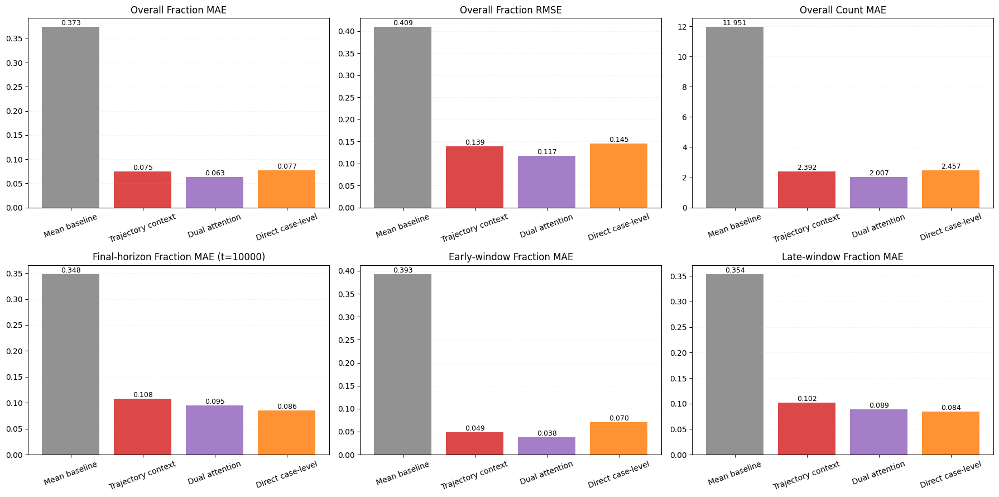
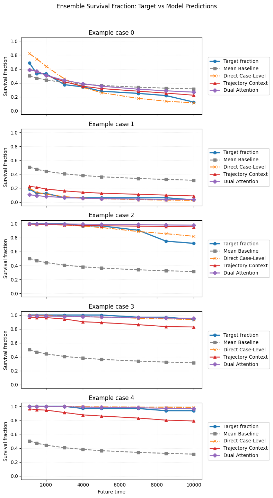

# task a
Task A complete. Outputs: results/task_a_binary_all
mlp {'accuracy': 0.843, 'precision': 0.5030674846625767, 'recall': 0.5189873417721519, 'f1': 0.5109034267912772, 'confusion_matrix': [[761, 81], [76, 82]], 'positive_rate': 0.158, 'predicted_positive_rate': 0.163, 'auc': 0.842245707928681, 'average_precision': 0.49244131737556407}
xgboost {'accuracy': 0.829, 'precision': 0.46596858638743455, 'recall': 0.5632911392405063, 'f1': 0.5100286532951289, 'confusion_matrix': [[740, 102], [69, 89]], 'positive_rate': 0.158, 'predicted_positive_rate': 0.191, 'auc': 0.8403665173336541, 'average_precision': 0.5116661244574336}
# task b
## Linear SVM / 200 epochs
**T=100**
train_acc: 0.8500
test_acc : 0.8083

**T=200**
train_acc: 0.8955
test_acc : 0.8420

**T=500**

## 1D-CNN / 50 epochs
**T=100**
TEST | AUC 0.9544 | F1 0.8284 | Acc 0.8674
**T=200**
TEST | AUC 0.9630 | F1 0.8568 | Acc 0.8886
**T=500**
TEST | AUC: 0.9783 | F1: 0.9087 | Acc: 0.9308

Input
  └─ x: [B, in_ch, L]

Backbone
  ├─ Conv1d(in_ch → 128, k=7, pad=3)      -> [B, 128, L]
  ├─ BatchNorm1d(128)                     -> [B, 128, L]
  ├─ ReLU                                  -> [B, 128, L]
  ├─ Conv1d(128 → 256, k=5, pad=2)        -> [B, 256, L]
  ├─ BatchNorm1d(256)                     -> [B, 256, L]
  ├─ ReLU                                  -> [B, 256, L]
  ├─ Conv1d(256 → 256, k=3, pad=1)        -> [B, 256, L]
  ├─ BatchNorm1d(256)                     -> [B, 256, L]
  ├─ ReLU                                  -> [B, 256, L]
  └─ AdaptiveAvgPool1d(1)                  -> [B, 256, 1]

Head
  ├─ Flatten                               -> [B, 256]
  ├─ Dropout(p=0.3)                        -> [B, 256]
  └─ Linear(256 → 1)                       -> [B, 1]  

## Attention / 50 epochs
**T=100**
TEST | AUC 0.9515 | F1 0.8307 | Acc 0.8670
**T=200**
TEST | AUC 0.9637 | F1 0.8648 | Acc 0.8974
**T=500**
TEST | AUC 0.9783 | F1 0.9210 | Acc 0.9410

Positional Encoding
  ├─ Sin/Cos PE (max_len ≥ T(+1))          -> [1, T(+1), d_model]
  ├─ Add PE                                -> [B, T(+1), d_model]
  └─ Dropout(p=dropout)                    -> [B, T(+1), d_model]

Backbone: Transformer Encoder × num_layers
  └─ for each layer:
       ├─ (Norm-first) LayerNorm           -> [B, T(+1), d_model]
       ├─ Multi-Head Self-Attention
       │    ├─ QKV projections             -> [B, T(+1), d_model] ×3
       │    ├─ Attention (nhead heads)     -> [B, T(+1), d_model]
       │    └─ Output projection           -> [B, T(+1), d_model]
       ├─ Residual Add                     -> [B, T(+1), d_model]
       ├─ (Norm-first) LayerNorm           -> [B, T(+1), d_model]
       ├─ FeedForward (MLP)
       │    ├─ Linear(d_model → dim_ff)    -> [B, T(+1), dim_ff]
       │    ├─ GELU                        -> [B, T(+1), dim_ff]
       │    ├─ Dropout                     -> [B, T(+1), dim_ff]
       │    └─ Linear(dim_ff → d_model)    -> [B, T(+1), d_model]
       └─ Residual Add                     -> [B, T(+1), d_model]

Pooling (sequence → vector)
  ├─ if pooling="cls": take x[:,0,:]       -> [B, d_model]
  └─ if pooling="mean": mean over time     -> [B, d_model]

Head
  ├─ LayerNorm(d_model)                    -> [B, d_model]
  ├─ Dropout(p=0.3)                        -> [B, d_model]
  └─ Linear(d_model → 1)                   -> [B, 1]   (binary logit)

## Task C: Survival Curve Prediction
Setting
- Case-level split with all 8 perturbed trajectories from the same initial condition kept in the same set.
- Total cases: 5000
- Train / Val / Test: 3500 / 500 / 1000
- Input horizon: `T_in = 100`
- Input features per trajectory: 15 orbital features
- Target: survival curve at future times `[200, 400, 600, 800, 1000]`
- Physics constraint: predicted survival curve must be monotonically non-increasing

### Mean-Curve Baseline
Predict the training-set mean survival curve for every test case.

- TEST loss: `0.173331`
- TEST overall_mae: `0.387228`
- TEST mae_per_horizon: `[0.361827, 0.384286, 0.394061, 0.397485, 0.398479]`
- TEST monotone_fraction: `1.0000`

### Flat Case Model
Trajectory prefix is first reduced to a single case-level sequence `(100, 15)`, then modeled with a GRU encoder + monotone autoregressive decoder.

- Best fit: `best_epoch = 47`, `best_val = 0.020906`
- TEST loss: `0.023562`
- TEST overall_mae: `0.091460`
- TEST mae_per_horizon: `[0.083607, 0.086039, 0.089609, 0.097061, 0.100984]`
- TEST monotone_fraction: `1.0000`
- Improvement over mean baseline on TEST overall_mae: `0.295768`

Architecture
- Encoder: GRU over `(100, 15)` prefix
- Decoder: autoregressive GRUCell-style monotone survival decoder
- Constraint: `P_k = P_{k-1} * alpha_k`, `alpha_k in [0, 1]`, `P_0 = 1`

### Hierarchical Set-Seq Model
Keep the full perturbation set `(8, 100, 15)`. Each trajectory is encoded independently with a shared GRU, then aggregated with cross-trajectory attention before monotone decoding.

- Best fit: `best_epoch = 23`, `best_val = 0.014173`
- TEST loss: `0.015504`
- TEST overall_mae: `0.070258`
- TEST mae_per_horizon: `[0.075002, 0.061150, 0.066067, 0.071811, 0.077261]`
- TEST monotone_fraction: `1.0000`
- Improvement over mean baseline on TEST overall_mae: `0.316969`
- Improvement over flat case model on TEST overall_mae: `0.021202`

Architecture
- Trajectory encoder: shared GRU for each of the 8 trajectories
- Set aggregator: cross-trajectory attention
- Decoder: monotone autoregressive survival decoder

### Temporal + Set Dual Attention Model
Use temporal self-attention within each trajectory, then set attention across the 8 perturbations, followed by the same monotone survival decoder.

- Best fit: `best_epoch = 32`, `best_val = 0.011909`
- TEST loss: `0.016849`
- TEST overall_mae: `0.070382`
- TEST mae_per_horizon: `[0.075645, 0.060703, 0.064337, 0.071629, 0.079597]`
- TEST monotone_fraction: `1.0000`
- Improvement over mean baseline on TEST overall_mae: `0.316846`
- Improvement over flat case model on TEST overall_mae: `0.021078`
- Improvement over hierarchical set-seq model on TEST overall_mae: `-0.000124`

Architecture
- Temporal encoder: Transformer-style self-attention over each `(100, 15)` trajectory
- Set encoder: cross-trajectory attention over 8 trajectory tokens
- Decoder: monotone autoregressive survival decoder

### Summary
- The monotonic survival constraint is satisfied in all tested models: `monotone_fraction = 1.0000`.
- The mean-curve baseline is weak, showing that the prefix contains strong predictive signal.
- The flat GRU Seq2Seq model already gives a large improvement over the baseline.
- The hierarchical set-seq model is the strongest current model on test MAE.
- Explicitly modeling the 8 perturbed trajectories is more valuable than only increasing temporal model complexity.
- The dual-attention model is competitive, but does not materially outperform the simpler hierarchical set-seq model in the current setup.

# results 5/14
## Task a
XGB TEST  | AUC 0.8458 | AP 0.9045 | F1 0.8478 | Acc 0.7900 |
confusion matrix [[tn, fp], [fn, tp]] = [[205, 134], [76, 585]]

MLP TEST | AUC 0.8489 | AP 0.9029 | F1 0.8434 | Acc 0.7890 |
confusion matrix [[tn, fp], [fn, tp]] = [[221, 118], [93, 568]]
## Task b 
TCN
early stopping at epoch 27 | best_val_auc 0.9711
TEST | AUC: 0.9710666529890278 F1: 0.8576659038901602 Acc: 0.9066720016004801

CNN
TEST metrics: {'auc': 0.9696482992203747, 'f1': 0.849039749888343, 'accuracy': 0.8985695708712613}
pred_prob_test shape: (19994,)
pred_prob_test[:10]: [0.0944 0.     0.     0.5178 0.9505 0.1744 0.     0.4185 0.7675 0.    ]
pred_label_test[:10]: [0 0 0 1 1 0 0 0 1 0]
true_label_test[:10]: [0. 0. 0. 0. 1. 0. 0. 1. 0. 0.]

attention
early stopping at epoch 39 | best_val_auc 0.9691
TEST | AUC 0.9689 | F1 0.8548 | Acc 0.9039

## Task c
 
Comprehensive test metrics on ensemble fraction Q=mean_i p_i:
                      loss  trajectory_bce  overall_mae  overall_rmse  count_mae  final_mae  early_mae  mid_mae  late_mae  mean_bias  auc_mae  monotone_fraction
Mean baseline       0.8851          0.8851       0.3735        0.4090    11.9512     0.3480     0.3926   0.3743    0.3535    -0.0038   0.3616                1.0
Trajectory context  0.3023          0.3023       0.0748        0.1390     2.3921     0.1076     0.0491   0.0733    0.1018     0.0446   0.0783                1.0
Dual attention      0.2704          0.2704       0.0627        0.1174     2.0068     0.0947     0.0382   0.0613    0.0886     0.0323   0.0657                1.0
Direct case-level   0.0612             NaN       0.0768        0.1449     2.4567     0.0857     0.0703   0.0761    0.0839    -0.0023   0.0755                1.0

## Task d
log_tau_system = np.log1p(tau_system)
delta_a(t) = abs(a_i(t) - a_j(t))
R_a(t) = delta_a(t) / delta_a(0)
R_a(t) > threshold = 1e3
tau_system = median(pair_taus)
log_tau_system = np.log1p(tau_system)

RandomForest:

MAE(log_tau): 0.878    exp(0.878) ≈ 2.4
RMSE(log_tau): 1.113
Spearman: 0.722

MLP:

MAE(log_tau): 1.013
RMSE(log_tau): 1.295
Spearman: 0.607

CNN:

MAE(log_tau): 0.833
RMSE(log_tau): 1.561
Spearman: 0.772

## Task e
64 steps -> 8 steps
### position
naive [20/36] 260193.07 batch/s eta=0s
naive [30/36] 304268.89 batch/s eta=0s
naive [36/36] 320244.81 batch/s eta=0s
naive: raw_mse=2.55639e+08 raw_mae=4348.31 z_mse=0.909423 runtime=0.0s
Running chronos on 4608 univariate series...
chronos [1/36] 0.70 batch/s eta=50s
chronos [10/36] 2.05 batch/s eta=12s
chronos [20/36] 2.33 batch/s eta=6s
chronos [30/36] 2.47 batch/s eta=2s
chronos [36/36] 2.52 batch/s eta=0s
chronos: raw_mse=6.0092e+07 raw_mae=1805.06 z_mse=0.259916 runtime=17.7s
Running patchtst on 4608 univariate series...
patchtst [1/36] 1.36 batch/s eta=25s
patchtst [10/36] 12.61 batch/s eta=2s
patchtst [20/36] 23.34 batch/s eta=0s
patchtst [30/36] 32.11 batch/s eta=0s
patchtst [36/36] 36.84 batch/s eta=0s
patchtst: raw_mse=8.15002e+09 raw_mae=21171.8 z_mse=0.562308 runtime=1.6s

256->64
Panda
TEST | norm_mse=1.01748 norm_mae=0.585153 raw_mse=6.45925e+12 raw_mae=878347

### orbital features
naive [20/36] 159445.13 batch/s eta=0s
naive [30/36] 178386.67 batch/s eta=0s
naive [36/36] 184974.90 batch/s eta=0s
naive: raw_mse=2.55639e+08 raw_mae=4348.31 z_mse=0.909423 runtime=0.0s
Running timesfm on 4608 univariate series...
Running chronos on 4608 univariate series...
chronos [1/36] 0.37 batch/s eta=1m34s
chronos [10/36] 1.55 batch/s eta=16s
chronos [20/36] 1.92 batch/s eta=8s
chronos [30/36] 1.97 batch/s eta=3s
chronos [36/36] 1.91 batch/s eta=0s
chronos: raw_mse=5.99669e+07 raw_mae=1797.67 z_mse=0.260191 runtime=34.8s
Running patchtst on 4608 univariate series...
patchtst [1/36] 3.44 batch/s eta=10s
patchtst [10/36] 26.48 batch/s eta=0s
patchtst [20/36] 42.61 batch/s eta=0s
patchtst [30/36] 53.29 batch/s eta=0s
patchtst [36/36] 58.01 batch/s eta=0s
patchtst: raw_mse=8.15002e+09 raw_mae=21171.8 z_mse=0.562308 runtime=1.1s

panda: raw_mse=5.8596e+07 raw_mae=407.626 z_mse=0.213708 runtime=8.8s

256->64
panda with mlp 4k raw_mse=7026.94 raw_mae=5.81212 z_mse=0.229276
              20k raw_mse=1992.26 raw_mae=2.50967 z_mse=0.173401