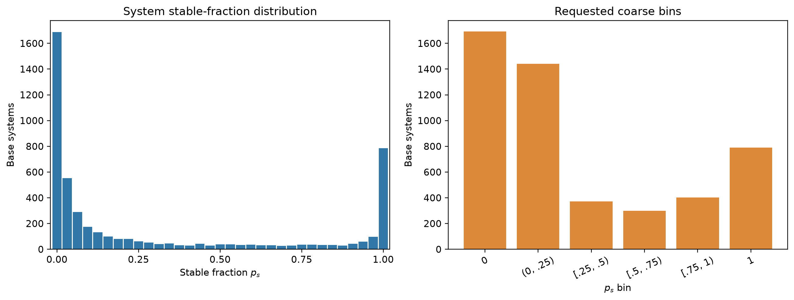
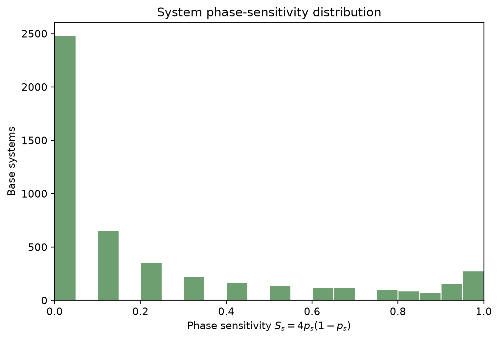
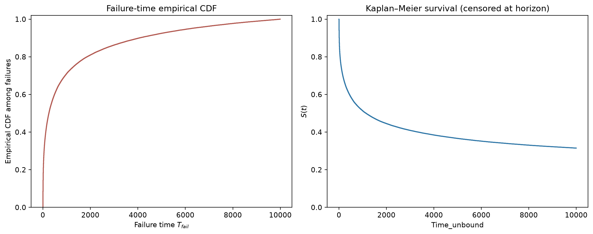
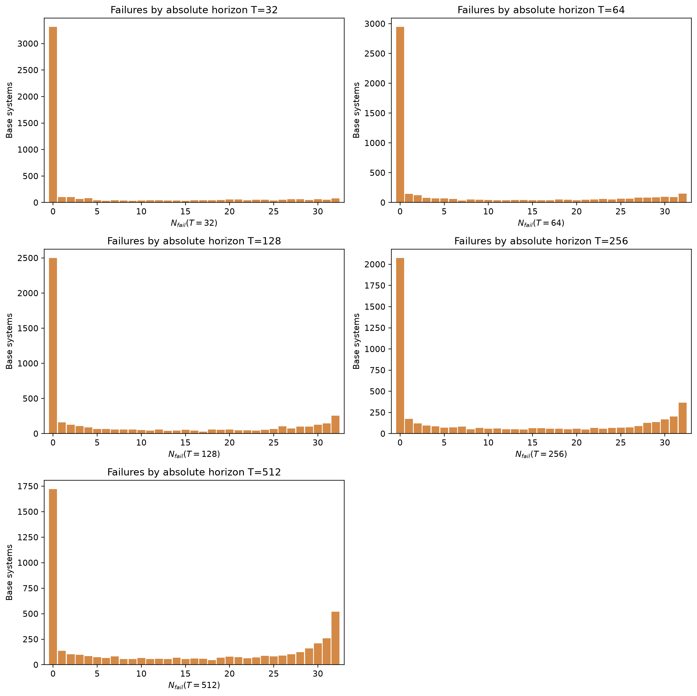
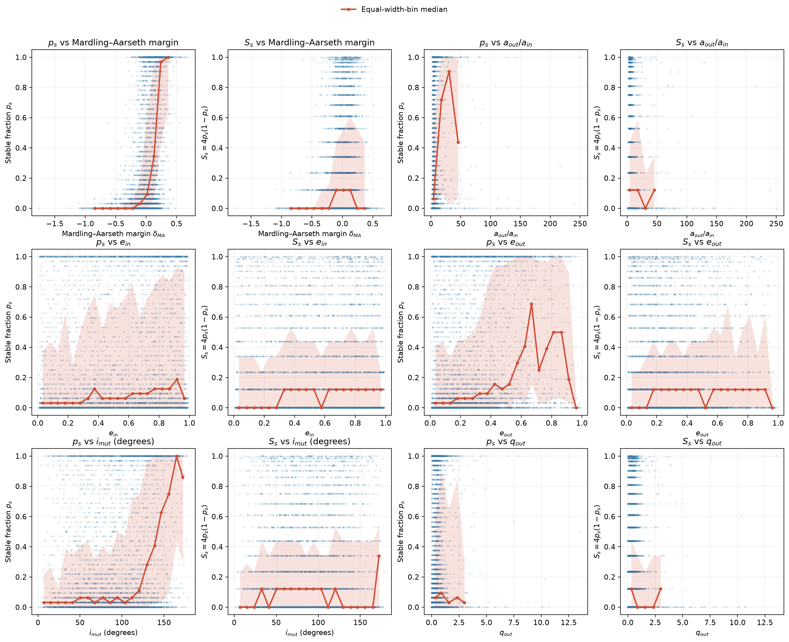
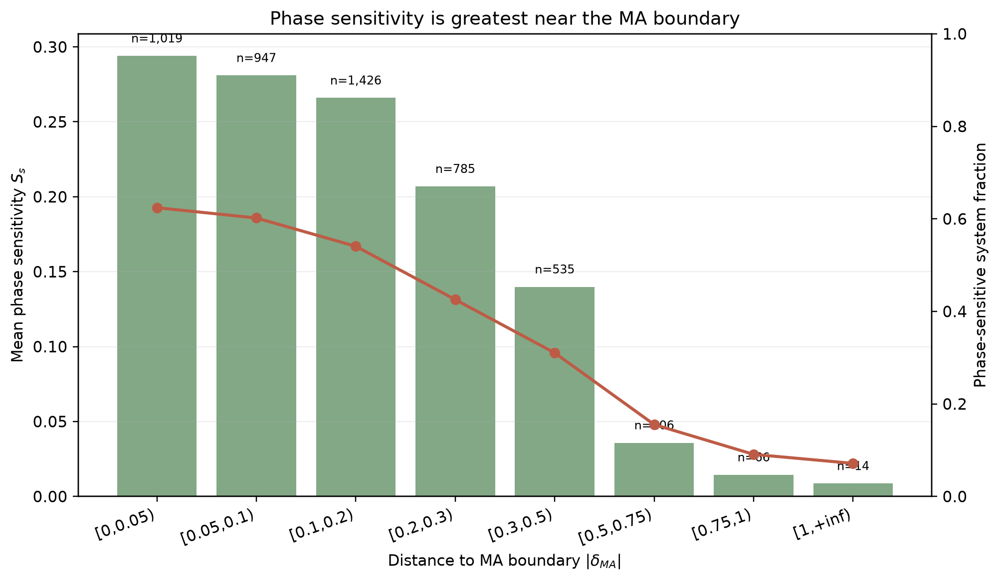

# System-level statistical audit (sampling 2)

- Dataset: `/data/sampling_2`
- Completion table: `/data/sampling_2/completed_systems_sampling_2.txt`
- Grouping: `system_id = index // 32`, `variation_id = index % 32`
- Stable label: `time_unbound >= 10000`; valid row requires `time_unbound >= 0` and `diagnosis == 0`.

## Relationship between sampling versions

Sampling 2 and sampling 3 are paired temporal-resolution versions of the same dataset, with corresponding base-system and variation identities. Sampling 3 is the higher-resolution version, while the local sampling3 files contain only a 1024-step prefix. This prefix limits stored trajectory history; the stable/failure labels in this audit come from the completion tables, so differences in those labels cannot be attributed to prefix truncation alone.

## Stored trajectory time coverage

- Stored `times_complete` samples: 2,001 / 2,001 source samples (100.00%).
- Stored time window: `0` to `1e+08`; median sample interval `50000.0`.
- Estimated full-source endpoint: `1e+08` (100.00% of the source time span is present locally).
- The stable-fraction and failure-time statistics below are calculated from the completion table, not inferred by treating the local HDF5 prefix as a completed trajectory.

## Cohort and labels

| Statistic | Value |
|---|---:|
| Raw base systems | 5,000 |
| Raw trajectories | 160,000 |
| Invalid trajectories | 47 |
| Complete valid systems | 4,998 |
| Trajectories in audit cohort | 159,936 |
| Valid rows excluded with incomplete systems | 17 |
| Mean stable trajectory rate | 31.51% |

## Stable fraction and phase sensitivity

| Statistic | Value |
|---|---:|
| Fully unstable systems (`p=0`) | 1,692 (33.85%) |
| Phase-sensitive systems (`0<p<1`) | 2,516 (50.34%) |
| Fully stable systems (`p=1`) | 790 (15.81%) |
| Median `p_stable` | 0.06250 |
| Mean phase sensitivity | 0.23824 |
| Median phase sensitivity | 0.12109 |
| Phase sensitivity `S>0.5` | 1,102 (22.05%) |

| Stable-fraction bin | Systems | Fraction |
|---|---:|---:|
| p=0 | 1,692 | 33.85% |
| 0<p<0.25 | 1,442 | 28.85% |
| 0.25<=p<0.5 | 371 | 7.42% |
| 0.5<=p<0.75 | 300 | 6.00% |
| 0.75<=p<1 | 403 | 8.06% |
| p=1 | 790 | 15.81% |

## Failure times and requested horizons

- Observed unstable variations in the audit cohort: 109,536/159,936 (68.49%).
- Failure-time quantiles among observed unstable variations: `{'q25': 35.0, 'median': 255.0, 'q75': 1310.0}`.
- The table below treats `T` as an absolute `time_unbound` threshold, matching the repository's survival targets.
- Repository notes say the stored trajectory sample clock uses a different unit from `time_unbound`; these rows must not be read as `prefix_len=T` exposure rates without a validated clock conversion.

| Absolute `time_unbound` horizon T | Failures by T | Cohort trajectories | Fraction failed by T | Fraction of all eventual failures |
|---:|---:|---:|---:|---:|
| 32 | 27,372 | 159,936 | 17.11% | 24.99% |
| 64 | 35,031 | 159,936 | 21.90% | 31.98% |
| 128 | 44,337 | 159,936 | 27.72% | 40.48% |
| 256 | 54,942 | 159,936 | 34.35% | 50.16% |
| 512 | 66,453 | 159,936 | 41.55% | 60.67% |

## Coarse initial conditions and MA boundary

Initial conditions source: `static IC file: /data/sampling_2/ICs_sampling_2.hdf5`.
For each system, physical coordinates are medians across its 32 valid initial variations. The MA margin follows the repository's existing log(Rp/Rp,crit) implementation.

| Feature | Spearman with `p_stable` | Spearman with `S` | Systems used |
|---|---:|---:|---:|
| ma_margin | 0.5875 | 0.1857 | 4,998 |
| abs_ma_margin | -0.1028 | -0.2389 | 4,998 |
| a_out_over_a_in | 0.4473 | 0.1802 | 4,998 |
| e_in | 0.1171 | 0.0510 | 4,998 |
| e_out | 0.2107 | 0.0910 | 4,998 |
| i_mut_deg | 0.2213 | -0.0107 | 4,998 |
| q_out | 0.0745 | -0.0812 | 4,998 |

### Phase sensitivity by distance to the MA boundary

| Absolute MA-margin bin | Systems | Mean `S` | Median `S` | Phase-sensitive fraction |
|---|---:|---:|---:|---:|
| [0,0.05) | 1,019 | 0.2940 | 0.1211 | 62.41% |
| [0.05,0.1) | 947 | 0.2810 | 0.1211 | 60.19% |
| [0.1,0.2) | 1,426 | 0.2660 | 0.1211 | 54.07% |
| [0.2,0.3) | 785 | 0.2069 | 0.0000 | 42.55% |
| [0.3,0.5) | 535 | 0.1399 | 0.0000 | 31.03% |
| [0.5,0.75) | 206 | 0.0358 | 0.0000 | 15.53% |
| [0.75,1) | 66 | 0.0144 | 0.0000 | 9.09% |
| [1,+inf) | 14 | 0.0086 | 0.0000 | 7.14% |

Separate signed-margin figures are also provided as `stable_fraction_vs_ma_margin.png` and `phase_sensitivity_vs_ma_margin.png`. These are descriptive summaries without confidence intervals.
