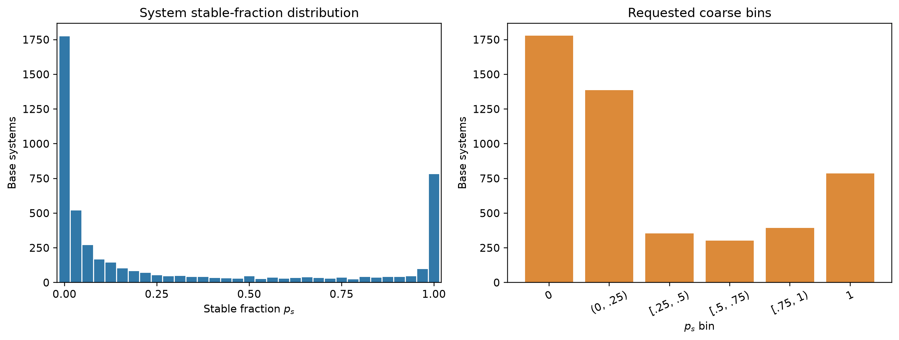
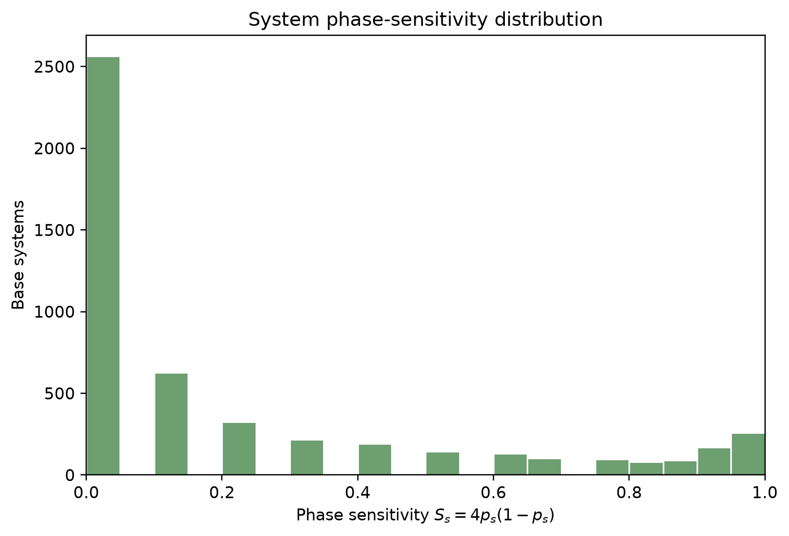
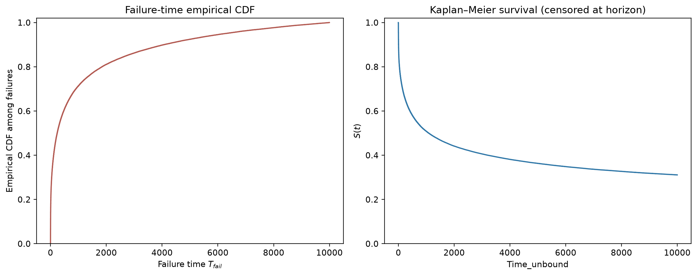
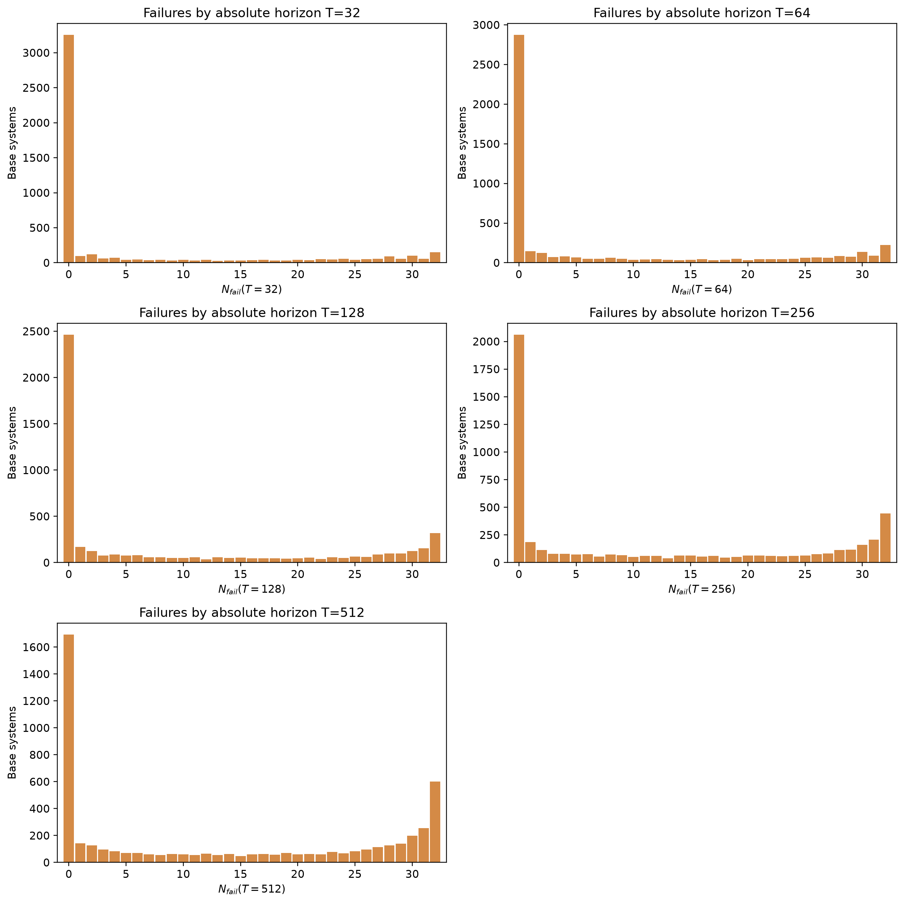
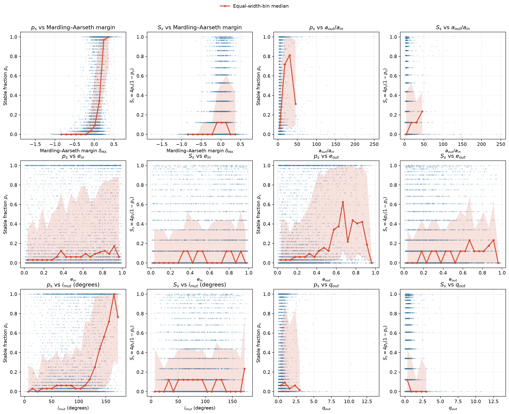
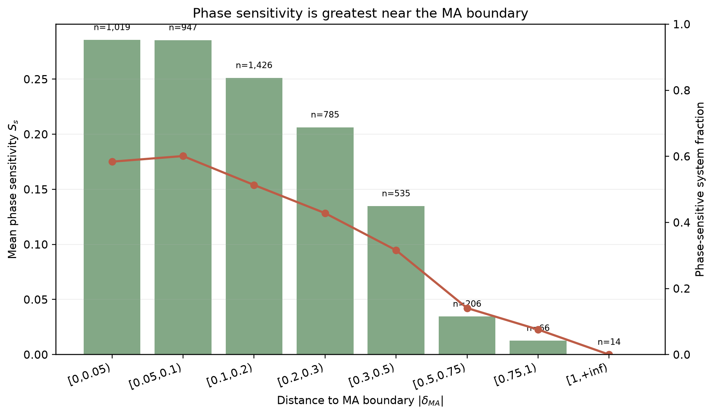

# System-level statistical audit (sampling 3)

- Dataset: `/data/dataset_sampling_3_prefix1024_float64`
- Completion table: `/data/dataset_sampling_3_prefix1024_float64/completed_systems_sampling_3.txt`
- Grouping: `system_id = index // 32`, `variation_id = index % 32`
- Stable label: `time_unbound >= 10000`; valid row requires `time_unbound >= 0` and `diagnosis == 0`.

## Relationship between sampling versions

Sampling 2 and sampling 3 are paired temporal-resolution versions of the same dataset, with corresponding base-system and variation identities. Sampling 3 is the higher-resolution version, while the local sampling3 files contain only a 1024-step prefix. This prefix limits stored trajectory history; the stable/failure labels in this audit come from the completion tables, so differences in those labels cannot be attributed to prefix truncation alone.

## Stored trajectory time coverage

- Stored `times_complete` samples: 1,024 / 10,001 source samples (10.24%).
- Stored time window: `0` to `1.023e+07`; median sample interval `10000.0`.
- Estimated full-source endpoint: `1e+08` (10.23% of the source time span is present locally).
- The stable-fraction and failure-time statistics below are calculated from the completion table, not inferred by treating the local HDF5 prefix as a completed trajectory.

## Cohort and labels

| Statistic | Value |
|---|---:|
| Raw base systems | 5,000 |
| Raw trajectories | 160,000 |
| Invalid trajectories | 48 |
| Complete valid systems | 4,998 |
| Trajectories in audit cohort | 159,936 |
| Valid rows excluded with incomplete systems | 16 |
| Mean stable trajectory rate | 31.12% |

## Stable fraction and phase sensitivity

| Statistic | Value |
|---|---:|
| Fully unstable systems (`p=0`) | 1,778 (35.57%) |
| Phase-sensitive systems (`0<p<1`) | 2,435 (48.72%) |
| Fully stable systems (`p=1`) | 785 (15.71%) |
| Median `p_stable` | 0.06250 |
| Mean phase sensitivity | 0.23240 |
| Median phase sensitivity | 0.00000 |
| Phase sensitivity `S>0.5` | 1,073 (21.47%) |

| Stable-fraction bin | Systems | Fraction |
|---|---:|---:|
| p=0 | 1,778 | 35.57% |
| 0<p<0.25 | 1,385 | 27.71% |
| 0.25<=p<0.5 | 354 | 7.08% |
| 0.5<=p<0.75 | 302 | 6.04% |
| 0.75<=p<1 | 394 | 7.88% |
| p=1 | 785 | 15.71% |

## Failure times and requested horizons

- Observed unstable variations in the audit cohort: 110,166/159,936 (68.88%).
- Failure-time quantiles among observed unstable variations: `{'q25': 24.0, 'median': 241.0, 'q75': 1292.0}`.
- The table below treats `T` as an absolute `time_unbound` threshold, matching the repository's survival targets.
- Repository notes say the stored trajectory sample clock uses a different unit from `time_unbound`; these rows must not be read as `prefix_len=T` exposure rates without a validated clock conversion.

| Absolute `time_unbound` horizon T | Failures by T | Cohort trajectories | Fraction failed by T | Fraction of all eventual failures |
|---:|---:|---:|---:|---:|
| 32 | 30,239 | 159,936 | 18.91% | 27.45% |
| 64 | 37,309 | 159,936 | 23.33% | 33.87% |
| 128 | 45,789 | 159,936 | 28.63% | 41.56% |
| 256 | 56,089 | 159,936 | 35.07% | 50.91% |
| 512 | 67,438 | 159,936 | 42.17% | 61.21% |

## Coarse initial conditions and MA boundary

Initial conditions source: `t=0 fields from 40 result shards under /data/dataset_sampling_3_prefix1024_float64`.
For each system, physical coordinates are medians across its 32 valid initial variations. The MA margin follows the repository's existing log(Rp/Rp,crit) implementation.

| Feature | Spearman with `p_stable` | Spearman with `S` | Systems used |
|---|---:|---:|---:|
| ma_margin | 0.5819 | 0.1826 | 4,998 |
| abs_ma_margin | -0.0918 | -0.2273 | 4,998 |
| a_out_over_a_in | 0.4431 | 0.1885 | 4,998 |
| e_in | 0.1067 | 0.0437 | 4,998 |
| e_out | 0.2057 | 0.0947 | 4,998 |
| i_mut_deg | 0.2223 | -0.0038 | 4,998 |
| q_out | 0.0854 | -0.0590 | 4,998 |

### Phase sensitivity by distance to the MA boundary

| Absolute MA-margin bin | Systems | Mean `S` | Median `S` | Phase-sensitive fraction |
|---|---:|---:|---:|---:|
| [0,0.05) | 1,019 | 0.2857 | 0.1211 | 58.39% |
| [0.05,0.1) | 947 | 0.2855 | 0.1211 | 60.08% |
| [0.1,0.2) | 1,426 | 0.2512 | 0.1211 | 51.33% |
| [0.2,0.3) | 785 | 0.2063 | 0.0000 | 42.80% |
| [0.3,0.5) | 535 | 0.1348 | 0.0000 | 31.59% |
| [0.5,0.75) | 206 | 0.0346 | 0.0000 | 14.08% |
| [0.75,1) | 66 | 0.0126 | 0.0000 | 7.58% |
| [1,+inf) | 14 | 0.0000 | 0.0000 | 0.00% |

Separate signed-margin figures are also provided as `stable_fraction_vs_ma_margin.png` and `phase_sensitivity_vs_ma_margin.png`. These are descriptive summaries without confidence intervals.
