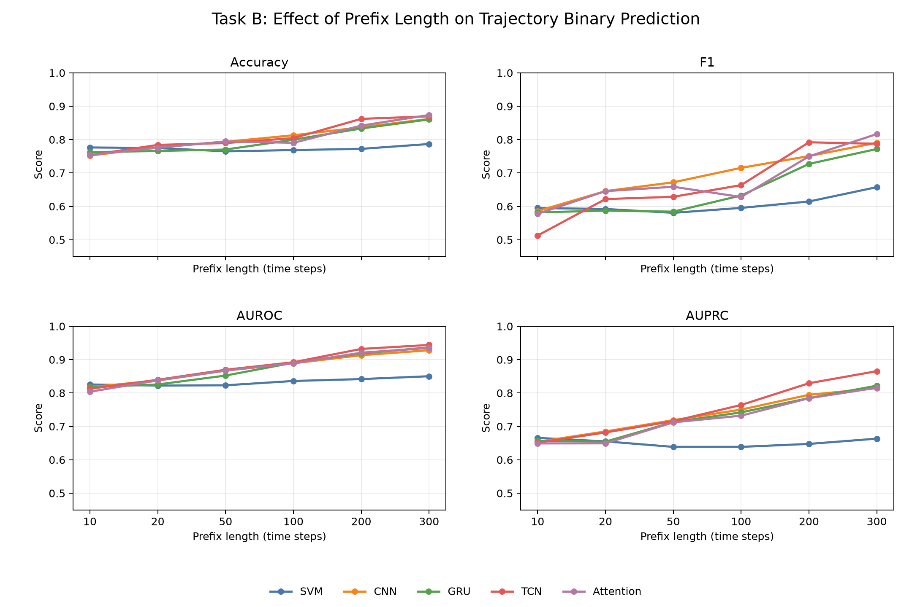

# Task B Prefix Ablation Results

上图展示了已有正式评估结果中，prefix 长度对 Accuracy、F1、AUROC 和 AUPRC 的影响。由于 `prefix=500` 没有正式 `metrics.json`，未纳入曲线。

## 实验范围

Task B 的 `trajectory_binary` 模式使用单条 trajectory 的早期轨道前缀，预测其在 `time_horizon=10000` 内是否失稳。以下结果来自 `dataset_v3`/对应采样数据，使用 `orbital15` 表示（每个时间步 15 个通道），并按 `raw_case_id` 做 group split。

共同设置如下：

- 样本数：`159953`
- 不稳定类别比例：约 `31.6%`
- `test_size=0.125`，`val_size=0.1`
- `seed=42`
- 最大训练轮数：`50`
- early stopping patience：`8`
- 模型：SVM、CNN、TCN、GRU、Attention

表中指标均为测试集结果，直接读取各 prefix 目录下的 `metrics.json`。指标定义为：

- `Acc`：accuracy
- `Prec`：precision
- `Recall`：recall
- `F1`：F1 score
- `AUROC`：ROC 曲线下面积
- `AUPRC`：PR 曲线下面积

## 已有结果

| Prefix | Model | Acc | Prec | Recall | F1 | AUROC | AUPRC |
| ---: | --- | ---: | ---: | ---: | ---: | ---: | ---: |
| 10 | SVM | 0.7765 | 0.6964 | 0.5195 | 0.5951 | 0.8256 | 0.6657 |
| 10 | CNN | 0.7522 | 0.6210 | 0.5548 | 0.5860 | 0.8179 | 0.6539 |
| 10 | TCN | 0.7536 | 0.6840 | 0.4100 | 0.5127 | 0.8127 | 0.6514 |
| 10 | GRU | 0.7623 | 0.6552 | 0.5237 | 0.5821 | 0.8176 | 0.6573 |
| 10 | Attention | 0.7543 | 0.6326 | 0.5317 | 0.5778 | 0.8039 | 0.6491 |
| 20 | SVM | 0.7749 | 0.6930 | 0.5170 | 0.5922 | 0.8223 | 0.6552 |
| 20 | CNN | 0.7771 | 0.6491 | 0.6425 | 0.6458 | 0.8374 | 0.6849 |
| 20 | TCN | 0.7842 | 0.6971 | 0.5613 | 0.6219 | 0.8397 | 0.6819 |
| 20 | GRU | 0.7660 | 0.6639 | 0.5263 | 0.5872 | 0.8256 | 0.6544 |
| 20 | Attention | 0.7756 | 0.6449 | 0.6463 | 0.6456 | 0.8378 | 0.6493 |
| 50 | SVM | 0.7649 | 0.6658 | 0.5150 | 0.5808 | 0.8232 | 0.6387 |
| 50 | CNN | 0.7935 | 0.6750 | 0.6693 | 0.6721 | 0.8671 | 0.7188 |
| 50 | TCN | 0.7897 | 0.7115 | 0.5632 | 0.6287 | 0.8697 | 0.7158 |
| 50 | GRU | 0.7703 | 0.6828 | 0.5107 | 0.5843 | 0.8523 | 0.7129 |
| 50 | Attention | 0.7946 | 0.6940 | 0.6270 | 0.6588 | 0.8673 | 0.7121 |
| 100 | SVM | 0.7687 | 0.6659 | 0.5385 | 0.5955 | 0.8361 | 0.6387 |
| 100 | CNN | 0.8130 | 0.6895 | 0.7435 | 0.7154 | 0.8890 | 0.7503 |
| 100 | TCN | 0.8045 | 0.7273 | 0.6104 | 0.6637 | 0.8922 | 0.7642 |
| 100 | GRU | 0.7997 | 0.7532 | 0.5453 | 0.6326 | 0.8908 | 0.7420 |
| 100 | Attention | 0.7904 | 0.7156 | 0.5597 | 0.6281 | 0.8890 | 0.7322 |
| 200 | SVM | 0.7723 | 0.6611 | 0.5743 | 0.6147 | 0.8418 | 0.6476 |
| 200 | CNN | 0.8370 | 0.7268 | 0.7761 | 0.7507 | 0.9133 | 0.7947 |
| 200 | GRU | 0.8333 | 0.7535 | 0.7028 | 0.7273 | 0.9186 | 0.7848 |
| 200 | TCN | **0.8622** | **0.7575** | **0.8297** | **0.7920** | **0.9321** | **0.8293** |
| 200 | Attention | 0.8420 | 0.7507 | 0.7490 | 0.7498 | 0.9208 | 0.7845 |
| 300 | SVM | 0.7868 | 0.6681 | 0.6474 | 0.6576 | 0.8503 | 0.6634 |
| 300 | CNN | 0.8619 | 0.7594 | 0.8245 | 0.7906 | 0.9282 | 0.8145 |
| 300 | GRU | 0.8605 | 0.7990 | 0.7466 | 0.7719 | 0.9366 | 0.8219 |
| 300 | TCN | 0.8697 | **0.8123** | 0.7644 | 0.7876 | **0.9440** | **0.8654** |
| 300 | Attention | **0.8737** | 0.7546 | **0.8897** | **0.8166** | 0.9350 | 0.8158 |

## 结果解读

1. 随着 prefix 从 10 增加到 200–300，时序模型整体性能明显提高，说明较长的早期轨道观测包含更强的失稳预警信号。
2. `prefix=200` 的 TCN 是当前综合排序最好的结果：`F1=0.7920`、`AUROC=0.9321`、`AUPRC=0.8293`。
3. `prefix=300` 的 Attention 取得最高 accuracy、recall 和 F1：`Acc=0.8737`、`Recall=0.8897`、`F1=0.8166`；TCN 取得最高 precision、AUROC 和 AUPRC：`Prec=0.8123`、`AUROC=0.9440`、`AUPRC=0.8654`。
4. CNN 在 `prefix=100` 和 `prefix=200` 上表现稳定，分别取得 `F1=0.7154` 和 `F1=0.7507`。
5. SVM 的 AUROC 从 `prefix=10` 的 `0.8256` 提高到 `prefix=300` 的 `0.8503`，但整体低于时序神经网络，说明简单 flatten baseline 对时间结构利用不足。

## 结果完整性

- `prefix=10,20,50,100,200,300`：均有五个模型的 `metrics.json` 和测试曲线，可用于正式比较。
- `prefix=300`：已有完整评估指标和测试曲线，但当前目录没有保存模型 checkpoint 和训练日志；如需复现实验或部署，需要补存这些文件。
- `prefix=500`：目前只有 SVM/CNN 的部分模型文件，没有 `metrics.json`；Attention、GRU、TCN 结果均缺失，不能纳入正式比较。
- `group_fraction` / `set_attention`：目前没有对应实验结果。

## 结果文件

- `prefix_10/metrics.json`
- `prefix_20/metrics.json`
- `prefix_50/metrics.json`
- `prefix_100/metrics.json`
- `prefix_200/metrics.json`
- `prefix_300/metrics.json`
