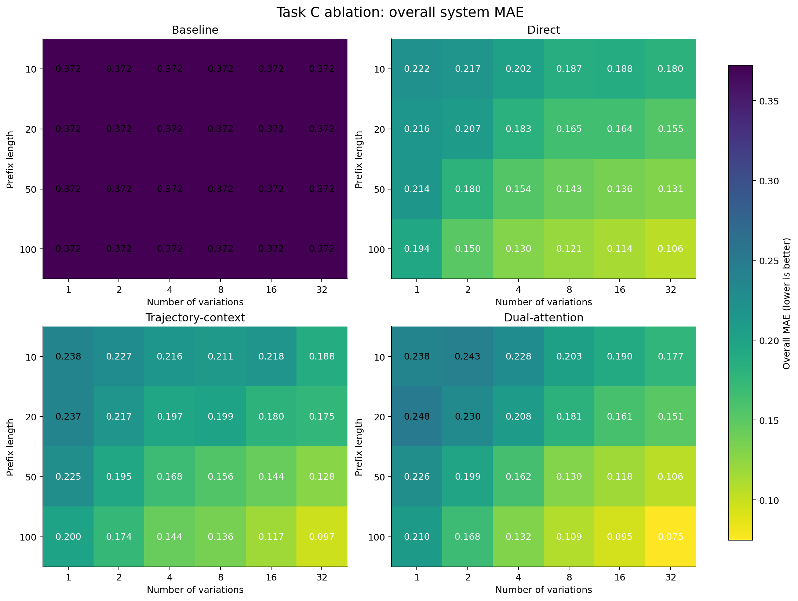
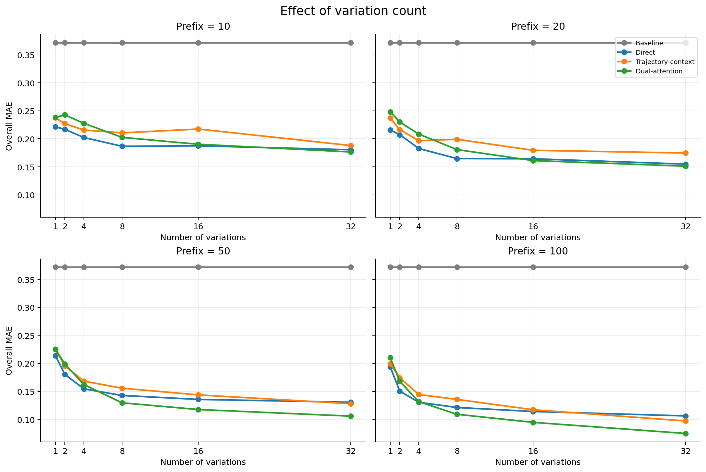
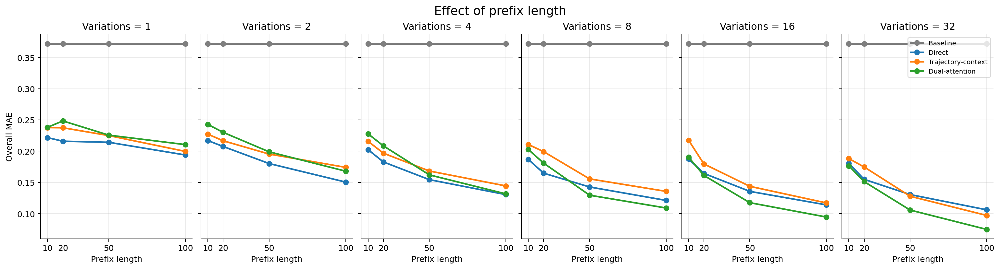
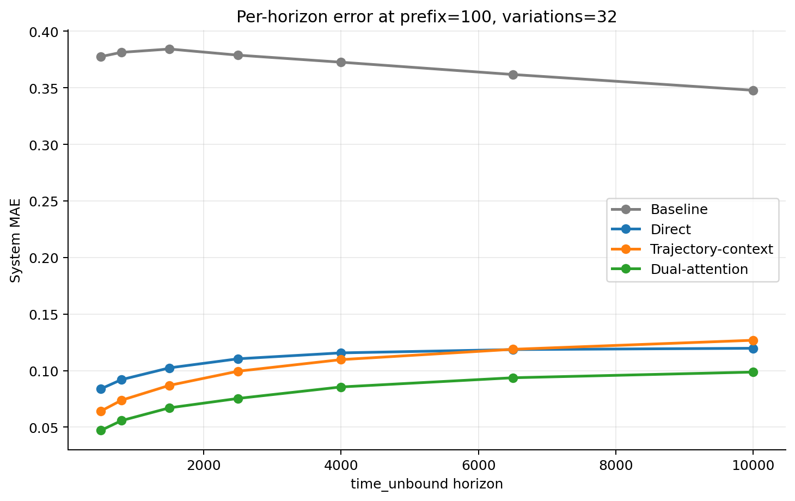
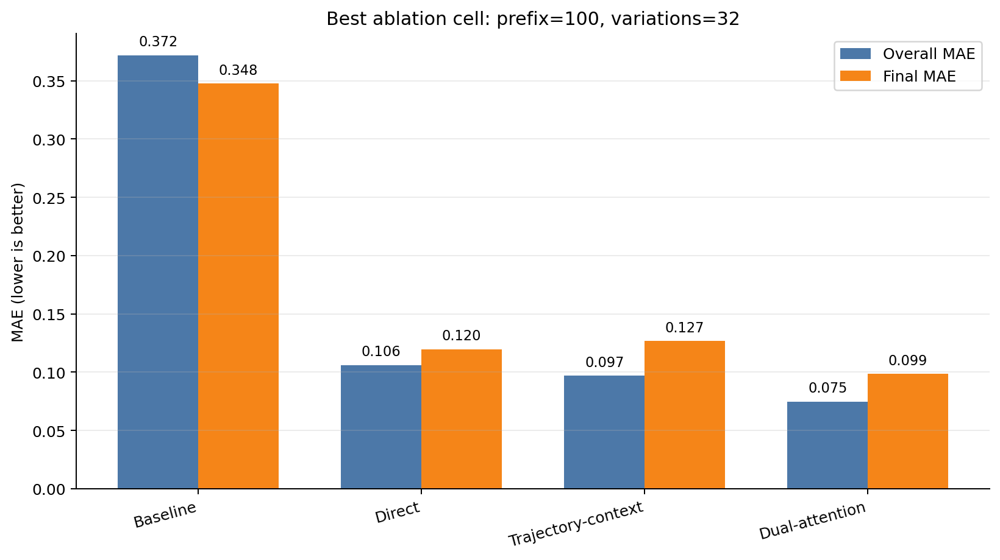
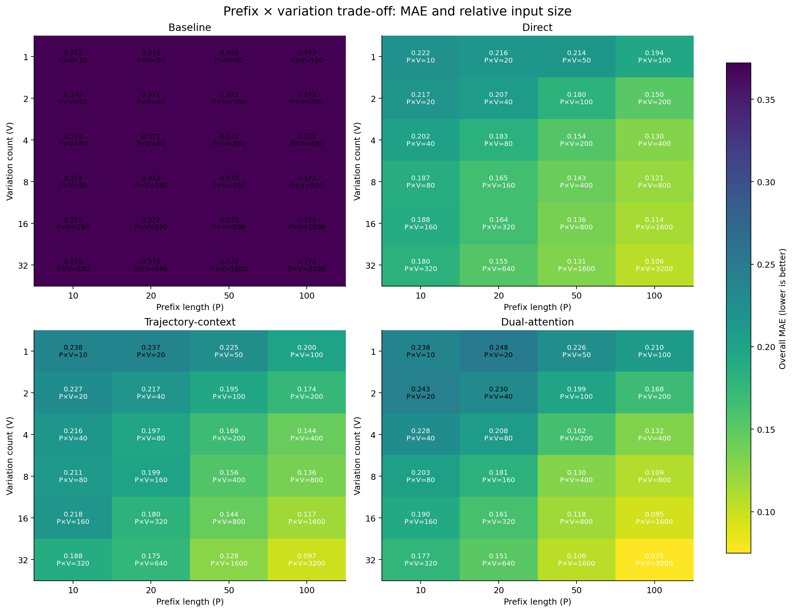
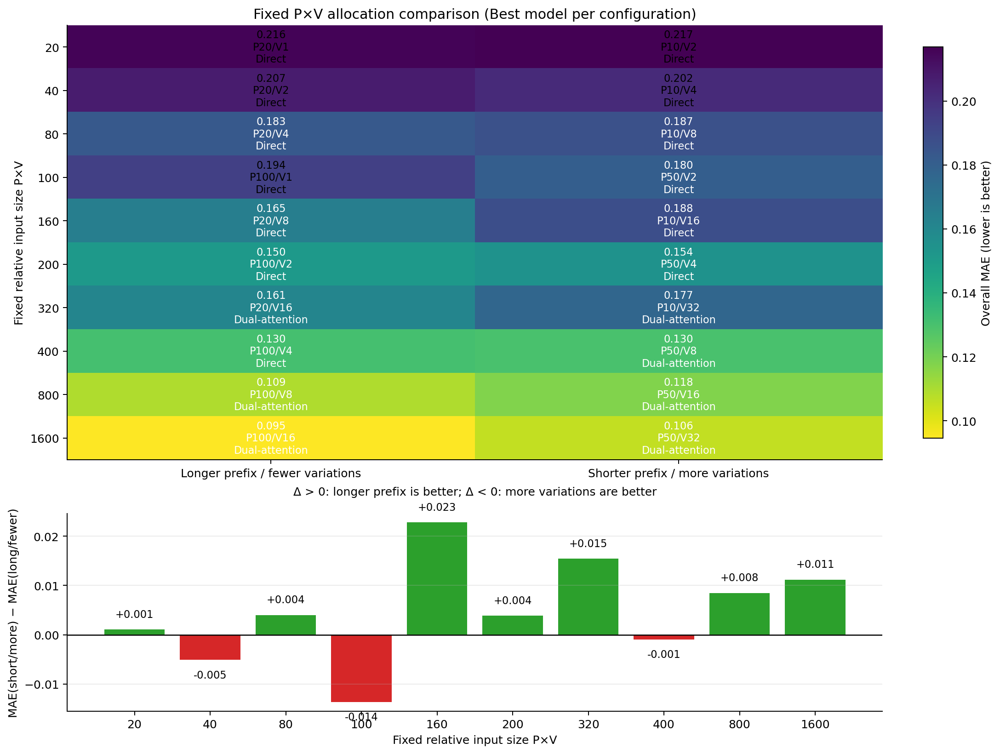

# Task C Prefix–Variation Ablation Results

这是 Task C 在 dataset_v3、sampling 2 上完成的 prefix length × variation count 消融实验。当前网格包含 4 个 prefix 长度、6 个 variation 数量和 4 个模型，共 **24 个配置 × 4 个模型 = 96 条模型结果**。

## 实验配置

| 项目 | 设置 |
| --- | --- |
| 数据集 | `dataset_v3`, sampling id `2` |
| 每个配置的 case 数 | 4,998 |
| 数据划分 | train 3,498 / validation 500 / test 1,000 |
| Prefix 长度 | 10, 20, 50, 100 |
| Variation 数量 | 1, 2, 4, 8, 16, 32 |
| Variation 子集 | balanced nested subset，seed=42 |
| Variation target | `full32`：variation 输入数量减少，但 system target 始终使用完整 32 条轨迹 |
| 输入表示 | `orbital15`，每个时间步 15 个通道 |
| 预测 horizons | 500, 800, 1500, 2500, 4000, 6500, 10000 |
| Horizon 定义 | absolute `time_unbound` horizons |
| Encoder | CNN |
| 训练 | 40 epochs，batch size 32，seed=42，CUDA |
| 优化器参数 | lr=0.001，weight decay=0.0001 |
| 隐藏层 | hidden_dim=128，dropout=0.2 |
| Dual loss | system loss weight=1.0，consistency weight=0.1 |

共享 prefix cache 位于 [_cache/metadata.json](_cache/metadata.json)，所有 cell 使用同一份缓存和同一套 train/validation/test split。

## 指标定义

- `overall_mae`：7 个预测 horizon 上的 system-level MAE 平均值。
- `final_mae`：最后一个 horizon（`time_unbound=10000`）的 system-level MAE。
- `variation_overall_mae`：单条 variation prediction 的 MAE 平均值。
- `mean_variation_overall_mae`：先对 variation prediction 求平均，再与 system target 比较的 MAE。
- `system_loss`、`variation_loss`、`consistency_loss`：Trajectory-context 和 Dual-attention 的测试损失分量；baseline/direct 不适用时记为 —。
- 下方的 horizon 表中，列顺序固定为：`[500, 800, 1500, 2500, 4000, 6500, 10000]`。

## 图形化结果

下面几张图从不同角度展示同一批结果，所有图的纵轴都是 MAE，越低越好。

### 1. Overall MAE 热力图

颜色越亮表示 MAE 越低。每个子图对应一个模型，横轴是 variation 数量，纵轴是 prefix 长度。

这张图最适合看整体 ablation 结构：prefix 从 10 增加到 100、variation 从 2 增加到 32 时，Direct、Trajectory-context 和 Dual-attention 的颜色总体变亮；最亮的格子是 Dual-attention、prefix=100、variations=32。

### 2. Variation 数量的影响

每个子图固定一个 prefix，观察增加 variation 数量是否改善结果。

### 3. Prefix 长度的影响

每个子图固定一个 variation 数量，观察增加 prefix 长度的影响。

### 4. 最优配置下的逐 horizon 误差

在 `prefix=100, variations=32` 下，Dual-attention 在所有 horizon 上都低于其他三个模型；随着预测 horizon 变远，学习模型的误差总体增加。

### 5. 最优配置的模型对比

这些图片可以用 [plot_ablation.py](../../tasks/task_c/plot_ablation.py) 从 `summary.csv` 和对应的 `metrics.json` 重新生成。

### 6. Prefix × variation 输入规模权衡

如果关心输入维度，可以用

\[
\text{relative input size}=P\times V
\]

其中 (P) 是 prefix 长度、(V) 是 variation 数量。由于每个时间步有 15 个通道，实际输入 feature 数为 (P\times V\times15)；因此用 (P\times V) 比较时只是省略了对所有配置都相同的常数 15。

下面的热力图在每个格子中同时标出了 MAE 和 `P×V`。同一输入规模下如何在 prefix 和 variation 之间分配预算，见下一节的最佳配置配对图。

### 7. 固定 P×V 时，prefix 和 variation 如何分配

如果要回答“同样的输入预算，应该增加 prefix 还是增加 variation”，需要只比较相同 \(P\times V\) 的配置。下面这张图对每个 (prefix, variation) 配置选择四个模型中 overall MAE 最低的结果，并将每一对配置拆成：

- 左列：较长 prefix、较少 variation；
- 右列：较短 prefix、较多 variation。

下方的差值定义为：

\[
\Delta=\text{MAE}_{\text{short prefix / more variations}}
-\text{MAE}_{\text{long prefix / fewer variations}}
\]

因此，\(\Delta>0\) 表示长 prefix 更好，\(\Delta<0\) 表示更多 variation 更好。图中每个格子也标出了该配置实际选中的模型。

| 固定 P×V | 长 prefix / 少 variation | MAE | 短 prefix / 多 variation | MAE | Δ | 更好 |
| ---: | --- | ---: | --- | ---: | ---: | --- |
| 20 | P20/V1 (Direct) | 0.2159 | P10/V2 (Direct) | 0.2169 | +0.0011 | 长 prefix |
| 40 | P20/V2 (Direct) | 0.2075 | P10/V4 (Direct) | 0.2024 | -0.0051 | 多 variation |
| 80 | P20/V4 (Direct) | 0.1827 | P10/V8 (Direct) | 0.1868 | +0.0040 | 长 prefix |
| 100 | P100/V1 (Direct) | 0.1938 | P50/V2 (Direct) | 0.1802 | -0.0136 | 多 variation |
| 160 | P20/V8 (Direct) | 0.1647 | P10/V16 (Direct) | 0.1875 | +0.0228 | 长 prefix |
| 200 | P100/V2 (Direct) | 0.1505 | P50/V4 (Direct) | 0.1544 | +0.0039 | 长 prefix |
| 320 | P20/V16 (Dual-attention) | 0.1611 | P10/V32 (Dual-attention) | 0.1766 | +0.0155 | 长 prefix |
| 400 | P100/V4 (Direct) | 0.1305 | P50/V8 (Dual-attention) | 0.1295 | -0.0010 | 多 variation |
| 800 | P100/V8 (Dual-attention) | 0.1090 | P50/V16 (Dual-attention) | 0.1175 | +0.0085 | 长 prefix |
| 1600 | P100/V16 (Dual-attention) | 0.0946 | P50/V32 (Dual-attention) | 0.1057 | +0.0112 | 长 prefix |

这是“每个输入配置选择最佳模型”后的可达到效果比较，不是完全固定模型结构后的纯 allocation effect。当前网格仍没有 prefix=80，因此严格的 V=2 对 V=16 等比例比较还需要额外补跑 prefix=80, variation=2（用于和 prefix=10, variation=16 配对）。

## 全部汇总结果

以下表格完整对应 [summary.csv](summary.csv) 的 96 条记录。数值保留 4 位小数。

| Prefix | Variations | Model | Total cases | Overall MAE | Final MAE | Variation overall MAE | Mean variation overall MAE | System loss | Variation loss | Consistency loss |
| ---: | ---: | --- | ---: | ---: | ---: | ---: | ---: | ---: | ---: | ---: |
| 10 | 1 | Baseline | 4998 | 0.3720 | 0.3478 | — | — | — | — | — |
| 10 | 1 | Direct | 4998 | 0.2216 | 0.2300 | — | — | — | — | — |
| 10 | 1 | Trajectory-context | 4998 | 0.2377 | 0.2379 | 0.3086 | 0.2362 | 0.3647 | 0.3800 | 0.0019 |
| 10 | 1 | Dual-attention | 4998 | 0.2381 | 0.2533 | 0.3083 | 0.2380 | 0.3588 | 0.3526 | 0.0003 |
| 10 | 2 | Baseline | 4998 | 0.3720 | 0.3478 | — | — | — | — | — |
| 10 | 2 | Direct | 4998 | 0.2169 | 0.2241 | — | — | — | — | — |
| 10 | 2 | Trajectory-context | 4998 | 0.2272 | 0.2314 | 0.3005 | 0.2265 | 0.3579 | 0.3635 | 0.0012 |
| 10 | 2 | Dual-attention | 4998 | 0.2428 | 0.2527 | 0.3196 | 0.2401 | 0.3569 | 0.3520 | 0.0006 |
| 10 | 4 | Baseline | 4998 | 0.3720 | 0.3478 | — | — | — | — | — |
| 10 | 4 | Direct | 4998 | 0.2024 | 0.2168 | — | — | — | — | — |
| 10 | 4 | Trajectory-context | 4998 | 0.2158 | 0.2246 | 0.2878 | 0.2093 | 0.3547 | 0.3568 | 0.0013 |
| 10 | 4 | Dual-attention | 4998 | 0.2277 | 0.2488 | 0.3115 | 0.2248 | 0.3464 | 0.3451 | 0.0001 |
| 10 | 8 | Baseline | 4998 | 0.3720 | 0.3478 | — | — | — | — | — |
| 10 | 8 | Direct | 4998 | 0.1868 | 0.2070 | — | — | — | — | — |
| 10 | 8 | Trajectory-context | 4998 | 0.2107 | 0.2233 | 0.2863 | 0.2066 | 0.3490 | 0.3436 | 0.0011 |
| 10 | 8 | Dual-attention | 4998 | 0.2026 | 0.2224 | 0.2779 | 0.2001 | 0.3417 | 0.3424 | 0.0003 |
| 10 | 16 | Baseline | 4998 | 0.3720 | 0.3478 | — | — | — | — | — |
| 10 | 16 | Direct | 4998 | 0.1875 | 0.2098 | — | — | — | — | — |
| 10 | 16 | Trajectory-context | 4998 | 0.2175 | 0.2334 | 0.2908 | 0.2108 | 0.3509 | 0.3456 | 0.0009 |
| 10 | 16 | Dual-attention | 4998 | 0.1903 | 0.2102 | 0.2709 | 0.1887 | 0.3334 | 0.3271 | 0.0001 |
| 10 | 32 | Baseline | 4998 | 0.3720 | 0.3478 | — | — | — | — | — |
| 10 | 32 | Direct | 4998 | 0.1805 | 0.2043 | — | — | — | — | — |
| 10 | 32 | Trajectory-context | 4998 | 0.1880 | 0.2080 | 0.2637 | 0.1810 | 0.3456 | 0.3405 | 0.0008 |
| 10 | 32 | Dual-attention | 4998 | 0.1766 | 0.2059 | 0.2618 | 0.1767 | 0.3233 | 0.3212 | 0.0000 |
| 20 | 1 | Baseline | 4998 | 0.3720 | 0.3478 | — | — | — | — | — |
| 20 | 1 | Direct | 4998 | 0.2159 | 0.2298 | — | — | — | — | — |
| 20 | 1 | Trajectory-context | 4998 | 0.2374 | 0.2486 | 0.3022 | 0.2330 | 0.3624 | 0.3601 | 0.0019 |
| 20 | 1 | Dual-attention | 4998 | 0.2484 | 0.2547 | 0.3216 | 0.2455 | 0.3628 | 0.3558 | 0.0004 |
| 20 | 2 | Baseline | 4998 | 0.3720 | 0.3478 | — | — | — | — | — |
| 20 | 2 | Direct | 4998 | 0.2075 | 0.2210 | — | — | — | — | — |
| 20 | 2 | Trajectory-context | 4998 | 0.2166 | 0.2278 | 0.2852 | 0.2144 | 0.3504 | 0.3428 | 0.0011 |
| 20 | 2 | Dual-attention | 4998 | 0.2301 | 0.2383 | 0.3066 | 0.2283 | 0.3505 | 0.3389 | 0.0002 |
| 20 | 4 | Baseline | 4998 | 0.3720 | 0.3478 | — | — | — | — | — |
| 20 | 4 | Direct | 4998 | 0.1827 | 0.1971 | — | — | — | — | — |
| 20 | 4 | Trajectory-context | 4998 | 0.1967 | 0.2157 | 0.2674 | 0.1860 | 0.3394 | 0.3345 | 0.0020 |
| 20 | 4 | Dual-attention | 4998 | 0.2085 | 0.2280 | 0.2830 | 0.2049 | 0.3423 | 0.3438 | 0.0003 |
| 20 | 8 | Baseline | 4998 | 0.3720 | 0.3478 | — | — | — | — | — |
| 20 | 8 | Direct | 4998 | 0.1647 | 0.1796 | — | — | — | — | — |
| 20 | 8 | Trajectory-context | 4998 | 0.1992 | 0.2192 | 0.2738 | 0.1919 | 0.3416 | 0.3320 | 0.0011 |
| 20 | 8 | Dual-attention | 4998 | 0.1808 | 0.2035 | 0.2491 | 0.1757 | 0.3312 | 0.3253 | 0.0003 |
| 20 | 16 | Baseline | 4998 | 0.3720 | 0.3478 | — | — | — | — | — |
| 20 | 16 | Direct | 4998 | 0.1644 | 0.1826 | — | — | — | — | — |
| 20 | 16 | Trajectory-context | 4998 | 0.1795 | 0.2048 | 0.2423 | 0.1682 | 0.3388 | 0.3269 | 0.0013 |
| 20 | 16 | Dual-attention | 4998 | 0.1611 | 0.1840 | 0.2347 | 0.1557 | 0.3180 | 0.3105 | 0.0003 |
| 20 | 32 | Baseline | 4998 | 0.3720 | 0.3478 | — | — | — | — | — |
| 20 | 32 | Direct | 4998 | 0.1548 | 0.1710 | — | — | — | — | — |
| 20 | 32 | Trajectory-context | 4998 | 0.1747 | 0.1997 | 0.2491 | 0.1661 | 0.3305 | 0.3211 | 0.0009 |
| 20 | 32 | Dual-attention | 4998 | 0.1512 | 0.1825 | 0.2348 | 0.1499 | 0.3088 | 0.3042 | 0.0001 |
| 50 | 1 | Baseline | 4998 | 0.3720 | 0.3478 | — | — | — | — | — |
| 50 | 1 | Direct | 4998 | 0.2141 | 0.2268 | — | — | — | — | — |
| 50 | 1 | Trajectory-context | 4998 | 0.2249 | 0.2372 | 0.2771 | 0.2167 | 0.3523 | 0.3398 | 0.0019 |
| 50 | 1 | Dual-attention | 4998 | 0.2256 | 0.2341 | 0.2772 | 0.2219 | 0.3522 | 0.3294 | 0.0006 |
| 50 | 2 | Baseline | 4998 | 0.3720 | 0.3478 | — | — | — | — | — |
| 50 | 2 | Direct | 4998 | 0.1802 | 0.1898 | — | — | — | — | — |
| 50 | 2 | Trajectory-context | 4998 | 0.1954 | 0.2130 | 0.2425 | 0.1858 | 0.3375 | 0.3181 | 0.0034 |
| 50 | 2 | Dual-attention | 4998 | 0.1989 | 0.2143 | 0.2454 | 0.1946 | 0.3397 | 0.3119 | 0.0005 |
| 50 | 4 | Baseline | 4998 | 0.3720 | 0.3478 | — | — | — | — | — |
| 50 | 4 | Direct | 4998 | 0.1544 | 0.1671 | — | — | — | — | — |
| 50 | 4 | Trajectory-context | 4998 | 0.1682 | 0.1934 | 0.2248 | 0.1582 | 0.3235 | 0.3114 | 0.0019 |
| 50 | 4 | Dual-attention | 4998 | 0.1620 | 0.1810 | 0.2340 | 0.1611 | 0.3157 | 0.3027 | 0.0003 |
| 50 | 8 | Baseline | 4998 | 0.3720 | 0.3478 | — | — | — | — | — |
| 50 | 8 | Direct | 4998 | 0.1426 | 0.1548 | — | — | — | — | — |
| 50 | 8 | Trajectory-context | 4998 | 0.1556 | 0.1798 | 0.2094 | 0.1450 | 0.3216 | 0.3004 | 0.0016 |
| 50 | 8 | Dual-attention | 4998 | 0.1295 | 0.1541 | 0.1951 | 0.1275 | 0.3016 | 0.2820 | 0.0002 |
| 50 | 16 | Baseline | 4998 | 0.3720 | 0.3478 | — | — | — | — | — |
| 50 | 16 | Direct | 4998 | 0.1356 | 0.1481 | — | — | — | — | — |
| 50 | 16 | Trajectory-context | 4998 | 0.1437 | 0.1715 | 0.2041 | 0.1344 | 0.3130 | 0.2900 | 0.0012 |
| 50 | 16 | Dual-attention | 4998 | 0.1175 | 0.1366 | 0.1886 | 0.1149 | 0.2923 | 0.2750 | 0.0003 |
| 50 | 32 | Baseline | 4998 | 0.3720 | 0.3478 | — | — | — | — | — |
| 50 | 32 | Direct | 4998 | 0.1305 | 0.1456 | — | — | — | — | — |
| 50 | 32 | Trajectory-context | 4998 | 0.1279 | 0.1601 | 0.2000 | 0.1204 | 0.3037 | 0.2844 | 0.0009 |
| 50 | 32 | Dual-attention | 4998 | 0.1057 | 0.1289 | 0.1859 | 0.1035 | 0.2879 | 0.2765 | 0.0001 |
| 100 | 1 | Baseline | 4998 | 0.3720 | 0.3478 | — | — | — | — | — |
| 100 | 1 | Direct | 4998 | 0.1938 | 0.2129 | — | — | — | — | — |
| 100 | 1 | Trajectory-context | 4998 | 0.1995 | 0.2159 | 0.2270 | 0.1915 | 0.3403 | 0.3121 | 0.0037 |
| 100 | 1 | Dual-attention | 4998 | 0.2104 | 0.2210 | 0.2343 | 0.2012 | 0.3419 | 0.2932 | 0.0018 |
| 100 | 2 | Baseline | 4998 | 0.3720 | 0.3478 | — | — | — | — | — |
| 100 | 2 | Direct | 4998 | 0.1505 | 0.1551 | — | — | — | — | — |
| 100 | 2 | Trajectory-context | 4998 | 0.1741 | 0.1927 | 0.1866 | 0.1517 | 0.3280 | 0.2851 | 0.0048 |
| 100 | 2 | Dual-attention | 4998 | 0.1680 | 0.1831 | 0.1920 | 0.1598 | 0.3247 | 0.2720 | 0.0011 |
| 100 | 4 | Baseline | 4998 | 0.3720 | 0.3478 | — | — | — | — | — |
| 100 | 4 | Direct | 4998 | 0.1305 | 0.1386 | — | — | — | — | — |
| 100 | 4 | Trajectory-context | 4998 | 0.1443 | 0.1658 | 0.1796 | 0.1268 | 0.3093 | 0.2695 | 0.0037 |
| 100 | 4 | Dual-attention | 4998 | 0.1316 | 0.1503 | 0.1712 | 0.1246 | 0.3011 | 0.2609 | 0.0007 |
| 100 | 8 | Baseline | 4998 | 0.3720 | 0.3478 | — | — | — | — | — |
| 100 | 8 | Direct | 4998 | 0.1212 | 0.1306 | — | — | — | — | — |
| 100 | 8 | Trajectory-context | 4998 | 0.1356 | 0.1596 | 0.1732 | 0.1166 | 0.3040 | 0.2576 | 0.0020 |
| 100 | 8 | Dual-attention | 4998 | 0.1090 | 0.1274 | 0.1620 | 0.1058 | 0.2891 | 0.2504 | 0.0004 |
| 100 | 16 | Baseline | 4998 | 0.3720 | 0.3478 | — | — | — | — | — |
| 100 | 16 | Direct | 4998 | 0.1140 | 0.1258 | — | — | — | — | — |
| 100 | 16 | Trajectory-context | 4998 | 0.1171 | 0.1445 | 0.1673 | 0.1051 | 0.2949 | 0.2507 | 0.0018 |
| 100 | 16 | Dual-attention | 4998 | 0.0946 | 0.1107 | 0.1511 | 0.0883 | 0.2796 | 0.2390 | 0.0005 |
| 100 | 32 | Baseline | 4998 | 0.3720 | 0.3478 | — | — | — | — | — |
| 100 | 32 | Direct | 4998 | 0.1061 | 0.1197 | — | — | — | — | — |
| 100 | 32 | Trajectory-context | 4998 | 0.0971 | 0.1268 | 0.1558 | 0.0828 | 0.2831 | 0.2384 | 0.0012 |
| 100 | 32 | Dual-attention | 4998 | 0.0748 | 0.0987 | 0.1484 | 0.0719 | 0.2690 | 0.2345 | 0.0002 |

## 全部逐-horizon system MAE

以下是每个配置、每个模型在 7 个 horizon 上的完整 system-level MAE。数值保留 6 位小数。

展开查看 96 条逐-horizon 结果

| Prefix | Variations | Model | 500 | 800 | 1500 | 2500 | 4000 | 6500 | 10000 |
| ---: | ---: | --- | ---: | ---: | ---: | ---: | ---: | ---: | ---: |
| 10 | 1 | Baseline | 0.377554 | 0.381327 | 0.384258 | 0.378834 | 0.372599 | 0.361742 | 0.347804 |
| 10 | 1 | Direct | 0.195870 | 0.207855 | 0.223666 | 0.229408 | 0.231760 | 0.232719 | 0.229987 |
| 10 | 1 | Trajectory-context | 0.221044 | 0.231016 | 0.241719 | 0.245274 | 0.245037 | 0.242024 | 0.237860 |
| 10 | 1 | Dual-attention | 0.198390 | 0.217324 | 0.240475 | 0.249575 | 0.253552 | 0.254378 | 0.253265 |
| 10 | 2 | Baseline | 0.377554 | 0.381327 | 0.384258 | 0.378834 | 0.372599 | 0.361742 | 0.347804 |
| 10 | 2 | Direct | 0.189741 | 0.202996 | 0.219767 | 0.225483 | 0.228468 | 0.227985 | 0.224070 |
| 10 | 2 | Trajectory-context | 0.204344 | 0.215600 | 0.229318 | 0.235565 | 0.237756 | 0.236164 | 0.231371 |
| 10 | 2 | Dual-attention | 0.210449 | 0.226968 | 0.244872 | 0.252912 | 0.255591 | 0.255844 | 0.252710 |
| 10 | 4 | Baseline | 0.377554 | 0.381327 | 0.384258 | 0.378834 | 0.372599 | 0.361742 | 0.347804 |
| 10 | 4 | Direct | 0.170188 | 0.183910 | 0.201668 | 0.210787 | 0.215981 | 0.217203 | 0.216799 |
| 10 | 4 | Trajectory-context | 0.185055 | 0.201968 | 0.217197 | 0.224993 | 0.228144 | 0.228397 | 0.224583 |
| 10 | 4 | Dual-attention | 0.181186 | 0.200587 | 0.226330 | 0.240031 | 0.246734 | 0.250186 | 0.248819 |
| 10 | 8 | Baseline | 0.377554 | 0.381327 | 0.384258 | 0.378834 | 0.372599 | 0.361742 | 0.347804 |
| 10 | 8 | Direct | 0.149487 | 0.163531 | 0.183276 | 0.195104 | 0.202609 | 0.206233 | 0.207032 |
| 10 | 8 | Trajectory-context | 0.177194 | 0.192786 | 0.210902 | 0.220657 | 0.224324 | 0.225528 | 0.223312 |
| 10 | 8 | Dual-attention | 0.162199 | 0.180175 | 0.201448 | 0.211973 | 0.218042 | 0.222082 | 0.222435 |
| 10 | 16 | Baseline | 0.377554 | 0.381327 | 0.384258 | 0.378834 | 0.372599 | 0.361742 | 0.347804 |
| 10 | 16 | Direct | 0.146621 | 0.164599 | 0.184111 | 0.195822 | 0.203430 | 0.208254 | 0.209826 |
| 10 | 16 | Trajectory-context | 0.177518 | 0.196830 | 0.217776 | 0.229483 | 0.233355 | 0.234385 | 0.233433 |
| 10 | 16 | Dual-attention | 0.149816 | 0.167912 | 0.189077 | 0.199287 | 0.206047 | 0.209940 | 0.210225 |
| 10 | 32 | Baseline | 0.377554 | 0.381327 | 0.384258 | 0.378834 | 0.372599 | 0.361742 | 0.347804 |
| 10 | 32 | Direct | 0.137243 | 0.155875 | 0.177665 | 0.189338 | 0.197139 | 0.201763 | 0.204287 |
| 10 | 32 | Trajectory-context | 0.151881 | 0.168540 | 0.185904 | 0.194626 | 0.201881 | 0.205452 | 0.208049 |
| 10 | 32 | Dual-attention | 0.127069 | 0.148290 | 0.171510 | 0.184983 | 0.195118 | 0.203228 | 0.205857 |
| 20 | 1 | Baseline | 0.377554 | 0.381327 | 0.384258 | 0.378834 | 0.372599 | 0.361742 | 0.347804 |
| 20 | 1 | Direct | 0.183943 | 0.198247 | 0.216388 | 0.223612 | 0.228599 | 0.230393 | 0.229849 |
| 20 | 1 | Trajectory-context | 0.210721 | 0.221075 | 0.236706 | 0.244634 | 0.249929 | 0.250470 | 0.248605 |
| 20 | 1 | Dual-attention | 0.222172 | 0.235415 | 0.251904 | 0.256482 | 0.259908 | 0.257903 | 0.254748 |
| 20 | 2 | Baseline | 0.377554 | 0.381327 | 0.384258 | 0.378834 | 0.372599 | 0.361742 | 0.347804 |
| 20 | 2 | Direct | 0.174896 | 0.189393 | 0.208803 | 0.216402 | 0.220003 | 0.221694 | 0.220989 |
| 20 | 2 | Trajectory-context | 0.187356 | 0.200793 | 0.217095 | 0.224871 | 0.228545 | 0.229854 | 0.227814 |
| 20 | 2 | Dual-attention | 0.197986 | 0.213419 | 0.233346 | 0.240804 | 0.244340 | 0.242380 | 0.238330 |
| 20 | 4 | Baseline | 0.377554 | 0.381327 | 0.384258 | 0.378834 | 0.372599 | 0.361742 | 0.347804 |
| 20 | 4 | Direct | 0.152340 | 0.166700 | 0.181241 | 0.189437 | 0.195223 | 0.197052 | 0.197117 |
| 20 | 4 | Trajectory-context | 0.159242 | 0.175476 | 0.194542 | 0.205722 | 0.211693 | 0.214829 | 0.215672 |
| 20 | 4 | Dual-attention | 0.165798 | 0.185514 | 0.207339 | 0.217945 | 0.226085 | 0.228568 | 0.227958 |
| 20 | 8 | Baseline | 0.377554 | 0.381327 | 0.384258 | 0.378834 | 0.372599 | 0.361742 | 0.347804 |
| 20 | 8 | Direct | 0.136370 | 0.147676 | 0.161745 | 0.170887 | 0.177526 | 0.179328 | 0.179623 |
| 20 | 8 | Trajectory-context | 0.159932 | 0.176478 | 0.197347 | 0.208058 | 0.215106 | 0.218491 | 0.219189 |
| 20 | 8 | Dual-attention | 0.140303 | 0.157042 | 0.177227 | 0.189073 | 0.196550 | 0.201932 | 0.203516 |
| 20 | 16 | Baseline | 0.377554 | 0.381327 | 0.384258 | 0.378834 | 0.372599 | 0.361742 | 0.347804 |
| 20 | 16 | Direct | 0.130619 | 0.145542 | 0.161144 | 0.170893 | 0.178046 | 0.181733 | 0.182609 |
| 20 | 16 | Trajectory-context | 0.135243 | 0.153384 | 0.175509 | 0.187854 | 0.197607 | 0.202300 | 0.204767 |
| 20 | 16 | Dual-attention | 0.122405 | 0.137503 | 0.156352 | 0.168799 | 0.176277 | 0.182551 | 0.183987 |
| 20 | 32 | Baseline | 0.377554 | 0.381327 | 0.384258 | 0.378834 | 0.372599 | 0.361742 | 0.347804 |
| 20 | 32 | Direct | 0.122420 | 0.136461 | 0.153176 | 0.162038 | 0.168250 | 0.170611 | 0.170978 |
| 20 | 32 | Trajectory-context | 0.129207 | 0.147998 | 0.170854 | 0.184066 | 0.193168 | 0.197911 | 0.199698 |
| 20 | 32 | Dual-attention | 0.100970 | 0.119909 | 0.144466 | 0.160917 | 0.171402 | 0.178600 | 0.182459 |
| 50 | 1 | Baseline | 0.377554 | 0.381327 | 0.384258 | 0.378834 | 0.372599 | 0.361742 | 0.347804 |
| 50 | 1 | Direct | 0.188156 | 0.200945 | 0.212647 | 0.219863 | 0.224002 | 0.226453 | 0.226813 |
| 50 | 1 | Trajectory-context | 0.194355 | 0.209516 | 0.225271 | 0.232393 | 0.237296 | 0.238213 | 0.237164 |
| 50 | 1 | Dual-attention | 0.197171 | 0.211502 | 0.227317 | 0.234935 | 0.237365 | 0.236621 | 0.234108 |
| 50 | 2 | Baseline | 0.377554 | 0.381327 | 0.384258 | 0.378834 | 0.372599 | 0.361742 | 0.347804 |
| 50 | 2 | Direct | 0.157339 | 0.167026 | 0.181530 | 0.186667 | 0.189717 | 0.189187 | 0.189821 |
| 50 | 2 | Trajectory-context | 0.160673 | 0.176111 | 0.192756 | 0.202444 | 0.209716 | 0.212740 | 0.213011 |
| 50 | 2 | Dual-attention | 0.162405 | 0.179299 | 0.198963 | 0.208187 | 0.214387 | 0.214873 | 0.214317 |
| 50 | 4 | Baseline | 0.377554 | 0.381327 | 0.384258 | 0.378834 | 0.372599 | 0.361742 | 0.347804 |
| 50 | 4 | Direct | 0.132126 | 0.140340 | 0.152498 | 0.158496 | 0.164169 | 0.165936 | 0.167112 |
| 50 | 4 | Trajectory-context | 0.126269 | 0.142500 | 0.164038 | 0.175562 | 0.185168 | 0.190532 | 0.193404 |
| 50 | 4 | Dual-attention | 0.126583 | 0.139658 | 0.158004 | 0.169086 | 0.179204 | 0.180522 | 0.180990 |
| 50 | 8 | Baseline | 0.377554 | 0.381327 | 0.384258 | 0.378834 | 0.372599 | 0.361742 | 0.347804 |
| 50 | 8 | Direct | 0.120432 | 0.128978 | 0.140333 | 0.146875 | 0.152554 | 0.154566 | 0.154811 |
| 50 | 8 | Trajectory-context | 0.116567 | 0.133063 | 0.150156 | 0.160624 | 0.171653 | 0.177254 | 0.179768 |
| 50 | 8 | Dual-attention | 0.093632 | 0.106313 | 0.122305 | 0.134047 | 0.145807 | 0.150304 | 0.154106 |
| 50 | 16 | Baseline | 0.377554 | 0.381327 | 0.384258 | 0.378834 | 0.372599 | 0.361742 | 0.347804 |
| 50 | 16 | Direct | 0.110798 | 0.120882 | 0.134397 | 0.141170 | 0.146223 | 0.147537 | 0.148066 |
| 50 | 16 | Trajectory-context | 0.101007 | 0.118228 | 0.137280 | 0.149628 | 0.160549 | 0.167710 | 0.171484 |
| 50 | 16 | Dual-attention | 0.084950 | 0.097482 | 0.113606 | 0.122662 | 0.131835 | 0.135407 | 0.136608 |
| 50 | 32 | Baseline | 0.377554 | 0.381327 | 0.384258 | 0.378834 | 0.372599 | 0.361742 | 0.347804 |
| 50 | 32 | Direct | 0.101284 | 0.113829 | 0.128309 | 0.137644 | 0.142715 | 0.144176 | 0.145647 |
| 50 | 32 | Trajectory-context | 0.082247 | 0.100071 | 0.119398 | 0.133499 | 0.145978 | 0.153661 | 0.160120 |
| 50 | 32 | Dual-attention | 0.073447 | 0.085272 | 0.099152 | 0.110065 | 0.118174 | 0.125158 | 0.128869 |
| 100 | 1 | Baseline | 0.377554 | 0.381327 | 0.384258 | 0.378834 | 0.372599 | 0.361742 | 0.347804 |
| 100 | 1 | Direct | 0.167265 | 0.176874 | 0.188313 | 0.196989 | 0.204270 | 0.210194 | 0.212876 |
| 100 | 1 | Trajectory-context | 0.172561 | 0.183568 | 0.195073 | 0.203541 | 0.211316 | 0.214818 | 0.215897 |
| 100 | 1 | Dual-attention | 0.184077 | 0.197234 | 0.209983 | 0.216726 | 0.221715 | 0.222387 | 0.220953 |
| 100 | 2 | Baseline | 0.377554 | 0.381327 | 0.384258 | 0.378834 | 0.372599 | 0.361742 | 0.347804 |
| 100 | 2 | Direct | 0.138632 | 0.142004 | 0.150387 | 0.154078 | 0.156336 | 0.156915 | 0.155072 |
| 100 | 2 | Trajectory-context | 0.148044 | 0.157986 | 0.168059 | 0.177059 | 0.184730 | 0.190003 | 0.192673 |
| 100 | 2 | Dual-attention | 0.143531 | 0.153092 | 0.164068 | 0.170530 | 0.178797 | 0.182550 | 0.183108 |
| 100 | 4 | Baseline | 0.377554 | 0.381327 | 0.384258 | 0.378834 | 0.372599 | 0.361742 | 0.347804 |
| 100 | 4 | Direct | 0.113576 | 0.120451 | 0.127796 | 0.133815 | 0.138974 | 0.139934 | 0.138635 |
| 100 | 4 | Trajectory-context | 0.116008 | 0.125915 | 0.137554 | 0.147728 | 0.156084 | 0.161326 | 0.165802 |
| 100 | 4 | Dual-attention | 0.108489 | 0.116804 | 0.125896 | 0.132914 | 0.140681 | 0.145890 | 0.150264 |
| 100 | 8 | Baseline | 0.377554 | 0.381327 | 0.384258 | 0.378834 | 0.372599 | 0.361742 | 0.347804 |
| 100 | 8 | Direct | 0.102927 | 0.110595 | 0.119096 | 0.124963 | 0.129508 | 0.130443 | 0.130604 |
| 100 | 8 | Trajectory-context | 0.106052 | 0.116832 | 0.127243 | 0.137295 | 0.148092 | 0.154238 | 0.159601 |
| 100 | 8 | Dual-attention | 0.091511 | 0.096459 | 0.102944 | 0.107920 | 0.115337 | 0.121511 | 0.127418 |
| 100 | 16 | Baseline | 0.377554 | 0.381327 | 0.384258 | 0.378834 | 0.372599 | 0.361742 | 0.347804 |
| 100 | 16 | Direct | 0.095073 | 0.101362 | 0.111238 | 0.117428 | 0.122288 | 0.124836 | 0.125781 |
| 100 | 16 | Trajectory-context | 0.085030 | 0.094276 | 0.107386 | 0.119168 | 0.130955 | 0.138520 | 0.144451 |
| 100 | 16 | Dual-attention | 0.075564 | 0.081991 | 0.090391 | 0.093988 | 0.102100 | 0.107107 | 0.110714 |
| 100 | 32 | Baseline | 0.377554 | 0.381327 | 0.384258 | 0.378834 | 0.372599 | 0.361742 | 0.347804 |
| 100 | 32 | Direct | 0.083846 | 0.091997 | 0.102430 | 0.110449 | 0.115667 | 0.118593 | 0.119743 |
| 100 | 32 | Trajectory-context | 0.064176 | 0.073784 | 0.086962 | 0.099471 | 0.109715 | 0.118828 | 0.126826 |
| 100 | 32 | Dual-attention | 0.047085 | 0.055776 | 0.067096 | 0.075407 | 0.085552 | 0.093667 | 0.098697 |

## 最优结果

按 overall_mae 选择每个模型的最佳配置：

| Model | Best configuration | Overall MAE | Final MAE | 相对 baseline 的 overall MAE 降幅 |
| --- | --- | ---: | ---: | ---: |
| Baseline | 所有配置相同 | 0.3720 | 0.3478 | — |
| Direct | prefix=100, variations=32 | 0.1061 | 0.1197 | 71.5% |
| Trajectory-context | prefix=100, variations=32 | 0.0971 | 0.1268 | 73.9% |
| Dual-attention | prefix=100, variations=32 | 0.0748 | 0.0987 | 79.9% |

当前全实验最优结果是 **Dual-attention + prefix=100 + 32 variations**：

- system overall MAE：**0.0748**
- system final MAE：**0.0987**

baseline 在所有 cell 中相同，因为它不使用 prefix 或 variation 输入；其 system overall MAE 为 0.3720。

## 结果解读

1. 增加 prefix 长度总体上显著降低 system-level MAE，说明更长的早期轨迹包含更多可用于生存曲线预测的信息。
2. 在本实验中，增加 variation 数量通常也会改善结果；最明显的趋势出现在 `prefix=100`，Dual-attention 的 overall MAE 从较少 variations 到 32 条持续下降。
3. Dual-attention 在最优配置下优于 Direct 和 Trajectory-context，说明同时建模 variation-level prediction 和 system-level prediction，并加入一致性约束是有效的。
4. Trajectory-context 的 `mean_variation_overall_mae` 可以低于其 system-level `overall_mae`，但最终 system 曲线仍由 system head 负责；这两个指标不能混为一谈。
5. 由于每个 cell 使用单一 seed=42、固定 40 epochs，表中差异适合做结构性 ablation 观察；若要报告统计显著性，还需要多 seed 重复实验。

## 每个配置的原始结果

每个配置目录都保存了 metrics.json、config.json，以及训练日志、模型 checkpoint 和评估图（具体文件以该目录实际内容为准）。

| Prefix | Variations | Metrics | Config | Directory |
| ---: | ---: | --- | --- | --- |
| 10 | 1 | [metrics.json](prefix_10/variations_1/metrics.json) | [config.json](prefix_10/variations_1/config.json) | [目录](prefix_10/variations_1/) |
| 10 | 2 | [metrics.json](prefix_10/variations_2/metrics.json) | [config.json](prefix_10/variations_2/config.json) | [目录](prefix_10/variations_2/) |
| 10 | 4 | [metrics.json](prefix_10/variations_4/metrics.json) | [config.json](prefix_10/variations_4/config.json) | [目录](prefix_10/variations_4/) |
| 10 | 8 | [metrics.json](prefix_10/variations_8/metrics.json) | [config.json](prefix_10/variations_8/config.json) | [目录](prefix_10/variations_8/) |
| 10 | 16 | [metrics.json](prefix_10/variations_16/metrics.json) | [config.json](prefix_10/variations_16/config.json) | [目录](prefix_10/variations_16/) |
| 10 | 32 | [metrics.json](prefix_10/variations_32/metrics.json) | [config.json](prefix_10/variations_32/config.json) | [目录](prefix_10/variations_32/) |
| 20 | 1 | [metrics.json](prefix_20/variations_1/metrics.json) | [config.json](prefix_20/variations_1/config.json) | [目录](prefix_20/variations_1/) |
| 20 | 2 | [metrics.json](prefix_20/variations_2/metrics.json) | [config.json](prefix_20/variations_2/config.json) | [目录](prefix_20/variations_2/) |
| 20 | 4 | [metrics.json](prefix_20/variations_4/metrics.json) | [config.json](prefix_20/variations_4/config.json) | [目录](prefix_20/variations_4/) |
| 20 | 8 | [metrics.json](prefix_20/variations_8/metrics.json) | [config.json](prefix_20/variations_8/config.json) | [目录](prefix_20/variations_8/) |
| 20 | 16 | [metrics.json](prefix_20/variations_16/metrics.json) | [config.json](prefix_20/variations_16/config.json) | [目录](prefix_20/variations_16/) |
| 20 | 32 | [metrics.json](prefix_20/variations_32/metrics.json) | [config.json](prefix_20/variations_32/config.json) | [目录](prefix_20/variations_32/) |
| 50 | 1 | [metrics.json](prefix_50/variations_1/metrics.json) | [config.json](prefix_50/variations_1/config.json) | [目录](prefix_50/variations_1/) |
| 50 | 2 | [metrics.json](prefix_50/variations_2/metrics.json) | [config.json](prefix_50/variations_2/config.json) | [目录](prefix_50/variations_2/) |
| 50 | 4 | [metrics.json](prefix_50/variations_4/metrics.json) | [config.json](prefix_50/variations_4/config.json) | [目录](prefix_50/variations_4/) |
| 50 | 8 | [metrics.json](prefix_50/variations_8/metrics.json) | [config.json](prefix_50/variations_8/config.json) | [目录](prefix_50/variations_8/) |
| 50 | 16 | [metrics.json](prefix_50/variations_16/metrics.json) | [config.json](prefix_50/variations_16/config.json) | [目录](prefix_50/variations_16/) |
| 50 | 32 | [metrics.json](prefix_50/variations_32/metrics.json) | [config.json](prefix_50/variations_32/config.json) | [目录](prefix_50/variations_32/) |
| 100 | 1 | [metrics.json](prefix_100/variations_1/metrics.json) | [config.json](prefix_100/variations_1/config.json) | [目录](prefix_100/variations_1/) |
| 100 | 2 | [metrics.json](prefix_100/variations_2/metrics.json) | [config.json](prefix_100/variations_2/config.json) | [目录](prefix_100/variations_2/) |
| 100 | 4 | [metrics.json](prefix_100/variations_4/metrics.json) | [config.json](prefix_100/variations_4/config.json) | [目录](prefix_100/variations_4/) |
| 100 | 8 | [metrics.json](prefix_100/variations_8/metrics.json) | [config.json](prefix_100/variations_8/config.json) | [目录](prefix_100/variations_8/) |
| 100 | 16 | [metrics.json](prefix_100/variations_16/metrics.json) | [config.json](prefix_100/variations_16/config.json) | [目录](prefix_100/variations_16/) |
| 100 | 32 | [metrics.json](prefix_100/variations_32/metrics.json) | [config.json](prefix_100/variations_32/config.json) | [目录](prefix_100/variations_32/) |

汇总 CSV：[summary.csv](summary.csv)。
